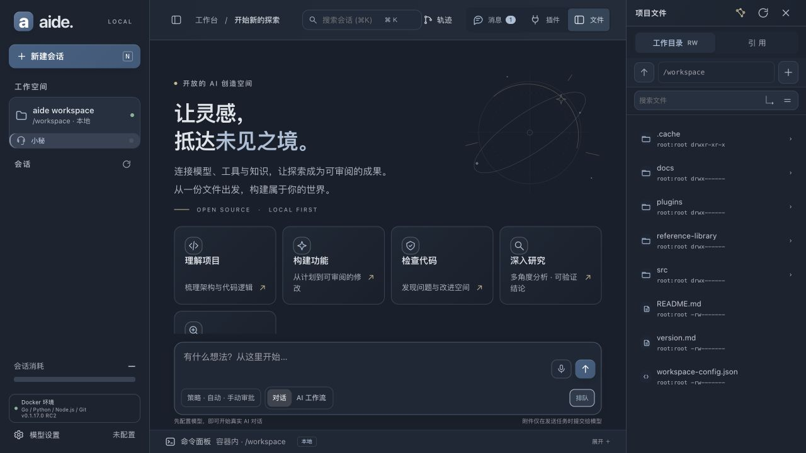

<div align="center">

# aide

### A self-hosted AI workspace for developers: connect local or SSH projects, use your chosen models, review changes, and move work forward.

Keep project files, AI workflows, plugins, and controlled execution in one workspace. You control the source and data, and choose the model provider.

[简体中文](README.md) · **English**

[](https://github.com/skyelan1999/aide/stargazers) [](LICENSE)

[Install and releases](docs/en/installation.md) · [UI walkthrough](docs/demo-guide.md) · [User guide](docs/en/user-guide.md) · [Remote/SFTP relay](docs/reference-relay.md) · [Feature scope](docs/en/features.md) · [Releases](https://github.com/skyelan1999/aide/releases)

</div>



> This README describes capabilities in the current source tree; that does not mean every capability is included in the latest release package. Check the matching [Release notes](https://github.com/skyelan1999/aide/releases) and [version record](version.md) before using a release.

## Run it in three steps

You need Git, Docker Engine, and Docker Compose (Docker Desktop works on macOS). The installer checks prerequisites, configures the checkout, builds it, and starts the source version:

```bash
git clone https://github.com/skyelan1999/aide.git
cd aide
bash scripts/install.sh --check
bash scripts/install.sh --source
```

After startup, configure your model under **Model settings** and choose a workspace. See [installation](docs/en/installation.md) for directory scopes, release packages, and troubleshooting.

⭐ If aide helps with your project, please [star it on GitHub](https://github.com/skyelan1999/aide).

## Focus on your professional work

**aide = AI + IDE.** It brings project files, reference material, AI conversations, proposed changes, execution tools, and task history into one local workbench. Spend less time switching between windows and more time analyzing, making decisions, and producing results.

Use aide directly, or extend it for a specialist workflow. The repository's Agent workflow manages development, maintenance, and customization; it is not an automatic product generator and does not replace professional judgment.

- **Work with real projects.** Browse local or SSH/SFTP workspaces, edit text, and attach reference files.
- **Inspect the process.** Review plans, tool calls, proposed file changes, and suggested commands before acting.
- **Keep environments portable.** Docker provides Go, Python, Node.js, and Git. Source, images, working files, and persistent data are managed separately.

Data is persisted locally. When using a cloud model, task content, context, and tool results are sent to the provider you configure. aide is an independent project inspired by DeepSeek Harness, not an official DeepSeek product or a full DSH/Cordis runtime.

## What you can do

| Capability | How it works | Boundary |
| --- | --- | --- |
| AI chat and workflows | Chat, or follow Plan → Propose → Review | Model review is not a passing test; responses appear by step |
| Parallel analysis | Ordinary chat offers 1x, 2x, 3x, 4x, 5x and 10x analysis concurrency limits | The main task verifies evidence and returns one answer; more requests increase usage and do not guarantee proportional speed |
| Files and Markdown | Browse, edit, preview, open in a new tab, and attach files | Text/size limits apply; saves check file hashes |
| Workspaces and references | Local, SSH/SFTP, Skill directories, links, FTP/FTPS/SMB, MCP stdio/Streamable HTTP; script relay directories and SFTP relay | Relays are read-only by default and need a script deployed manually on the remote device |
| Models and strategies | Multiple model IDs, parameter profiles, automatic/manual routing | Models bind to their own provider and named encrypted key |
| Approval selection | A separate Approval column in the input's Strategy menu selects manual or assisted review | Reviews one exact command using the task model and records usage; uncertainty returns to manual confirmation and permissions are unchanged |
| Knowledge map | Open an independent star-map page from Project files; search file, session, and code IDs and insert references into the original draft | Bounded local index; static code relationships are candidates; incremental updates preserve valid camera and selection state |
| Original text and retrieval | Exact text search or local TF-IDF excerpt ranking; click AI for an answer with citations | TF-IDF retrieval is on-demand and uses no model; AI sends retrieved excerpts and incurs provider usage; optional vector retrieval is configured separately; [scope and limits](docs/architecture/knowledge-map.md) |
| Trajectory, search, compaction | Inspect events, search conversation history, summarize old context | Compaction is summarization, not lossless compression or ZIP |
| Usage, cost and account quota | Token heatmap, daily details, rate snapshots, and plugin-provided monetary balances or quota windows | Currency and percentage quotas stay separate; unsupported data is unavailable rather than zero; alerts do not recharge or stop work |
| Command panel | Run, inspect, and cancel individual shell commands | This panel runs one-off commands; see the terminal plugin for persistent sessions |
| Plugins | Upload, enable, and call tools with executable handlers; built-in draw.io diagram tool | Plugins are trusted code, not a security sandbox |
| Permissions, voice & personalization | Three-level sandbox (read-only/workspace-write/full-access), per-tool toggles, lock screen; page-owned work coordination, continuous voice, Qwen/Bailian TTS and persistent personas; config backup export/import | The sandbox bounds container privileges, not malicious plugins; speech recognition runs in the browser |
| Appearance and language | Professional/Comfort/Classic palettes; light/dark/system; Chinese/English | Browser-local preferences; language does not translate your content |

## Source configuration details

Install Git and Docker Engine/Desktop with Compose v2. Image checksum validation also needs Python 3. Host Go/npm are not needed for ordinary use.

```bash
git clone https://github.com/skyelan1999/aide.git
cd aide
bash scripts/install.sh --check
bash scripts/install.sh --source
```

The installer creates a configuration only when `.env` does not exist, prepares a reference directory, builds the source, and starts the service. Existing settings and data volumes are preserved. First-time downloads need internet access.

For a published ARM64 image, download the matching source, image archive, and `SHA256SUMS`, then use `scripts/install.sh --image ARCHIVE`. Follow the exact versioned commands in [Installation](docs/en/installation.md); do not mix source and image versions.

Edit `.env` to select existing directories:

```dotenv
AIDE_PORT=8097
AIDE_WORKSPACE=/absolute/path/to/project
AIDE_CONTEXT=/absolute/path/to/references
AIDE_LOCAL_ROOT=/absolute/path/to/projects
```

`/workspace` and `/local` are writable; `/context` is read-only. The raw Compose default for `/local` is your entire HOME. The first-run installer narrows this to the repository. Use a scope appropriate to your project.

Open `http://127.0.0.1:8097`. The startup script opens a local token login automatically when a desktop opener is available. The local access token is separate from your model API key; do not share either.

## Your first task

1. Open **Model settings** and configure a provider, model ID, and key. Official OpenAI GPT-6 models use the Responses API; other models use their provider-compatible endpoint.
2. Confirm the workspace. Open a file and select **Attach to task**.
3. Choose a model and profile under **Strategy**.
4. Use **Chat** to understand the project or **AI workflow** to propose changes.
5. Review the proposed files before applying them. Existing-file changes require the attachment snapshot and conflict checks.
6. Review suggested commands and run them separately in the command panel. Check actual results.

In candidate builds, **Strategy → Approval** controls manual or assisted command review independently of model routing. The constellation icon in **Project files** opens the map directly. Find a file (`F…`), code symbol (`C…`), or session (`S…`) and insert its reference into the originating conversation draft; insertion never sends a message. See the [user guide](docs/en/user-guide.md#knowledge-map-candidate-source) and [knowledge-map architecture](docs/architecture/knowledge-map.md).

Choose **Settings → Language → 中文 / English** in a build with language support. The login screen and standalone file view also expose a language selector. Switching language preserves task drafts and editor contents. Model responses, file names, custom profiles, plugins, terminal output, and provider error details retain their original content.

## Extend aide

Describe your specialist task, data sources, tools, permissions, and acceptance criteria. Let your development AI read [AGENTS.md](AGENTS.md) and follow the shared route:

**Requirements → Design → Implementation → Verification → Documentation → Cleanup → Release**

```bash
python3 scripts/agent-route.py start my-feature --request "My scenario and acceptance criteria"
python3 scripts/agent-route.py prompt codex
python3 scripts/agent-route.py verify quick
```

See [Customization](docs/customization.md) and [Client adapters](docs/agent/ADAPTERS.md). Local instruction files cannot force external clients to comply; confirm that each client actually loaded them.

## Operations and limits

```bash
bash scripts/aide.sh status
bash scripts/aide.sh logs
bash scripts/aide.sh stop
```

Go embeds the frontend; rebuilding the image is necessary after source changes. Images do not contain mounted project files, API keys, or session data. Back up data volumes separately.

This is a trusted, single-user local workbench, not public multi-user hosting. AI read tools may read beyond explicitly attached files. File application is atomic per file, not a multi-file transaction. Plugins can use Node capabilities. Per-token SSE streaming is supported (chat mode updates live). Full MCP, PTY, and complete DSH compatibility are not implemented. Token estimates and compaction can lose precision or detail.

[Documentation index](docs/en/README.md) · [Architecture](docs/architecture.md) · [Knowledge map](docs/architecture/knowledge-map.md) · [Operations](HANDOVER.md) · [Plugin protocol](docs/plugin-protocol.md) · [Requirements](docs/PRD.md)

## License and acknowledgements

[MIT License](LICENSE). Bundled third-party components retain their licenses. Thanks to [DeepSeek Harness](https://github.com/deepseek-ai/deepseek-harness) for design inspiration.

## Built-in whale-girl background

Settings → Appearance → Workbench background → Whale girl uses the bundled silent looping video without a local upload. Background intensity and the existing hidden-page, lock and reduced-motion rules still apply; the default remains Off. See [actual screenshots and implementation limits](docs/builtin-background.md).


## English documentation

The [English documentation center](docs/en/README.md) covers current operation, workspace permissions, knowledge search, native voice calls, plugin development, diagnostics and release/maintenance procedures. Dated evidence and third-party/plugin internals retain their own language and publication boundary.

## Documentation scope and versions

This README summarizes capabilities described by the current source tree. Check the matching Release notes and release receipt to confirm what is included in a specific package. Candidate builds, static screenshots, and local checks are not formal release results.

The workbench screenshots were captured from source baseline `0fef6411` on 17 October 2026, in an isolated instance with dedicated sample data. They may not reflect the latest UI and are not production or release acceptance evidence. See [screenshot evidence and validation scope](docs/ui-evidence.md), the [UI walkthrough](docs/demo-guide.md), and [current interaction design](docs/design/current-workbench.md).

For source checkouts, `.env` is the startup configuration source: `start.command` → `scripts/aide.sh` → Docker Compose, using `AIDE_PORT` (default 8097) and `COMPOSE_FILE`. Temporary review ports are not user startup entries. See [workspace configuration](docs/workspace-paths.md).
