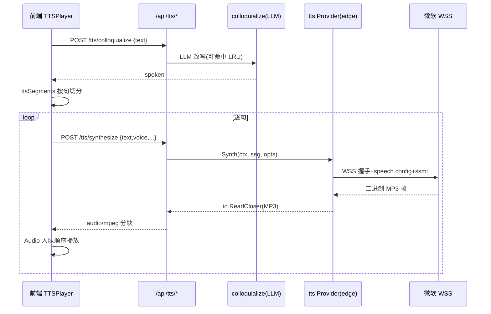
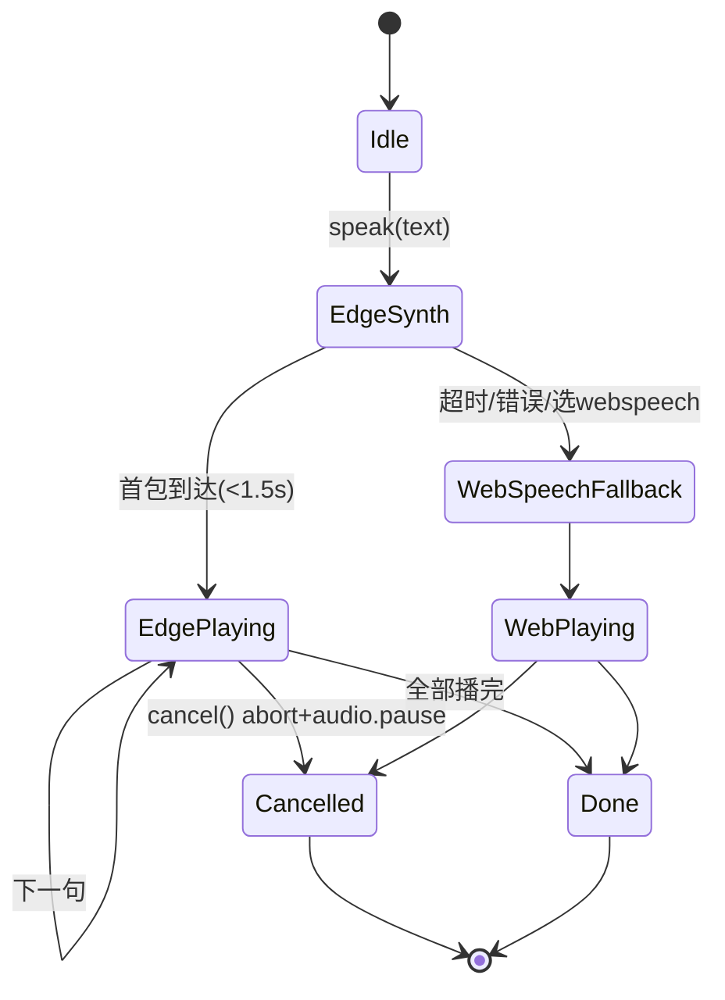

# aide 架构与接口索引

> 第一次浏览仓库可先看[代码目录导航](architecture/code-layout.md)，再按下方模块职责进入具体实现。

> **启动配置以 `.env` 为准**：`start.command` → `scripts/aide.sh` → Docker Compose，统一读取 `AIDE_PORT`（默认 8097）和 `COMPOSE_FILE`。临时验收端口不是用户启动入口。目录范围和 macOS 共享根模式见 [工作目录配置](workspace-paths.md)。

核对日期：2026-10-12。本页描述 `0.1.17.0 RC2` 源码候选；RC1 发布范围与附件仍以[发布记录](reviews/release-0.1.17.0-RC1-2026-10-08.md)为准，源码新增能力不据此推定已发行。aide 融合 AI 与 IDE；架构由 Go 服务、浏览器 UI 与 Docker 工具环境组成。统一虚拟形象使用共享偏好与按需素材播放器，后端真实任务事件确定状态，模型反馈只选择动作变体；响应式侧栏宽度由 CSS 变量与拖动控制器共同维护。小秘明确转交时通过既有 `startTask` 路径创建并启动/排队 Aide 任务；TTS 自动模式按可用提供商回退，无法播放后端音频时退到浏览器合成。历史验收保留于 [验证记录](verification.md)，功能状态以对应任务验收记录为准，发布身份由 tag、镜像和发布记录共同确认。

超长会话、摘要压缩、项目记忆及工业使用边界见[超长对话与工业复杂任务支持说明](industrial-long-conversation-support.md)。

## 系统结构

```mermaid
flowchart TB
    Browser[浏览器：会话 / 文件 / 设置 / 轨迹] --> API[Go HTTP API：令牌与同源校验]
    API --> Runs[任务与上下文构造器]
    API --> Workspace[工作区身份 / 本地与 SSH 驱动]
    API --> Storage[会话 / 设置 / 来源 / 统计]
    Runs --> Provider[Chat Completions 提供商]
    Runs --> Tools[内置工具 / Node 插件宿主]
    Tools --> Proposals[待批准文件与命令提案]
    Proposals --> Approval[用户确认]
    Approval --> Workspace
    Workspace --> Mounts[/workspace · /context · /local]
    Storage --> Data[/data 持久卷]
```

Go 标准库 HTTP 单体；模型步骤在 goroutine 中执行，文本 token 通过 SSE（`GET /api/sessions/{id}/runs/{run}/events`）增量推送到浏览器，最终任务状态仍由 `GET /sessions/{id}` 持久化兜底。前端使用原生 JS/CSS 和本地 vendor Markdown 库，由 `go:embed` 编入二进制。Node 插件宿主是可信代码执行器，不是权限沙箱。

## 模块职责

| 文件 | 责任 |
| --- | --- |
| `cmd/aide/main.go` | 启动与退出 |
| `internal/server/server.go` | 路由、鉴权、配置、会话存储、统计与费率、构建身份 |
| `workflow.go` | 任务状态、工具循环、提案、应用、摘要压缩 |
| `context.go` | 上下文预览、预算拦截、请求快照 |
| `provider.go` | 模型请求、参数、usage、超时；complete（非流式）+ completeStream（SSE，400 时去 stream_options 重试） |
| `profiles.go` | 内置/用户 Profile、策略文件、参数校验 |
| `workspace_config.go` / `ssh_session.go` | 工作区身份、本地映射、SSH/SFTP 生命周期 |
| `files.go` / `sources.go` / `mcp_source.go` | 路径/内容策略、读写冲突、引用来源与受限 stdio MCP 驱动 |
| `knowledge_map.go` / `knowledge_updates.go` / `knowledge_sources.go` | 多来源有界知识索引、来源身份重查、版本差量与文件／代码缓存 |
| `knowledge_code.go` / `code_analysis/` | Go／JavaScript／Python AST与静态调用候选 |
| `knowledge_documents.go` / `document_analysis/` | 文档原文提取、本地TF-IDF RAG与原文指纹回填 |
| `web/starmap*` | 独立知识星图、自然尺度、代码探索和自动增量绘制；直接进入，无入场过场 |
| `command.go` | 本地/SSH 命令、NDJSON 输出、超时与取消；SSH 交互 PTY 输入透传原始按键字节 |
| `persona.go` / `settings_persona_persist` | 性格系统：多人格（activePersona）、AES-256-GCM 密文（personaCiphers）、可演化 personalities、解锁/保存/重置 |
| `config_backup.go` | 配置备份信封 `aide-config-backup`：导出/导入设置快照、来源与工作区密钥、小秘历史 |
| `voice_agent.go` | 语音小秘：send/ignore/standby 研判、VoiceHistoryEntry 记录、AES-256-GCM 历史加解密、双向朗读 |
| `environment_guide.go` | 系统文档自动挂载与环境引导 |
| `plugins.go` / `plugin_host.js` | 插件登记、加载、schema 和 handler |
| `web/settings-init.js` | 同步首帧外观、`aide.ui`、系统外观响应与跨标签同步 |
| `web/settings-schema.json` / `app.js` | 设置导航、控件与应用交互；SSE 流式渲染（rAF 批量、live 文本/光标/工具行、会话快照去重）；排队/插话/暂停（运行时输入框旁固定显示暂停控制，发送键保留停止操作） |
| `web/themes/**` / `style.css` / `macos.css` | 颜色变量、既有样式与新版表现层 |

文件名省略前缀时均位于 `internal/server/`。不维护容易过时的文件行数/测试数量，查当前源码与本次测试输出。

## 两种路由不能混淆

- 产品模型路由：`profiles.json` + `routing-policy.json`，选择模型参数 Profile。
- 开发 Agent 路由：`AGENTS.md` → `docs/agent/WORKFLOW.md` + `router.json`，管理需求到发布的开发过程，不参与用户模型任务执行。

## 数据与权限

会话写入 `/data/session-<id>.json`；模型连接配置、令牌、Token 统计/费率等也在数据卷。`profiles.json` 与模型策略位于工程目录。来源登记在 `/data/config/sources.json`，秘密在数据卷；UI 外观在浏览器 `localStorage['aide.ui']`。

Compose 将工作区可写挂载 `/workspace`，参考资料只读挂载 `/context`；`/local` 默认是可写 HOME。`os.Root` 和路径检查约束文件 API，但手动命令/Node 插件仍具有容器用户可访问的目录权限。插件 helper 当前读取 `/workspace`，不能把它等同于所有远程工作区的统一文件驱动。

任务快照记录工作区身份；旧提案、编辑器保存需要通过身份和哈希检查。文件应用为逐文件原子替换，可能部分成功。压缩用结构化摘要与近期历史构造后续请求，不保证删除 Runs 或缩小磁盘。

上下文预检按模型窗口与输出预留计算预算。历史接近动态阈值时会在任务结束后压缩；自动与手动压缩都通过会话级进度状态向侧栏上下文卡报告待整理条数、摘要 map/reduce 当前批次、稳定开始时间、持续耗时、折叠保存阶段及压缩前后活动上下文估算。自动压缩将每个摘要批次同步写入当前任务 SSE 与会话进度接口；手动压缩在请求期间轮询同一状态接口。前端按会话 ID 缓存该状态，用户切换会话时只显示当前会话进度，切回仍在进行的会话可恢复动画和耗时；完成、失败、取消都作为独立终态短暂展示后清除。取消信号会在每个 map/reduce 批次边界检查；提供方请求遵循请求上下文取消，任何结果只会在完整摘要生成且快照校验通过后原子写入，因此取消不会折叠原历史。摘要提取单独关闭隐藏推理，并使用有界输入、输出预算，把生成额度留给结构化摘要；摘要条目数量和长度也受提示约束。若新请求预检仍超限，则先对旧消息生成摘要、保留近期原文并重算预算，再决定是否接受。摘要调用失败、会话在压缩期间变化或压缩后仍超限都会返回错误，不会发送超预算请求。模型 SSE 流在连续 3 分钟没有有效 JSON 数据事件时会取消请求并给出可重试错误；纯传输层注释心跳不会刷新此计时。此空闲限制与单请求 2 小时总上限、聊天任务活动预算分开。项目记忆和工作流建档使用配置的项目缓存目录；SSH 工作空间选择远端缓存时，经 SFTP 拉取与写回，并在数据卷保留工作副本。默认缓存仍是本机缓存；应用会话、凭据及文档提取缓存不会随项目缓存设置一起迁移。完整配置边界见 [SSH 与存储配置](architecture/ssh-storage.md)。

工作台对思考事件仅保留有界文本，超出 131,072 个字符时保留开头和末尾片段。思考区默认折叠；折叠时只更新一行预览，不向隐藏正文节点逐 token 累积文本，展开后才装载已保留记录。最终回答沿用增量 Markdown 扫描与稳定块渲染。超长未闭合块以纯文本显示，活动区记录起始偏移并只复制新到达的尾部；稳定区同样仅复制新闭合范围，避免逐帧复制累计前缀或活动尾部。活动区偏移改变、文本回退时重建节点以保持内容正确。该路径减少长流期间的重复 DOM/Markdown 工作，但最终回答仍须进入浏览器 DOM，不能视为无上限或跨设备性能保证。


上下文卡按工作区与会话隔离缓存，只在成功响应后提交缓存键。切换期间先清空旧值，过期响应不得覆盖当前会话；同键请求合并，失败后可重试。草稿预算不会复用为会话基线，清空输入后重新获取基线。

The context card scopes its cache to the workspace and session and commits cache keys only after successful responses. Switching clears stale values; late responses cannot overwrite the current session. Pending requests are deduplicated and failures can retry. Draft budgets are invalidated before returning to the session baseline.


运行中插话使用与初始输入一致的用户气泡，按保存顺序显示在该任务输出、工具记录和错误信息之后，避免长回复将插话留在任务顶部。仍在排队的输入只出现在队列条，提升为插话后才显示气泡；重复文字按独立输入保留。会话刷新指纹显式包含所有可见任务的插话内容与排队状态，不依赖 updated 或消息数量改变。服务端任务仍保存累计答复，本次不将答复重写成虚构的逐段对话时间线。

Accepted in-run interjections use the same user bubble as the original prompt and appear at the tail of their run's rendered output. Queued items remain in the queue until promoted. Repeated text remains separate input. Session snapshots include interjection content and queue flags so promotion or edits trigger rendering even without timestamp/count changes. The server's accumulated answer and execution semantics are unchanged; the UI does not invent per-segment response chronology.

Git 文件比较接口见 [Markdown 编辑与文件历史](architecture/markdown-editing-export.md#git-文件历史比较--git-file-history-comparison)。本地仓库按所选文件读取提交／暂存／磁盘版本，不修改仓库；历史窗口可切换快照与Git比较，草稿／磁盘口径明确区分；实际8097部署验收仍独立记录。

## 多来源知识与独立产品主页

知识星图、原文检索、本地TF-IDF RAG及编号查看共用有界只读来源适配层；本地／Skill、SSH工作区、自动系统文档、独立SFTP、HTTP／HTTPS、FTP／FTPS、SMB按来源分区，MCP只索引已发现的工具说明。节点、检索结果和回填保留来源编号、名称、类型及当前身份；改配、停用和移除后拒绝旧引用。远端来源约30秒缓存、最多3个并发扫描，默认800文件／200目录预算按启用区域分配；截断、不可用及未核实状态与真实节点数量分开。HTTP／SMB单资源，不递归爬取；格式、读取、查看和插件的详细边界见[知识星图架构](architecture/knowledge-map.md)。

`site/` 是独立产品主页，仅静态 HTML/CSS/JavaScript 与本地素材，不读取会话、调用模型或接入应用 API；不经 Go `embed` 的工作台路由提供。`.github/workflows/pages.yml` 仅手动发布 `site/`，提交或推送不触发部署。主页预览、来源素材及发布操作见[主页说明](website.md)。

## API 索引

除静态资源、`/healthz` 外，`/api/` 路由需要 Bearer token；以 `server.go: Handler` 为完整注册表。

| 方法 | 路由 | 用途 |
| --- | --- | --- |
| GET | `/api/knowledge-map`、`/api/knowledge-map/updates` | 知识／代码快照、稳定编号与版本差量同步；详见[知识星图](architecture/knowledge-map.md) |
| POST | `/api/knowledge-map/assist` | 带编号和片段证据的知识／代码／RAG辅助理解 |
| POST | `/api/knowledge-map/documents/search`、`/api/knowledge-map/documents/reference` | 原文或RAG检索、回填前重查文件指纹与定位 |
| GET / PUT | `/api/knowledge-map/embedding-policy` | 工作区向量检索配置；密钥保存在保险库，默认关闭；配置版本冲突返回409 |
| GET | `/api/config` | 脱敏配置、version/revision/buildCommit |
| PUT | `/api/settings` | 模型连接与模型列表 |
| GET | `/api/models`、`/api/balance` | 提供商代理；支持程度依赖上游 |
| GET / PUT | `/api/profiles` | Profile 与当前策略 |
| GET / PUT | `/api/workspace-config` | 工作目录、文档、缓存、远程连接 |
| GET / POST | `/api/capabilities`、`/api/capabilities/check` | 能力元数据与显式范围检查，见[能力仪表](architecture/capability-dashboard.md) |
| GET | `/api/approval-policy/rules` | 审批授权清单、精确身份与有效期 |
| PUT / DELETE | `/api/approval-policy/rules/{rule}` | revision 校验下更新有效期或单条撤销 |
| GET / PUT | `/api/sources` | 引用来源注册表 |
| PUT | `/api/sources/ai-visibility` | 按工作区保存来源 AI 可见性；保留手动浏览，不替代操作系统权限 |
| POST | `/api/sources/{id}/test` | 初始化 stdio MCP 并发现工具（仅保存安全摘要） |
| GET | `/api/files`、`/api/file` | 目录/文本读取 |
| GET | `/api/file/git-history` | 本地文件 Git 探测／最近提交／HEAD、提交、暂存区和磁盘的只读比较；参见[文件历史](architecture/markdown-editing-export.md#git-文件历史比较--git-file-history-comparison) |
| PUT | `/api/file` | 保存；包含路径、正文、哈希和工作区身份 |
| GET / POST | `/api/sessions` | 会话列表/创建 |
| GET | `/api/sessions/{id}` | 会话、消息与任务 |
| POST | `/api/sessions/{id}/runs` | 启动对话或工作流 |
| POST | `/api/sessions/{id}/runs/{run}/cancel`、`/apply` | 取消/应用 |
| GET | `/api/sessions/{id}/runs/{run}/requests` | 请求快照 |
| GET | `/api/sessions/{id}/runs/{run}/events` | SSE 实时事件（step/delta/tool/status/done）；EventSource 经 `?access_token=` 鉴权 |
| POST | `/api/context-preview` | 与运行请求共用构造器的预算预览 |
| GET | `/api/search` | 会话全文搜索 |
| POST | `/api/sessions/{id}/compact` | 手动摘要压缩 |
| GET | `/api/token-stats` | 用量与费用汇总；逐调用缓存命中/未命中与价格快照 |
| GET / PUT | `/api/token-pricing` | 官方 DeepSeek 费率预览；其他模型的自定义费率管理 |
| GET / POST | `/api/plugins` | 插件列表/上传 |
| PUT / DELETE | `/api/plugins/{id}` | 启停/删除 |
| GET | `/api/plugin-surface` | 插件能力清单 |
| POST | `/api/command` | 命令执行，NDJSON 输出 |
| POST | `/api/config/export`、`/api/config/import` | 配置备份导出/导入（信封 `aide-config-backup`，可选含密钥/语音历史） |
| POST | `/api/sessions/{id}/runs/{run}/retry`、`/answer`、`/queue/{index}` | 重试/回答澄清问题/排队项改删升级 |
| GET / POST | `/api/file/raw`、`/api/file/download`、`/api/file/archive`、`/api/file/extract`、`/api/file/rename` | 原始文件查看、文件/目录下载与 ZIP 导出、创建 ZIP/TAR/TAR.GZ/TAR.BZ2/TAR.XZ、解压受支持归档到同级新目录、重命名；归档创建拒绝覆盖同名文件，解压限 1,000 条与 64 MiB 并拒绝危险路径、链接和特殊文件；download/raw 允许 `access_token` 供浏览器资源请求使用 |
| PATCH / DELETE | `/api/sessions/{id}`、`/api/sessions/archived/all` | 改 pinned/archived/删除/清空归档 |
| POST | `/api/persona/*`（unlock/save/reset/GET）、`/api/personas/*`（GET/active）、`/api/personality/*`（GET/PUT/reset/evolve） | 性格加解密、多人格切换、性格演化 |
| POST | `/api/voice-filter`、`/api/voice-narrate` | 小秘研判 send/ignore/standby、双向朗读 |
| GET/DELETE/POST | `/api/voice-history`（list/clear/enable/unlock/lock/change-password/disable） | 小秘工作历史与加锁 |
| POST | `/api/account/verify-password` | 账户密码校验（Argon2id，兼容旧密码摘要；可提交锁屏解锁） |

这里是导航索引，不代替每个 handler 中的完整请求结构、验证与错误码。完整注册表以 `server.go` mux 注册为准。

## 任务与工具

`running → completed / awaiting_approval / failed / cancelled`；待审批提案应用后 completed；服务重启将运行任务标记 interrupted。

规划、提案、审查每个阶段（及 AI 工作流四阶段/自动模式）可进入模型工具循环，循环上限 `ToolMaxRounds` 默认 60、可配 5–200。单步工具调用总预算按轮数推导为 `max(64, 4 × ToolMaxRounds)`，不再固定 24 次；同一工具、参数、结果在步骤内重复 3 次起会提示模型停止原样重试，达到 8 次时暂停剩余重复探测并给用户可继续的说明。预算耗尽时同样给可继续的说明，不将正常步骤标记为错误。`list_files`/`read_file` 直接读，`write_file`/`run_shell` 产生提案。工具结果回传模型；已有文件写入仍需显式附件快照。插件参数 schema 进入工具声明，但可信插件本身能直接使用 Node 能力，不能声称写操作都被安全沙箱阻止。

## 界面设置

```json
{"version":1,"theme":"system","palette":"blue"}
```

`theme` 为 light/dark/system，`palette` 为 blue/green。页面 `data-theme` 是解析后的明暗，`data-theme-pref` 是用户选择，`data-palette` 是风格。专业与经典各一排三项，通过 `aideUI.setAppearance()` 一次保存组合。旧 `aide.theme` 和中间版本 classic 偏好迁移；`settings-schema.json` 侧边分区为：消耗统计(stats)/外观(appearance)/语言(language)/模型(model)/会话数据(sessions-data)/权限(permissions)/账户(account)/性格(persona)/语音(voice)/无障碍(accessibility)/备份(backup)/关于(about)。

文件侧栏顶部采用紧凑间距：标题栏 42px、根目录切换按钮最小 28px，路径与搜索行收紧内边距；触摸设备标题栏 46px、主要按钮 34px。规则统一在 `style.css` 的 `#file-panel` 范围内，适用于经典与专业外观，不改变文件列表行样式。

## 本任务自动命令审批

聊天输入框的策略菜单提供独立“审批”栏（手动审批／辅助审批），策略按钮摘要显示当前选择；小秘会话不显示此栏。源码候选将审批模式作为服务端全局偏好持久化；新建、重试、续跑与子会话采用同一模式，切换立即更新所有活动任务并取消旧审核代次，跨标签页通过 SSE 同步。人工命令和文件卡片提供仅本次或记住操作，期限可选永久、1小时、1天或30天；长期授权精准匹配工作空间、根目录与完整操作。策略栏可管理单条授权的有效期、撤销或清空记忆。默认手动，不改变沙箱与插件权限，见[全局审批设计与验收边界](architecture/execution-policy.md)。开启后，shell 命令及运行结束的新文件提案使用独立、无工具的模型请求审核，提供真实用户授权与工作目录，60 秒时限、512 输出 token，用量计入任务。授权范围内低风险或可逆中等风险操作才可放行。文件提案必须是本地工作区的新文件，经过完整提案内容审核，再复用正常应用路径及文件版本校验；已有文件覆盖、SSH 文件提案、只读沙箱、提案中途变化仍转人工。普通 ask_user 和浏览器/电脑控制确认不由此机制代答。失败、超时、取消不放行。

命令确认由服务端标记 `approvalKind=shell` 和轮次；按钮提交轮次，过期请求拒绝。手动审批明确提供允许、拒绝和要求调整命令；拒绝记录 `declined`，不会执行当前命令。审核结果只有在同一轮次、同一开关代际、未被人工应答且上下文有效时生效；切换或人工应答取消进行中的审核。保留最近 50 条具体命令、状态和原因，先持久化记录再唤醒执行；现有命令执行器仍检查沙箱。前端应答成功后通过实时事件及异步快照刷新会话，避免阻塞在完整会话重载上。文件、网页与模型回复均不能自行开启审批方式。

参考 [Codex Auto-review](https://learn.chatgpt.com/docs/sandboxing/auto-review) 的独立审核、具体行动与审批原因设计。本实现使用 Aide 当前连接的模型，未接入 Codex 服务，也未声称具有相同安全保证。

## 锁屏集群

工作台、文件查看器与知识星图通过 `internal/server/web/lock-cluster.js` 同步视觉锁屏，BroadcastChannel 频道为 `aide-lock-v1`。服务端 `config/lock-state.json` 保存 `locked/gen/updatedAt`，原子写入，权限 0600；页面启动、主从竞选、恢复前台和可见页面每 5 秒读取权威状态。未设置账户密码时 GET 返回未锁，避免星图被历史状态困住。已设置密码且状态文件损坏时保持锁定。

新标签启动时，页面先显示中性的“正在确认安全状态”遮罩。BroadcastChannel 的欢迎/心跳用于发现 master 与选举，但不能单独结束首次锁态确认：页面须先读回 `/api/lock-state` 的权威状态，避免旧标签尚未完成持久化的广播短暂冒充当前锁态。权威读取成功后再按 `locked/gen` 更新遮罩；服务端不可达时仍由 2.5 秒有界加入超时按已知状态或保守默认锁定收敛，不会无限停留在中性遮罩。已进入页面后的锁定消息仍立即遮盖。

工作台优先于文件查看器和星图成为 master，同类页面按启动时间及 tabId 竞选。主页面降为 slave 时停止发送心跳；主页面消失时重新选举并先读取持久状态。无 BroadcastChannel 时仍可通过服务端复核同步。旧代际响应不能覆盖更新状态。

锁定立即遮盖页面并串行提交 `PUT /api/lock-state`，保存失败明确显示错误。配置了密码时该端点拒绝直接写入未锁状态。全局解锁通过密码验证端点（`unlockScreen/lockGen`）或 WebAuthn 验证端点（同名查询参数）完成：先验证身份，再检查锁定代际，原子保存解锁，最后前端移除遮罩。期间出现新锁定时返回 409，旧验证不能清除新锁定。

slave 单独验证只在该页面设置 `localDismiss`，不解锁其他页面；新页面加入不会清掉已有本地解锁标记，新一轮锁定会清除该标记。全局解锁后各页面跟随揭开遮罩，其他页面不恢复麦克风。工作台空闲计时由 master 管理，依据最后一次用户活动计算；配置读取不延长空闲期限，解锁时重新计时。文件页和星图的活动可向 master 中继。

这是视觉锁屏，不是账户退出或 bearer API 权限撤销。后台任务继续运行；星图锁定时清空当前图谱和详情，解锁后重新加载。触控 ID 的真实硬件链路需要浏览器与设备验收，源代码测试不能替代该验收。

## TTS 分层架构

小秘朗读是可插拔管线：后端 `internal/server/tts` 定义 `TTSProvider` 接口（`Name/Synth/Format/Available`），`NewProvider(name, Config)` 按名注册。当前实现 edge-tts——用标准库手写最小 RFC6455 WebSocket 客户端直连微软 Read-Aloud（`wss://speech.platform.bing.com/...`，公开 token + 时间派生的 `Sec-MS-GEC`，无需 key），SSML 映射语速/情感，回流式 MP3。Web Speech 是纯浏览器能力，后端不合成（`ErrBrowserOnly`），由前端兜底；自动模式在 sherpa/edge/Azure 均不可用时直接使用浏览器合成，后端音频解码或播放失败也会回退浏览器。

**音频流路径**：



**降级链**：自动模式优先本地 sherpa-onnx，之后尝试 edge-tts 与已配置的 Azure；均不可用时由前端使用浏览器 Web Speech。后端音频请求、解码或播放失败时，同一段文本改走 `webSpeakReply`/`webSpeakAwait`。显式选择浏览器合成时前端直接使用 Web Speech；显式选定其他引擎时不静默改写用户选择。



**口语化预处理**：对话回复（`speakReply`）在合成前先经 `App.colloquialize` 调 `complete()` 改写为口语稿，按 `sha1(model+原文)` 存内存 LRU（256 条）。导览讲解（`speakAwait`）的文本已由 `voice-narrate` 口语化，跳过这步，避免双重改写。主聊天"朗读"按钮走裸 Web Speech，不进此管线。

**设置与回显**：`Settings` 新增 `ttsProvider/ttsVoice/ttsEndpoint/ttsAPIKey/ttsRate/ttsExpressiveness`；`ttsAPIKey` 同 `apiKey` 模式不回显，`/config` 只给 `hasTTSKey` 布尔与 `ttsVoices` 音色列表。

## 验证与扩展

变更前读取 [统一开发工作流](agent/WORKFLOW.md)。新前端须验证浏览器实际交互；正式发布须在没有 `/web` 挂载的构建镜像中验证 embed 资源。早期预览使用 RC5 后端 + 工作区静态文件；本次发布另行验证无静态目录覆盖的镜像。

待独立规划：PTY、目录分页、streamable HTTP MCP 与统一插件文件驱动。stdio MCP 引用已落地：程序和参数以 `exec.Command` 启动、不经 shell；测试发现工具；AI 仅能调用服务实时声明为只读的工具。会话归档（pinned/archived、子会话自动归档与折叠组）、SSE 流式输出已落地。

## 外部 AI 诊断接口（/api/debug）

`App.Handler()` 外层对 `/api/debug/` 前缀做独立分流，**先于**普通 access-token 校验进入 `serveDebug`，四段中间件顺序执行：

1. **开关判定**：读 `settings.DebugAccessEnabled`；关即整体 `404`（不暴露存在性），仍记一条审计。
2. **独立鉴权**：调试令牌走 `Authorization: Bearer`，常量时间比对 `sha256(token)` 与 `settings.DebugTokenHash`；校验过期时间；SSE `/events` 例外允许 `?access_token=`。普通 access-token（owner）放行全部；调试令牌仅放行非 `/admin`、非 `/audit` 端点。
3. **审计**：每条访问（含 401/404/403）追加 `data/debug-audit.jsonl`（time/ip/ua/method/path/owner/result）。
4. **分发+脱敏**：通过 `a.routes` 分发到 mux；handler 内白名单聚合——只回 `hasKey/hasPassword`、baseURL 主机名、模型 id、挂载与用量，绝不回 key/密码哈希/人格密文/请求快照正文/access-token。

状态落点：`App.startedAt`（uptime）、`App.errorRing`（失败终态由 `finishStream` 落一条）、`App.providerHealth`（ping-provider 探测缓存）。令牌哈希只由 `/api/debug/admin/*` 管理；关闭总开关或吊销即即时清空哈希。详见 [debug-api.md](debug-api.md)。


### 2026-10-08：舒适配色、共享动效与静态加载

- `web/experience.css` 在现有主题与 macos 样式之后加载，统一短交互时长 140/200/260ms、稳定焦点轮廓与选中勾选。主题预览限定于 `data-palette`，普通分段选项保持紧凑。专业主题为中性灰与石板蓝，舒适主题为灰绿；图片、图表、文件预览没有整体滤色，经典主题偏好兼容保留。
- `aide.ui.motion` 支持 `system/full/reduced`；系统 `prefers-reduced-motion` 优先。`settings-init.js` 仍同步执行以避免主题闪烁，同时应用 `data-motion` 并广播 `aide:motion`。CSS、共享形象播放器、星图、STL 与 STEP 查看器遵循该偏好；后台暂停绘制，减少动效时模型交互仍可立即重绘。
- `web/experience.js` 为装饰性的短星轨汇聚，动画 940ms，980ms 回收，当前标签页会话首次显示。`startupAnimation=off` 关闭自动播放；外观中可以主动重播。减少动态效果优先关闭；点击、键盘操作或切到后台提前回收。覆盖层 `aria-hidden`、`pointer-events:none`，无输入或初始化等待门禁。
- 除主题初始化外首页脚本使用 `defer`。Mermaid 与 Three/STLLoader/OrbitControls 按需加载且并发去重：合计 3,977,524 字节（约 3.79MiB）从首页初始脚本移出，并非库被移除。Mermaid 首次绘制不依赖语言切换；失败保留文字提示。代码编辑器输入通过 RAF 合帧，滚动只同步偏移，避免每次滚动重复高亮。
- `static_assets.go` 只对嵌入的公共 JS/CSS/WASM/图片/字体/JSON 资源发出 SHA-256 ETag 与 `public,max-age=0,must-revalidate`，摘要按进程缓存。浏览器仍向服务端校验，资源变化不会沿用旧摘要。HTML、API、工作区文件继续 `no-store`；并未改变鉴权或跨工作区权限。

### 2026-10-13：独立文件页浏览器标题

- 从项目文件编辑器“在新标签页打开此文件”时，独立文件页将浏览器标题设为文件名（后缀 `· aide`），便于在 Safari 标签页间识别文档；工作台仍使用应用默认标题。

### 2026-10-12：STEP/STP 本地三维预览

- `.step/.stp` 文件在工作台和独立文件视图中使用同源、按需加载的 `occt-import-js@0.0.23`（OpenCascade WebAssembly，LGPL-2.1）解析 B-rep 几何。解析运行于专用 Worker，模型数据留在浏览器本机；64 MiB 输入与 300 万三角面为预览上限。解析器和 OCCT 许可证、上游源代码包放在 `web/vendor/occt-import-js/`；无 WebGL、损坏、超限或解析失败时显示说明及原文件下载。
- STEP 单位经 OpenCascade 解析为毫米；预览保留实体/面颜色，显示尺寸与三角面数，并支持轨道旋转、缩放和归位。Worker 在视图关闭或切换时终止，Three.js 场景和 WebGL 资源随之释放。
- 主文档 CSP 为同源 `script-src 'self' 'wasm-unsafe-eval'`，允许本机 WebAssembly 模块且不开放 JavaScript `unsafe-eval`。为兼容 OCCT Embind，仅 `/step-import-worker.js` 的隔离 Worker 响应增加 `unsafe-eval`；该 Worker 使用 `connect-src 'self'`，不能继续创建 Worker，也不能加载远端脚本。
- 所选正文/背景颜色的算术对比值约 12.0–12.87，白色主按钮文字/石板蓝底约 6.47。数值是设计计算，不是全页面可访问性认证，也不能证明保护视力、消除疲劳或保证每个人的颜色识别。实际首屏时长、FPS、持续使用效果需要设备测量。
- 本次 Safari 观察与构建范围见 `docs/tasks/ui-comfort-motion-20261008.json`。仅隔离候选18189；未发布或替换生产。

### 2026-10-08：天文观测殿视觉层

- `web/sanctum.css` 在 `experience.css` 后加载。共享覆盖工作台导航、文件与插件面板、提醒、输入区、策略菜单、审批澄清卡、设置、文件预览与终端标题；专业主题采用深空石板／珍珠白，淡金仅用于装饰细节，成功、警告与错误的语义颜色保持原有值。经典和舒适主题仍继承各自语义令牌。
- 首页文案突出开放创造、模型／工具／知识连接与可审阅成果。入口星轨为本地、`aria-hidden`、不可聚焦且不接收指针事件的内联 SVG；仅空工作台显示，小屏隐藏。无远端素材或常驻粒子渲染，不对正文、图片、CAD、文档和图表做整体滤色。
- 启动星轨增加精细刻度与淡金弧线，继续保持940ms淡出、980ms回收及减少动态效果优先。共享动效层仍限制短过渡；装饰星轨是静态画面。
- 独立知识星图使用同一石板／月白／淡金层次，搜索、详情、AI区域的表面降低模糊半径，辅助文字提升亮度。当时保留原索引、AI调用提示、编号回调与入场交互；后续入场已删除，当前行为见[知识星图](architecture/knowledge-map.md)。
- 源码巡检和验证边界记录于 `docs/tasks/ui-celestial-sanctum-20261008.json`。本轮Mac锁定，Safari实际检查尚未完成；内置浏览器自签证书拒绝访问，未绕过警告。不能据此声称全UI实际验收通过或整体性能提升。

### 2026-10-08：共享界面精修

- 在现有 `sanctum.css` 中统一会话菜单、文件列表、插件卡、设置、审批命令、聊天操作、PDF/CAD 工具栏的排版、边框和焦点；采用主题语义令牌。参考 [Fluent 2 设计令牌](https://fluent2.microsoft.design/design-tokens) 的语义层次与 [动效指导](https://fluent2.microsoft.design/motion) 的短反馈、减少动效原则；大型产品的完成度为设计参考，没有流量排名或比较性验收结论。
- 主按钮及品牌标识使用 `--on-brand`，修正舒适／经典暗色浅底按钮白字问题；运行环境锁定提示改用主题文字，移除其背景模糊。文件工具栏也改用稳定不透明表面。API 状态保持 `--success/--warn`，停止任务保持危险色；原文档、图片与 CAD 内容无整体滤色。
- 会话更多操作为30px，模型／插件／配置删除为32px；粗指针下扩大到40px。聊天操作不小于30px。隐藏设置开关的相邻滑块显示键盘焦点。审批命令使用等宽字体、主题边框、独立滚动；策略菜单整体限制高度并滚动，小屏单列。
- 以下为较早候选精修记录；星图随后改为共享工作台主题并删除入场动画，当前行为见[知识星图](architecture/knowledge-map.md)。其 CSS 统一搜索、原文／RAG、代码层级、详情和 AI 区域，详情与 AI 区域按高度分隔，小屏以浮层切换；减少透明度与强制颜色有对应样式。此前采用独立夜空基调，现已由工作台主题连续性替代。没有新增常驻动画、外部素材或依赖。
- 手动检查发现重复的 `LockCluster` 有效状态通知会触发星图重新索引并清掉节点详情。`setLocked` 记录首次状态，仅在首次通知或真实状态切换时初始化／清理；重复心跳保留当前选择。真实锁定、解锁及索引取消代次处理保持原有链路。
- 本轮仅更新隔离候选18189，通过 `start.command` 启动；构建、手动浏览器检查、未覆盖场景及回滚文件以 `docs/tasks/ui-observatory-refinement-20261008.json` 为准。构建成功不等于全界面、真实模型或所有设备验收。

### 2026-10-08：星图差量更新与入场删除

星图使用独立页、自然尺度及调用层星等；知识／代码变更通过 `/api/knowledge-map/updates` 按稳定编号自动合并，未变布局与镜头保留。节点视图、文档原文及本地TF-IDF RAG分别表达不同检索范围，Office插件共用原文提取与引用校验。已删除星图刷新按钮和入场过场，保留持续星空、新星渐入与归位。接口、预算、缓存边界、主题和验收状态见[知识星图架构](architecture/knowledge-map.md)与[源码交接](reviews/2026-10-08-starmap-source-sync.md)。

轨迹面板统一提供历史、调用记录与成果舱切换，成果舱按当前会话任务选择查看文件提案、审批依据与原始证据。见 [持续性路线图](architecture/continuity-roadmap.md)。

### 记忆神经

记忆神经视图已撤下，代码作为[备用提案](proposals/memory-neural-20261010/README.md)归档。普通项目记忆读写与既有 token 存储兼容保留。


## Linux 文件列表身份与权限


2026-10-14 第一块：目录条目可包含可选的 `unix` 对象：`owner`、`group`、`permissions`，Linux 本地还返回十进制字符串 `uid`／`gid`。本地读取目录项实际 stat，不跟随被排除的符号链接；权限以 `-rw-r--r--`／`drwxr-xr-x` 形式展示，包括 setuid／setgid／sticky 的 s/S/t/T。每次目录响应按 UID/GID 复用名称查询；运行环境无法解析名称时使用数字。stat 失败省略该条元数据，不阻断文件列表。非 Linux 本地不合成该对象。

SSH/SFTP 长列表若报告完整 POSIX 权限、所有者和组，则保留原字段（包括 ACL 标记后缀），不调用本机用户库替换远端身份，也不增加逐文件远程命令。兼容降级目录列表、非 Unix 格式和不报告属主的来源不显示猜测值。Docker bind mount 的身份与模式是容器看到的结果，不保证映射宿主机同名账号；权限位不包括完整 ACL、SELinux、capabilities 或最终可访问性判断。本次只展示，不修改权限、属主或组。

Directory entries may include optional `unix` metadata: owner, group and symbolic permissions, plus numeric UID/GID for local Linux entries. Names resolve once per directory response, falling back to numeric IDs. Non-Linux local listings omit this Linux metadata. SFTP preserves explicitly reported POSIX identities and modes without extra remote commands or local-name substitution. Container-visible ownership is not a promise about host accounts, and permission bits do not describe complete ACL/access policy. This is read-only display.

第一块定向验收：隔离 Linux Docker 内 `go test -race -mod=vendor ./internal/server -run '^(TestFileUnix|TestSFTPList)' -count=1 -timeout=3m` 通过。覆盖实际列表身份、普通／目录／特殊位格式、远端原值和不完整字段拒绝；前端与实际8097验收独立记录于 [任务账本](tasks/linux-file-metadata-20261014.json)。

文件行使用 9px 等宽小字显示 `owner:group  permissions`，位于文件名下方；文件名和元信息分别省略，完整身份通过 title 和 ARIA 可读。缺失或非法元数据保持单行。名称节点仍单独用于重命名，因此权限不进入输入框；取消重命名后元信息保持。只读取展示字段，不增加 chmod/chown 功能。

The workspace renders a 9px monospace ownership/mode line beneath the original filename node. Both lines truncate within narrow panels; title and ARIA expose full metadata. Missing metadata keeps the original single-line entry, and inline rename only replaces the filename.

Safari 原生组件验收使用实际文件行渲染器、重命名函数和主题 CSS：深色 320px、浅色 240px、长身份省略、数字 UID/GID、缺失元数据，以及重命名／Esc 取消均通过观察。复现：`python3 scripts/fixtures/render-file-unix-metadata.py`，浏览器打开输出的本地 HTML。这是合成数据组件验收，不连接模型或修改真实文件，不代表8097实例部署验收。

## 会话输出布局 / Conversation output layout

`web/conversation.css` 在共享主题之后加载，只约束 `#timeline` 内的回答和用户气泡。回答使用统一的宽度、边框、圆角、内边距和正文行距；流式稳定区与活动区以 `display:contents` 共享完成态的块排版，光标绝对定位，不额外占一行。超过流式 Markdown 预算的纯文本尾部单独恢复 `pre-wrap`，保留换行。

代码、表格和媒体限定在回答框内；代码保持原始空白并独立横向滚动。复制代码按钮、错误警告、空回答和原有 Markdown 渲染链保留。仅统一会话阅读表面，不更改模型输出、消息持久化、会话选择或文件预览样式。Markdown 标记尚未闭合时仍可能改变排版；本次不承诺所有内容在逐字生成期间高度不变。

`conversation.css` loads after shared themes and scopes its rules to the conversation timeline. Streaming partitions and persisted Markdown share one block layout; the cursor does not contribute a line. Code and tables stay within the answer frame. This normalizes presentation without changing message data, the renderer, or file previews; incomplete Markdown can still reflow when its syntax closes.

复现组件验收：`python3 scripts/fixtures/render-conversation-output.py`，Safari 打开输出路径。夹具提取当前实际 Markdown、流式渲染、边界扫描和清洗函数，使用本地解析器、复制组件和完整主题样式，不连接8097或模型。内置几何检查比较同一内容的流式/完成态宽高及段落位置，检查框内溢出；包含长路径、列表、长代码、表格和引用。Safari 观察：840px 回答宽度的深色专业主题、364px 回答宽度的浅色专业主题及经典/舒适明暗状态均通过；逐段流式观察通过。这是组件验收，实际8097运行仍受既有容器退出故障阻塞。详见[任务账本](tasks/conversation-output-stability-20261014.json)。

## aide 设置入口悬停反馈

恢复原有左上角品牌方块的 `rotate(-12deg) scale(1.16)` 悬停与键盘聚焦反馈，删除 macos.css 后段将它清零的覆盖规则。只对精细指针启用悬停，鼠标移出回到原位；系统减少动态效果和应用显式 `data-motion="reduced"` 均不旋转。入口的设置按钮与点击行为不变。复现夹具：`python3 scripts/fixtures/render-brand-hover.py`，使用完整生产样式链与实际品牌标记。

Restored the original brand-square left tilt by removing a later transform reset. Fine-pointer hover and keyboard focus retain feedback; system/application reduced-motion settings suppress rotation. Native Safari rendered the fixture and accepted its synthetic click action. Automation did not maintain the hover pseudo-state, so real hover/keyboard motion remains a manual acceptance item; no browser security warning was bypassed. See [task record](tasks/brand-hover-restore-20261014.json). Actual8097 deployment remains separately blocked by the existing container fault.

## 会话并行分析 / Parallel conversation analysis

普通对话输入区左下角提供 `1x`–`5x` 的“并行”选择，默认 `1x` 沿用原调用链；浏览器保存该选择，应用于下一次发送，不改变已经运行的任务。工作流与小秘模式禁用此项，保持既有调度。`POST /api/sessions/{id}/runs` 接受整数 `parallelism`，旧客户端省略/0按1处理，负值、超过5或工作流大于1返回400。任务保存并行度，重试沿用它；恢复沿用已有检查点。

2x–5x 使用当前模型与任务上下文先规划2至所选上限的独立分析子题。只有基于已有对话/附件可独立完成的分析才拆分；需要其他部分结果、先取得外部证据、简单或不可拆分的需求返回空计划并交回主任务。规划JSON无效、请求失败或上下文不足也回退常规执行，不伪装并行成功。各子题同时调用模型，不携带工具；不能读写文件、执行命令或声称实际读取外部资料。最终由原主任务工具循环核验工作笔记、解决矛盾与缺口、执行必要工具，并产生一份最终答复。这里的倍数是分析请求的并发上限，不是速度保证；规划与汇总有顺序开销，更多请求增加Token消耗，背景主题总结等既有辅助调用不计入分析路数。

规划最长35秒，子分析使用既有单次请求120秒上限，继承主任务取消上下文。停止/暂停取消全部分析请求；失败路由主任务补足，全部失败则回退。已完成分析的结果和状态持久化，阶段包含 planning/running/merging/completed/fallback/interrupted，界面可展开查看子题状态。分析阶段暂停后恢复可能重新规划/调用；准备好的汇总检查点不重复规划。子分析正文不混入最终回答的SSE文本流，只发阶段进度与心跳，最终主任务保持原有插话/排队语义；分析过程收到的插话由主任务工具循环接续处理。

每个辅助调用计入原任务Usage与既有全局Token统计，记录模型请求快照（沿用12条上限）。规划最多768输出tokens，子分析最多2048；存档结果至多12000字符，汇总每路只带4000字符摘录并标记截断。辅助请求在发送前检查上下文，汇总还预留正常执行工具和输出预算，放不下则保留原始输入。没有跨子任务文件并写，也不将模型分析当成已执行证据。

Chat supports a persisted 1x–5x analysis limit. The same model plans independent subtasks, performs bounded tool-free requests concurrently, then the existing main executor reconciles working notes and returns one answer. Dependency-heavy or invalid plans fall back to the ordinary task. Cancellation propagates to every request; partial failures stay explicit. Usage and bounded request snapshots belong to the original task. Retry preserves the limit; resume reuses a prepared merge checkpoint, while interrupted analysis may be recomputed. This is a concurrency limit, not a proportional speed promise. Workflow/assistant modes retain their existing scheduling.

定向验收在隔离Linux Docker中使用模拟模型HTTP接口，`go test -race -mod=vendor ./internal/server -run '^(TestConversationParallel|TestToolLoopReadFile)' -count=1 -timeout=3m` 两份源码通过。测试覆盖5路真实重叠、上限、计划拒绝、取消、上下文拦截、请求/用量记录、一路失败后的端到端汇总与重试。没有调用用户真实模型或衡量真实加速比例。Safari组件夹具复现：`python3 scripts/fixtures/render-parallel-chat.py`，检查实际选择器和进度渲染器；1x/5x、工作流禁用与恢复、明暗/390px容器和单份最终答复显示已观察。实际8097仍受既有容器故障阻塞，组件与模拟接口通过不等于部署完成。见[任务账本](tasks/conversation-parallel-20261014.json)。

2026-10-14 runtime update: local8097 now runs the new development image and passes authenticated read-only API/static-asset smoke checks. Earlier deployment-blocked statements above describe prior attempts; actual Safari interaction remains pending manual certificate handling. See [local rollout receipt](reviews/2026-10-14-local8097-parallel-rollout.md).

## 会话级策略、模型与推理强度 / Per-session model selection

普通会话和AI工作流独立保存 `modelSelection={strategy,profile,model,reasoningEffort}` 及 `modelSelectionRevision`。底部策略菜单只修改当前会话，不再写全局 `/settings` 或 `/profiles`；模型/提供商/参数模板目录仍共享，审批模式也保留原有全局语义。新会话保存创建时的默认选择；创建时尚未配置模型的会话，在首次成功发送时固定实际解析的模型；旧会话缺少此字段时从最近任务推导模型和策略，历史没有记录的推理强度使用默认值，不虚构历史值。GET返回有效选择的副本，首次成功发送时才持久化旧会话选择。小秘独立模型来源继续使用其原有设置。

`PUT /api/sessions/{id}/model-selection` 接收非秘密选择字段和可选 `revision`，返回 `{modelSelection,revision}`。版本过期返回409；非法策略、已删除的手动参数模板、不可用模型或非法推理强度返回400，不写入。保存按会话串行化，成功回执和后续GET按版本比较，切换到另一会话后旧回执不能覆盖界面；跨窗口冲突会取消同批过期排队修改，须用户重新选择。未创建会话的草稿按工作区保留选择；创建/发送过程中切换界面仍使用原草稿快照。

开始任务时保存不可变选择到Task，并按所选模型解析提供商地址、凭据、能力和上下文窗口；不修改全局活跃模型。手动发送、语音发送和 `/api/context-preview` 携带同一选择快照；API旧客户端省略时读取该会话设置，已有strategy/profile参数保留兼容。运行期间改菜单只影响之后的发送，重试/恢复保留原任务选择。并行分析沿用主任务配置，子代理继承模型/推理强度，并保留角色配置覆盖；模型移除时明确要求重新选择，不静默路由到另一模型。`/api/config.models[].supportsVision` 返回每模型的有效图片能力，附件前端门禁与服务端所选模型一致。

正在运行的任务接收插话或澄清回答时继续沿用其原有配置，即使菜单中为下次发送选择的模型后来不可用，也不阻断当前任务的输入。辅助审批调用跟随原任务的模型端点、凭据和推理强度；审批模式仍保留既有语义。参数模板的内容与自动路由规则仍共享，本次独立保存的是每个会话所选的策略和模板。

模型列表和凭据配置仍是现有产品能力：规范仓支持多提供商，定向测试验证不同会话发往不同HTTP端点并携带各自测试凭据；本机8097开发仓目前是单提供商版本，本次保留其共享端点/凭据结构，只隔离模型ID、策略与推理选择。其兼容helper和对应测试没有假装支持多提供商，也没有覆盖本机其他开发改动。两份源码分开测试与构建，不能据此声称镜像来自规范仓的干净提交。

Ordinary chats/workflows own independent strategy/profile/model/reasoning choices. Catalogs and credentials stay shared. Versioned session saves reject stale edits and cannot repaint another chat; draft selections are scoped by workspace. Every task captures its choice; previews, provider routing, vision gating, retry/resume and parallel analysis use that choice. Existing assistant-specific model settings and global approval behavior remain intact. Canonical source supports provider-aware routing; the older local8097 checkout preserves its single-provider compatibility path.

验证使用模拟HTTP模型，不调用真实模型。定向race覆盖会话隔离、磁盘持久化、旧会话、版本冲突、删除/非法配置、模型窗口、视觉能力、实际请求路由/凭据/推理参数、运行中改配置、重试与恢复，并回归并行分析和既有读文件工具。前端VM覆盖串行保存、旧GET、切换会话、远端新版本、冲突后的排队修改和草稿快照；Safari离线夹具使用实际菜单及选择模块，验证A/B会话模型与推理各自保存/恢复、全局默认不变，以及明暗主题。复现 `python3 scripts/fixtures/render-session-model-selection.py`。实际8097浏览器仍需要用户手动处理本机证书提示，不能将组件验收等同于真实模型使用验收。见[任务账本](tasks/session-model-selection-20261014.json)。

本轮规范仓与本机兼容仓的最终定向race、扩展回归及quick均通过。扩展回归使用带Node的本地运行镜像并清空其继承的内置插件目录环境变量，避免将不同仓库的插件安装路径当成测试输入。本机8097已更新并通过鉴权API与静态资源一致性检查，见[会话配置更新回执](reviews/2026-10-14-session-model-selection-rollout.md)；真实浏览器交互和模型调用仍保留上述验收边界。
