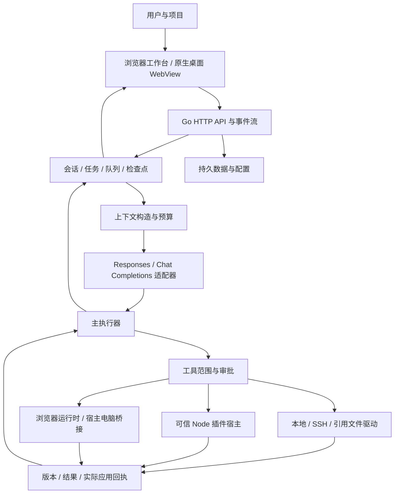
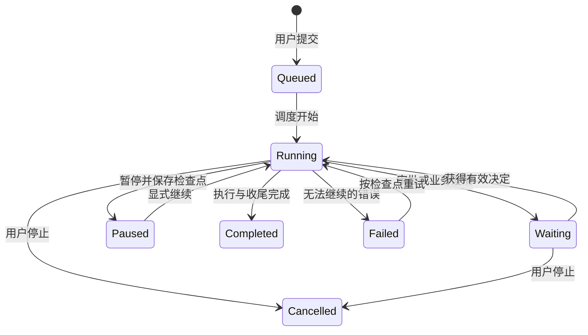
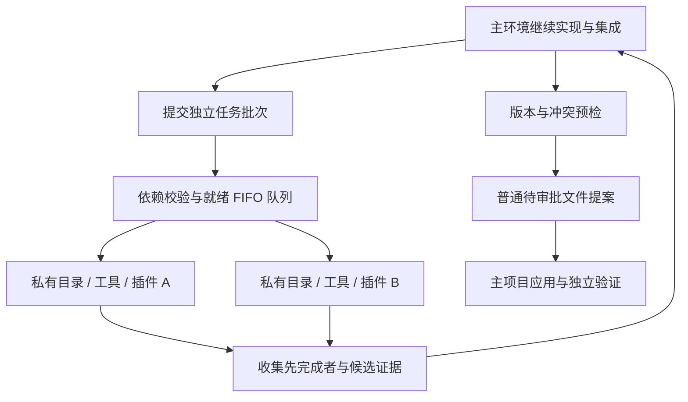

# Aide 技术白皮书：面向项目的可审阅 AI 工程执行系统

作者：**Skye Lan**
文档版本：**1.1 草稿**
编写与源码核对日期：**2026-11-12**
实现基线：[`5bec24776314b37565a13ff9f25746ca0f770741`](https://github.com/skyelan1999/aide/tree/5bec24776314b37565a13ff9f25746ca0f770741)
范围：Aide 本体；独立插件产品的技术方案不在本文范围内。

## 摘要

Aide 将模型对话与真实项目执行组织为一个持久任务过程：任务接收用户目标，构造有预算的上下文，经提供商适配器取得回复或工具调用；宿主按工作区身份、来源权限、执行策略和审批结果调用工具，再将结果回送模型，最后记录实际成果。浏览器工作台与原生桌面壳共享后端，文件、知识索引、插件、桌面控制、语音和运行轨迹接入同一任务体系。

本文说明已经存在于上述源码基线的结构、关键约束及设计取舍。重点是五条工程链路：**有身份的文件与资料来源、有预算的上下文、私有执行环境与主项目汇入分离的并行协同、审批后的执行前重查、区分模型陈述与实际效果的回执**。下文按数据流、状态、接口和失败处理解释这些机制，并分别列出实现依据与验证范围。

本文可作为后续技术论文和版本公开记录的基础。已有代码与程序 Release 的公开元数据可独立核对；这份新文稿在实际提交与公开之前仍是本地草稿。验证范围和公开记录方法见第 13、14 节。

## 1. 工程问题与系统目标

聊天回答无法自行证明文件已更新、命令已执行或软件已部署。项目工作还包含不断变化的文件版本、用户中途调整、工具故障、长历史、外部服务、审批等待和多种成果格式。若把这些状态全部隐含在一段提示词中，恢复、复核和权限控制会依赖模型对历史的记忆。

Aide 把这些条件落到宿主结构中：

| 问题 | 实现方法 | 仍有的限制 |
| --- | --- | --- |
| 回答与真实效果脱节 | 工具回执、文件提案和实际应用结果分开记录 | 外部系统的真实效果仍需相应验证 |
| 历史超过模型窗口 | 每请求预算、摘要、近期原文、有界附件和按段读取 | 摘要有损，检索结果不保证完整 |
| 文件在读取后被别人修改 | 目标来源身份、基准哈希、完整读取覆盖和应用前重查 | 不能据此提供跨多个系统的事务 |
| 并发分析重复或互相覆盖 | 独立执行目录、依赖队列、版本化候选与主项目统一汇入 | 快照、调度和集成有额外延迟与费用 |
| 工具权限与用户目标不一致 | 沙箱/范围校验与人工或独立辅助审批 | 审批模型也可能判断错误 |
| 运行中断后无法接续 | 持久任务、检查点、队列及明确终态 | 不自动重放结果不明的外部写入 |

产品面向可信单用户的本地工程工作台。它不是公网多租户隔离平台，也不把加载的 Node 插件当作不可信代码执行。

## 2. 部署结构与责任分层



### 2.1 服务、前端与工具环境

Go 服务维护 HTTP API、任务调度、模型适配、状态和文件驱动。前端使用原生 JavaScript/CSS，本地 vendor 库提供 Markdown 等渲染能力；静态资源通过 `go:embed` 编入服务，更新源码后需要构建相应产物，刷新旧服务页面不会加载新后端。

标准发行路径使用 Docker 工具环境提供 Node.js、Python、Git 等依赖。macOS 桌面壳采用 AppKit/WKWebView，连接同一后端并提供原生权限、快捷键和捕获桥接。浏览器标签页或桌面窗口不是自动独立的服务实例，也不是独立操作系统桌面。其他平台有各自适配，不将一端实测结论扩展为所有平台均已通过。

### 2.2 数据位置

| 逻辑位置 | 责任 | 重要边界 |
| --- | --- | --- |
| `/workspace` | 当前项目文件 | 与任务固定的工作区身份对应 |
| `/context` | 参考资料挂载 | 通常只读；来源名称不能覆盖底层只读权限 |
| `/data` | 会话、配置、凭据和应用状态 | 不随 Git 提交自动备份或迁移 |
| `/local` | 配置的宿主浏览范围 | 是文件挂载；不等同桌面控制权限 |
| 项目缓存目录 | 项目记忆、索引和工作副本 | 选定父目录后使用其下 `.cache/`；不自动删除旧缓存 |

实际路径以启动和工作区配置为准。目录范围检查保护宿主文件 API，但手动命令及可信 Node 代码还受其实际进程和挂载权限影响。不能把应用层路径检查解释成完整的操作系统隔离。

## 3. 任务生命周期与运行轨迹

用户一次提交形成一个 Run，归属一个会话和工作区。任务保存输入、附件、策略、模型选择、输出、工具交换、待处理提案、错误及检查点。SSE 增量事件服务于实时展示，持久化会话快照用于刷新或恢复后的状态重建。



该图是行为关系图，不替代源码中的全部状态常量。暂停、取消、失败和完成不能合并成一个“停止”：暂停需要保留可恢复工作；取消应传播到当前请求并阻止后续动作；失败需保留诊断；完成应有对应结果。重启后的恢复不能假定先前不明结果的动作从未执行。

运行中排队与插话也不同：队列等待后续调度，提升为插话后才进入当前任务输入。用户新指令可以改变剩余范围，助手自己的历史计划不能覆盖它。

轨迹按输入、模型请求和工具交换组织，记录模型、时间、参数摘要、状态和用量。墙钟跨度包含间隔和等待，不等于模型推理时间或有效工作时间；缺失事件不能补造。搜索、折叠和概览用于定位调用，不是把对话内容重新画成只有总耗时的甘特图。

### 3.1 核心对象和持久字段

| 对象 | 代表字段 | 设计目的 |
| --- | --- | --- |
| `Session` | `id`、`messages`、`runs`、`compact`、`modelSelectionRevision`、`plan` | 保存对话与多次任务；模型选择及摘要不混为任务结果 |
| `Task` | `workspaceId/workspaceRev`、`modelSelection`、`executionPolicy`、`attachments` | 固定本次执行使用的项目和配置快照 |
| `Task` 的运行证据 | `toolUses`、`requestSnapshots`、`orchestrationEvents`、`usage` | 工具结果、请求与耗时各有数据结构；快照有界并标记截断 |
| `Task` 的恢复字段 | `checkpointMessages`、`checkpointStep`、`canResume`、`pauseRequested`、`stopRequested` | 区分已完成交换、未完成阶段和用户控制意图 |
| `Change` | `source`、`binding`、`targetPath/path`、`baseHash`、`before/content`、`applied` | 将文件候选、版本和实际应用标志保存在一起 |
| `ToolUse` | `tool`、`args`、`result`、`preview`、`callId`、`completedAt` | 完整结果与 UI 预览分开，调用 ID 关联请求和结果 |

这些是源码字段的选取，不是全量公开 API schema。`ToolUse` 的参数/结果可以包含业务内容，界面的有限摘要不意味着所有持久记录已经脱敏。会话的分页视图可返回部分历史并带总数，不能把当前页面载入条数当成完整记录量。

实现入口：[workflow.go](../../internal/server/workflow.go)、[tool_calls.go](../../internal/server/tool_calls.go)、[上下文与恢复专题](context-recovery.md)。

## 4. 上下文构造、附件与长期记忆

### 4.1 每请求预算

逻辑预算可写为：

```text
系统指令 + 当前目标 + 选取的历史 + 资料/附件 + 工具交换 + 输出预留 ≤ 模型窗口
```

这是预算模型，不是对上游 tokenizer 的精确等式。预检估算、提供商实际 usage、会话累计消耗和并发请求各自窗口必须分别展示。十个请求的输入相加不会变成一个十倍大的共享上下文。

系统、用户、助手和工具消息保留协议角色。外部网页、文件和工具正文是待分析资料，不能因其包含命令式文字而成为用户授权。提供商适配器负责将内部消息映射为对应协议，包括文本、工具和支持时的图片内容。

### 4.2 大文件不等于全文塞入请求

当前 Markdown 附件在一个请求内共享 **16 KiB 内联预算**。可容纳的小文档全文加入；大文档或累计超预算文档改为来源文件引用，附路径、大小、行数、SHA-256、有限节选及读取示例。文件本身保留，模型可通过 `read_file` 的行段或 `byteOffset`/`byteLimit` 继续读取。

这解决“大 Markdown 全文导致按钮因窗口超限禁用”的问题，保留模型窗口保护；并没有取消所有附件数量、传输、二进制和来源规则。节选不能作为完整文件已读取的证据，更不能形成覆盖整个旧文件的修改基线。

另有提取/组装内存边界 `maxAttachmentTextBytes = 16 MiB` 和部分文档格式提取上限 `maxDocExtractChars = 60000`。它们属于不同阶段，不能与 Markdown 内联预算或模型窗口混称为“上传上限”。图片、Office 和其他二进制格式也不能一概按 Markdown 机制处理。

### 4.3 摘要和项目记忆

摘要流程用有界批次生成结构化摘要，再与近期原文构造后续请求；提交压缩结果前检查取消与会话快照。模型超时、摘要失败或会话变化应保留原历史，不能把失败摘要当作成功整理。压缩活动上下文不保证删除磁盘历史或缩小所有日志。

项目记忆以项目缓存为持久辅助资料，不扩大模型单次窗口。摘要可能遗漏细节，项目记忆也可能陈旧；涉及关键参数、文件修改和发布结论，应重新读取当前证据。

实现入口：[context.go](../../internal/server/context.go)、[attachments.go](../../internal/server/attachments.go)、[markdown_attachments.go](../../internal/server/markdown_attachments.go)。[大附件实测报告](../reviews/2026-11-09-large-markdown-attachments.md)记录了合成约 1.8 MB 文件的预览、发送和文件尾读取，不能据此声称所有远端来源都经过真机验收。

## 5. 异步执行环境与兼容分析路径

### 5.1 容量与职责

新普通聊天的 1X–5X、10X 表示执行容量，包含正在工作的主环境。例如 5X 为主环境与最多四个临时环境，10X 最多九个临时环境。主模型用 `environment_submit_batch` 或单项 `environment_submit` 派出独立任务后继续自己的实现、集成准备或验证；完成者经 `environment_collect_ready` 优先收集，不必等待最慢任务才处理全部结果。

1X 不创建子运行态，也不增加这一组调度工具 schema。SSH 工作区及不能安全复用捕获根的场景保持普通主执行路径。容量不是固定岗位数量、实际活跃数或必须填满的指标；微小任务拆分可能更慢。



### 5.2 接口与队列语义

| 接口 | 责任 | 返回值的含义 |
| --- | --- | --- |
| `environment_submit_batch` | 原子校验任务、批内 key 和依赖后入队 | 接受任务及稳定 ID，不代表已开始或完成 |
| `environment_queue` | 分页查看任务与全队列计数 | 显示预算不限制真实任务数 |
| `environment_collect_ready` | 收集任意先完成者；可取消等待 | 每项独立结果，失败不遮蔽其他完成者 |
| `environment_collect` | 按 ID 查看、选择路径与登记候选 | `merge=true` 只形成待审批提案，不写主文件 |
| `environment_exchange` | 任务内带版本的比较并交换 | 内容是未验证参考；不是全局长期记忆 |
| `environment_load_plugin` | 工作者按需加载已启用插件副本 | 不安装新插件，不更改全局配置 |
| `environment_shared_tool` | 工作者请求共享设备或宿主动作 | 仍经主协调、正常审批与资源租约 |
| `environment_cancel` | 中止指定工作者 | 仍需收集并确认其终态与已产生证据 |

批次先检查缺失依赖、重复 key 和环，无效批次不启动部分任务。依赖仅决定执行先后，**不会自动复制或应用前置候选**。就绪队列按槽位自动补位，等待依赖的任务不占运行槽。显式限定工具范围的自定义 Agent 可使用保留的同步 `environment_run_queue` 实验，借用暂停主模型的槽位；普通聊天不披露这条路径。

### 5.3 私有执行与主项目写入

临时环境创建独立 App 运行态、源码目录、进程及插件/daemon 状态，复用工具循环和审批实现，不启动独立 HTTP 工作台、账户迁移或生产后台任务。源码快照包含已提交、未提交及未跟踪的普通文件，跳过 `.git`、运行缓存、符号链接和特殊文件；省略清单交给工作者，依赖仍需正常准备。

与旧无工具分析不同，工作者可以读写私有目录、运行测试、按需调用插件。私有 `write_file` 经校验后应用到临时副本，便于实际验证；汇入主项目是另一个动作。目录工具使用受控根，私有 Shell/Node 进程使用可用的 Linux Landlock 约束，缺失相应能力时不静默扩大权限。这是目录和进程隔离，不是虚拟机或网络/硬件虚拟化。

共享浏览器、电脑和设备走主协调与资源租约，不因创建九个工作者就产生九套物理输入设备。未知插件资源声明采用保守协调；可信插件的私有副本不等于插件在所有部署模式均不可信沙箱化。

### 5.4 收集、版本与中断

结果保留身份、分工、工具证据、用量、候选路径及原始/候选哈希，存于服务数据 `execution-results/<task>/<environment>/`。收尾流式计算摘要，未修改文件不加载成提案；二进制和删除保留证据并交主环境处理。

收集候选先检查所选路径、主文件版本和已有提案冲突，再逐项注册普通 `write_file` 提案。成功路径立即持久化；后续 hook 或检查点失败时，`MergedPaths` 仍表示已登记子集，重试只处理剩余路径。`completed` 是工作者结束，`mergedAsPending` 是候选已登记，均不是应用或集成验收通过。主环境应独立检查集成并收集全部任务。

主循环从运行态生成精简账本，保留任务 ID、运行/收集/汇入状态和候选路径，避免摘要遗漏后重复派工；账本不是完整工具历史。恢复时保留已结束结果，原运行/排队任务标记 interrupted，不自动重放未知副作用。

### 5.5 旧分析路径的适用范围

`ParallelProgress` 兼容检查点仍走独立、无工具分析；`conversation_parallel.go` 在新证据后重评估，同一用户目标范围最多三轮规划。受约束编辑草稿由 `parallel_edit_drafts.go` 经主任务登记。草稿回退移除对应提案，不是回滚磁盘。**这些约束属于兼容分析路径，不是新异步执行环境的统一三轮上限。**

实现入口：[execution_environments.go](../../internal/server/execution_environments.go)、[workflow.go](../../internal/server/workflow.go)、[详细执行环境设计](../designs/execution-environments-20261101.md)、[兼容分析专题](adaptive-parallel.md)。

## 6. 权限、审批与执行前重查

Aide 的控制链包含多个独立判断，不能用一个“RW”标签概括：

```text
用户授权范围
  → 当前工作区与来源身份
  → 来源启用 / AI 可见 / 读写能力
  → 工具和进程执行范围
  → 人工或辅助审批
  → 应用前身份、版本和取消状态重查
  → 实际执行及回执
```

读取工具在允许范围内直接执行；写文件生成提案。辅助审批由独立模型请求审核具体动作，结果计入用量并留痕；符合条件的新 Markdown 系统文档还有简化应用路径，不能推广为所有文件免审。

浏览器与电脑操作也进入辅助审批：任务已经明确授权、目标可确定且单次动作适合自动审核时，基本聚焦、浏览与点击可以自动通过。审核不扩充永久应用/网站名单，也不代授操作系统权限。结果不确定、目标变化、审核失败或不适合自动化的动作转人工。

审批是对具体动作的判断，不是疗效、业务正确性或永久授权的证明。模型审核、宿主校验和实际操作系统权限各自承担一层约束；任一层拒绝都不能被另一层的“允许”替代。

实现入口：[assisted_approval_surface.go](../../internal/server/assisted_approval_surface.go)、[execution_policy.go](../../internal/server/execution_policy.go)、[workspace_execution_policy.go](../../internal/server/workspace_execution_policy.go)及[用户审批说明](../user-guide.md#会话审批)。

## 7. 文件版本、来源绑定与实际应用

### 7.1 来源是身份而非路径字符串

同一个相对文件名可以存在于本地项目、SSH 工作区和不同引用。任务和提案保存工作区/来源身份、目标路径及基准版本。来源改配、停用或权限变化后，应重新解析并拒绝不再匹配的旧目标，不能把旧提案自动重定向到新的同名目录。

自动系统文档绑定是可配置的逻辑来源，不是必须硬编码的某个本机目录；四阶段建档与项目缓存的后备行为也应区分。

### 7.2 完整读取与版本冲突

已有文件修改需要可验证基线。大文件分段读取时，完整覆盖和一致的文件哈希用于判断是否真正读完；仅文件名、首段或链接不足以证明完整读取。写入前再次检查目标版本，冲突应反馈给任务重新读取，而不是为了通过而清空版本条件。

### 7.3 替换与失败语义

本地文件使用受控目标、临时内容和替换路径降低半写文件风险；远程 SFTP 的原子替换依赖相应服务器能力，例如受支持的 posix-rename。文件编辑器、插件文档绑定和模型提案复用受约束的宿主通道，但不因此获得任意宿主路径写入能力。

逐文件原子性只涉及单个替换。多个文件、命令和外部系统之间不是分布式事务，部分成功时应记录已完成、失败和待核对项。收到“提案已创建”不能报告“文件已保存”；应用回执与必要的读回才用于确认落盘结果。

实现入口：[files.go](../../internal/server/files.go)、[document_proposals.go](../../internal/server/document_proposals.go)、[plugin_file_document.go](../../internal/server/plugin_file_document.go)。

## 8. 工具、插件与工作台协议

内置工具与插件工具统一向任务暴露名称、参数 schema 和结果。Node 宿主执行插件 handler，前端工作台通过声明和宿主桥接交换消息。工具声明不等于授权，插件设置也不能替代宿主的来源读写、管理权限或文档版本校验。

插件的工具调用、工作台 UI、文件查看器、文档绑定和管理动作是不同表面。安装启停等管理提案有独立权限，普通工具调用不能静默获得插件管理能力。工作台通过宿主接口请求受约束的文件操作，不应把页面端持有的路径或哈希直接当作可信证明。

### 8.1 工作台消息通道

协议 v1 的工作台先向父页面发送 `aide.workbench.ready`。宿主检查当前 iframe 来源并转移 `MessagePort`；opaque origin 场景依赖精确窗口和端口身份，而不是用通配 origin 代替身份校验。工具请求带 `protocol`、`requestId`、`method`、`tool` 和 `arguments`；宿主保留认证和插件实例范围。

```text
iframe ready
  → 宿主连接端口并告知可用工具
  → tool.call(requestId, tool, arguments)
  → 宿主校验声明、当前实例和工具策略
  → result / proposal_pending / error
  → proposal.status 或 proposal.changed 观察后续状态
```

`proposal_pending` 只在宿主验证并登记提案后返回；普通工具 `result` 与原生文件保存回执不同。工作台协议还包含分块文件文档和导出交接等专用能力；应按各能力声明使用，不能把工具端口当作任意 API 代理。新客户端可声明单调请求 ID 和桥接续期能力；旧客户端保留原请求预算，具体限制以[插件协议](../plugin-protocol.md)为准。

插件代码是可信 Node 可执行代码。schema、包检查和工作台 iframe 约束能减少接口误用，但不是对恶意包的操作系统级沙箱。安装第三方代码属于部署信任选择，不能靠提示词消除风险。

插件源码仓库、ZIP、Release 和市场索引分别有版本。宿主 Git 更新不会自动替换所有已安装插件，市场列表可见也不等于目标实例已经加载新包。协议字段和当前扩展点以 [plugin-protocol.md](../plugin-protocol.md) 为准。

实现入口：[plugins.go](../../internal/server/plugins.go)、[plugin_host.js](../../internal/server/plugin_host.js)、[插件市场专题](plugin-market.md)。

## 9. 知识索引与代码理解

知识星图在有界来源扫描上组织文件、会话、代码和文档信息，保留来源标识及原文定位；增量同步依据来源/文件指纹复用缓存。启用、AI 可见与当前身份变化后重新核对来源，而不是继续使用过期节点访问数据。

文档检索包含原文查找和本地 TF-IDF RAG；这一路径不等于默认运行向量数据库。可选 embedding/语义检索需要单独配置和有效服务。检索阶段的本地处理与把选中片段发送给模型是不同数据流，不能笼统声称“全部资料从不离开本机”。

代码分析以 AST、符号和静态调用候选辅助理解。动态派发、反射、运行时注入和跨语言行为可能无法完整覆盖；静态边不等于实际执行轨迹。AI 解释还应引用文件与片段，索引中的结论不能替代构建、测试和运行证据。

实现与缓存预算详见 [knowledge-map.md](knowledge-map.md)；源码入口为 [knowledge_map.go](../../internal/server/knowledge_map.go) 及同目录 `knowledge_*`、`code_analysis/`、`document_analysis/`。

## 10. 原生控制、视觉证据与全局捕获

### 10.1 视觉定位链路

```text
确定目标应用与窗口
  → 捕获并登记截图
  → 支持图片的模型观察
  → 返回图像坐标与截图引用
  → 服务端校验目标、窗口、尺寸和有效期
  → 转换坐标并执行动作
  → 重新观察结果
```

当前图像坐标引用有效期为两分钟，绑定任务内目标和窗口，不能拿另一会话或旧窗口的截图继续点击。该机制减小缩放/焦点误配，不会使模型视觉识别永远正确。

电脑工具包含目标检查、截图、点击、文本、拖拽、滚动与复杂组合键。平台支持时可后台读取或向目标派发动作，不要求所有操作都由用户手动切前台；但依赖系统焦点的应用和动作仍需激活。虚拟焦点用于会话目标管理，不提供多个互不干扰的系统鼠标、键盘或桌面。共享物理输入应按平台能力调度并在执行前核对目标。

具体参数和平台限制见[电脑控制说明](../plugins/computer-browser-control.md)。实现入口为 [computer_control.go](../../internal/server/computer_control.go)、[computer_actions.go](../../internal/server/computer_actions.go)、[computer_snapshot_evidence.go](../../internal/server/computer_snapshot_evidence.go)。

### 10.2 双修饰键应用捕获

macOS 桌面设置支持快捷键绑定和可选全局双修饰键捕获。捕获流程识别有效按下/松开序列，取得前台应用窗口 PNG，并附应用名、bundle identity、窗口标题、时间和尺寸等上下文；通过绑定当前草稿的一次性票据送入已有附件流程，唤起 Aide，但不自动发送任务。

权限依赖屏幕录制、辅助功能和具体原生环境。普通组合键、长按、输入及目标改变的处理属于手势和票据校验，不是模型判断。实现入口：[modifier_gesture.swift](../../native/macos-desktop/modifier_gesture.swift)、[app_capture.swift](../../native/macos-desktop/app_capture.swift)。

## 11. 语音、消息与交互呈现

朗读、麦克风转写、双向语音会话和消息邀请是不同流程；模型密钥、提供商、设备权限和用户开始动作分别决定其可用性。语音产生的任务仍需经过既有任务和审批通道，不能因输入来自声音而扩大文件或工具权限。

前端流式呈现将模型输出、工具状态和任务终态分离，批量更新稳定文本和活动区以减少重复渲染。发送、停止、暂停和等待审批使用各自状态；动效是反馈，不能替代实际任务状态。减少动态效果遵循系统偏好。

源码包含相应功能不证明真实音频质量、浏览器录音、云端可用性或双设备通信已完成新一轮验收。详见[语音架构](assistant-openai-speech.md)与[消息架构](decentralized-messages.md)。

## 12. 运行、更新与可恢复性

源码树、编译产物、镜像、持久数据和运行进程各有生命周期。`start` 复用/启动已安装产物；`build` 从源码构建并启动对应产物。程序的版本字符串、构建提交和源码指纹服务于不同身份核对，不能只看页面角落的 RC 字样。

健康接口说明进程及依赖的当前状态，不证明全部功能正确；完整性诊断也不能代替浏览器和真实外部服务验收。恢复时应分别保留未提交源码、项目和数据卷，不能用删除卷来“修复”代码或把镜像回退当作数据回退。

仓库 `AGENTS.md` 和开发路由管理维护者的需求、设计、测试与交付流程；运行时 Profile 和执行策略管理用户模型任务。两者不是同一个路由系统。

操作以[启动器契约](launcher-contract.md)、[HANDOVER](../../HANDOVER.md)及[验证分层](../testing/release-validation.md)为准。本次文档维护不启动额外 Aide/Docker 实例、不重建当前服务。

## 13. 验证方法与已知边界

### 13.1 证据分层

| 层次 | 可回答的问题 | 不能直接推出 |
| --- | --- | --- |
| 源码定位 | 某分支或约束是否实现、调用关系是什么 | 实际实例已加载该代码 |
| 聚焦测试 | 给定夹具下参数、状态和拒绝分支是否符合预期 | 真机、真实账号和所有故障都通过 |
| 构建与健康 | 产物可构建、服务可运行 | UI、模型或外部写入已完成 |
| 当前实例操作 | 指定页面和目标应用的操作结果 | 所有平台兼容或安装包包含相同代码 |
| 公开交付 | 指定 tag、附件和哈希可定位 | 新草稿已公开、技术新颖性或独立权属结论 |

### 13.2 可复核材料

- [执行环境验收](../reviews/2026-11-01/execution-environments.md)：固定合成项目的私有工具、候选汇入与应用后断言，不代表所有任务的提速结果。
- [电脑能力差距与目标控制](../reviews/2026-11-08-computer-control-gap.md)：特定本地实例的控制与审批范围。
- [视觉定位及动作补齐](../reviews/2026-11-09-computer-actions.md)：特定平台拖拽、滚动、按键和坐标链路。
- [大 Markdown 附件](../reviews/2026-11-09-large-markdown-attachments.md)：合成文件从附加到文件尾读取，包含失败与修正。
- [文档维护核对](../reviews/2026-11-11-aide-docs.md)：本稿的链接、来源和修改范围检查；不重复冒充功能验收。

这些是已有记录，不是本文重新运行的测试。本稿没有给出统一性能排行榜、并行倍数收益、成功率、全平台验收率或可靠性概率；没有受控测量就不能把实现路径变成实验结论。

### 13.3 后续可重复实验设计

可选择固定项目快照和任务集，比较 1X 与较高并发下的墙钟时间、总用量、正确交付率、重复规划和人工介入次数；固定模型、预算、网络条件并报告失败样本。权限路径可做来源改配、版本冲突、截图过期、取消、桥接断连和结果不明注入，核对是否有错误目标写入或重复动作。跨平台、远端 SSH、真实语音和浏览器站点应各自建矩阵。

以上是实验方法，不是已取得结果。它们允许后续论文将系统设计与量化评估分开，避免仅用演示截图论证可靠性。

## 14. 版本公开与技术记录

本稿采用三种可核对身份：

1. **实现身份**：固定 Git 提交、对应文件和内容 SHA-256，说明本文讨论的代码是什么。
2. **程序公开身份**：GitHub Release 的 tag、`published_at`、公开 URL 和附件元数据，说明哪个程序版本在何时被平台记录为发布。
3. **文稿身份**：本稿自己的提交、公开 URL、版本与内容摘要，在真正公开后补记；不能复用程序旧 Release 的日期作为本文首次公开日期。

截至本次查询，最新公开程序 Release 为 [v0.1.18.0-RC3](https://github.com/skyelan1999/aide/releases/tag/v0.1.18.0-RC3)，`published_at = 2026-11-02T06:55:25Z`。它与 2026-11-12 的源码核对基线并不相同。2026-11-11 的历史公开元数据、提交身份和源码摘要保存于 [aide-public-baseline-20261111.json](evidence/aide-public-baseline-20261111.json)，可以对照公开 API 和固定提交复查。

Git 提交中的作者时间、提交时间、Release 创建时间和实际发布字段具有不同语义；摘要证明内容一致性，不单独证明首次公开时间。这些记录可支持后续追溯“某个版本及其内容何时可被访问”，不自动证明首创性、专利优先权或法律权属。本文不使用“全球首个”等未经检索验证的结论。

正式公开时，应提交文稿及证据清单，保留固定提交链接，并为后续修订记录增量说明。文稿公开、程序安装包发布和运行实例升级分别进行。

## 15. 结论与演进方向

Aide 的工程核心是把生成式模型放入可记录、可检查、有权限与版本约束的执行循环：上下文构造决定模型可见证据，私有环境执行与主项目汇入分别管理工具副作用，审批和目标重查约束具体动作，回执记录实际结果，持久检查点支持中断后继续。

目前的主要限制包括摘要有损、规划和审批依赖模型判断、插件执行的信任边界、跨资源非事务性、共享桌面输入及不同平台实现差异。后续工作应围绕受控任务集的量化评估、更完整的故障注入、平台兼容矩阵和更强的插件隔离逐项验证，而非用更大的并发数或更长提示词替代工程证据。

## 1.1 增补：目录对象、远端文件提交与可复现解码

2026-11-12 主干增加两种不能混为一谈的文件机制。自选宿主目录由原生助手持有 `os.Root` 对象，数据通道采用 loopback NFSv3 能力导出，Docker 使用命名卷而非再次打开已验证的宿主路径。配置身份跨准备保存；运行期间对象固定与下一次准备的身份拒绝分别验证。该机制不改变全局既有挂载，也不提供宿主其他进程的数据库锁。

插件远端文件操作通过单调用 checkout/commit 绑定来源、连接、锁屏代次及原始摘要。发布前检查与临时文件减少失配，但 SFTP 没有分布式 CAS；外部写入必须停止，保存后遇到来源变化时需重读确认。权限隔离不依赖把远端路径误映射成本机路径。

JPEG2000 fallback 现在保留固定原生源码、补丁、编译器摘要和构建方法；两次干净重建一致，C sanitizer 和分配故障回归提供源层证据。原生 CLI 比对、标准符合性和浏览器实际显示是不同证据。Markdown PDF 的标准嵌入附件也通过独立解析器恢复并比较摘要。

对应设计、实际检查和未验证范围见[发行迁移说明](../release-guide-0.1.19.md)。本增补仍是技术白皮书草稿；源码发布或文档更新不等同于学术论文公开发表，也不把本次 Delivery 尚未完成的项目写成已通过。
