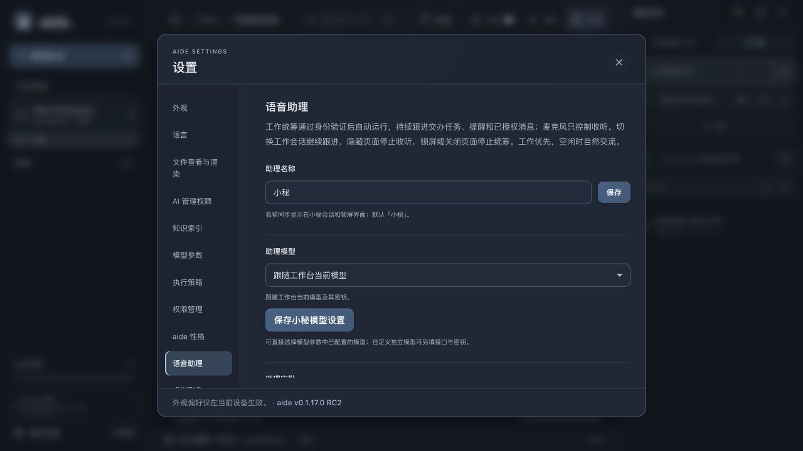

# Page-owned work coordinator

> 当前说明按 2026-10-17 源码 `0fef6411` 核对；实际界面、示例数据、截图原图及验证范围见[实际使用截图](../ui-evidence.md)。源码、浏览器观察与发行验收分别记录，截图中的版本文字不代表已发布本提交。

当前模块职责见[软件模块说明](modules.md)；工作统筹和模型设置入口；没有执行真实语音或模型任务。

The assistant is a work coordinator first: understand goals and dependencies, delegate to the existing Aide executor, follow task progress and blockers, then report results and next steps. Friendly conversation belongs in idle time. User personality settings are preserved and affect tone rather than changing this responsibility.

After identity verification, the page automatically starts the heartbeat; there is no companion enable, pause or end switch. Existing assigned work continues through the executor and its approval controls. This is automatic follow-up of assigned work, not an unbounded loop that invents new jobs. The microphone starts only through its own user gesture, and turning it off does not disable coordination. Switching work sessions keeps the page monitor alive. Hiding the page releases microphone capture and stops audio, while monitoring continues subject to browser timer throttling. Locking or closing the page ends monitoring. Closing the browser does not create a background service. Authentication failures stop checks until reauthentication; transient network failures retry with a slower cadence.

The read-only assistant-watch heartbeat checks followed task states, due reminders in scope and unread-message metadata only when assistant access is granted. The ledger orders blockers and approvals first, then completed results, then active work. Completed previews include only user-facing chat content, never reasoning or tool arguments. Initial blockers are visible immediately; unchanged checks and routine running/queued transitions stay quiet. It neither marks messages read nor accepts invitations/files nor approves commands. The existing agent/tool loop handles actual user-assigned work.

The design borrows heartbeat/quiet-output and queue coordination principles from https://docs.openclaw.ai/gateway/heartbeat and https://docs.openclaw.ai/cron-vs-heartbeat ; it does not embed OpenClaw or add a 24-hour external scheduler. No model requests run on empty heartbeat checks.

Voice uses browser ASR and the configured TTS. New interim speech cancels synthesis/playback; exact echo-like reply fragments are suppressed. Actual acoustic echo and latency depend on browser and hardware. Stop, lock and page close invalidate late results.

## 阿里云百炼千问 TTS

Qwen uses the native DashScope HTTP synthesis API and downloads signed WAV results over HTTPS without forwarding the API key. Only official result OSS hosts are accepted; redirects are disabled. Failure displays a safe stage/status/error code. Qwen keeps text and does not switch voices automatically unless the user opts into browser fallback.

This is a non-realtime text synthesis adapter. Realtime model IDs are not compatible. Qwen playback speed uses media playbackRate with pitch preservation; model expressiveness is hidden. Actual cloud voice quality, latency and microphone echo require target-device verification.

## Catalog discovery and playback reliability (2026-10-17)

GET /api/tts/catalog returns the verified bundled catalog. POST reads the native DashScope /api/v1/models endpoint using the selected region and TTS key, and decodes the official help article JSON/HTML for preset voices. It does not invent an account preset-voice API or enumerate private cloned voices. Failed refreshes preserve bundled choices and display source/warnings. Model discovery does not prove account synthesis access; the selector filters realtime and Qwen-Audio-TTS protocols incompatible with this adapter. Existing saved values absent from the catalog are explicitly labeled rather than overwritten.

Qwen text is grouped into at most 280 Unicode characters per request, avoiding one request per comma and preserving long sentences. Cloud request/download timeouts are 45 seconds and the frontend timeout covers the full audio fetch for 60 seconds. Synthesis POST is not automatically retried because it may have incurred billing. Safe error stages and status codes are shown without raw provider bodies, keys or signed URLs. User interruption/cancellation invalidates playback generations and aborts fetches without triggering fallback. Opt-in fallback resumes from unfinished chunks instead of replaying completed chunks.

Sources: https://help.aliyun.com/zh/model-studio/list-models and https://help.aliyun.com/zh/model-studio/qwen-tts-voice-list . Actual read-only model discovery succeeded with the configured provider; the public article JSON parsed 48 non-realtime preset IDs. These checks do not call paid synthesis.

Configuration: Settings > Voice assistant > Speech engine > Alibaba Cloud Model Studio / Qwen TTS. Choose region, model and voice, enter a dedicated TTS key, save and preview. Keys are not echoed; blank preserves the existing key, and clearing requires an explicit checkbox.

## Safari playback lifecycle (2026-10-17)

The same media element is activated synchronously on microphone/companion/preview gestures, then reused after asynchronous cloud synthesis. Safari autoplay grants are per element (https://webkit.org/blog/7734/auto-play-policy-changes-for-macos/). A NotAllowedError keeps the current audio URL and shows a Play voice reply button; that user gesture retries playback without another synthesis request. Normal playback state stays internal. There is no permanent playback/status toolbar or duplicate speech-reply toggle; the saved Voice reply setting is authoritative. Browser-blocked playback alone shows a temporary action notification, and failures use the existing error notification/settings status. Completion means a media ended event, not proof that a speaker produced audible sound. Stop/interruption resolves pending playback, clears retries and releases object URLs immediately. Failed starts time out with a visible error. No browser autoplay/security setting is changed.

The historical 200 WAV synthesis test did not validate audible Safari playback. Actual microphone barge-in, acoustic echo rejection and output device routing still require target hardware acceptance.

Text messages submitted from the assistant composer must refresh the session before speech begins: selectSession cancels earlier playback. The active page coordinator routes replies into the same interruption-aware queue. Lock/close cancels monitoring and playback; silent/ignore replies remain silent. References to companion/paused controls in older test names describe the historical implementation, not current UI controls. The media lifecycle test executes this response-routing block with a cancelling refresh in both modes.

## Delegated execution and approval (2026-10-17)

Both dispatch routes enter the validated task-start pipeline. `push_to_session` starts a real run or queues its prompt behind a running task, and returns a failure if starting is rejected; appending a chat message alone is not success. A generated prompt cannot answer a pending human clarification or approval channel.

Settings > Voice assistant > Assistant approval contains “允许助理代审交办任务”. It defaults off and is independent of the workbench global approval mode. Only server-marked assistant-delegated runs and their child tasks receive this optional independent reviewer. Public run payloads cannot claim that origin. Disabling the option invalidates in-flight review generations and returns to the existing workbench policy.

The reviewer checks the original human instruction, never treating an assistant-generated task summary as additional authorization. Existing operation fingerprints, sandbox constraints, audit reasons, protected-operation checks and manual-review requirements remain. Existing-file overwrites, uncertain authorization, business clarifications, fingerprint verification and peer invitations remain manual. Settings changes alone do not enable the option on the user's behalf.

Delegated prompt, follow-up and queue bubbles show “助理代发”; approval audit entries identify “助理代审”. Origin metadata is saved with the run/message and survives reload. Historical messages without metadata are not retroactively guessed to be assistant-created.

## Document and explicitly selected reference proposals (2026-10-17)

New text document deliverables use `write_file(source="system-docs", path="relative/name.md", content=...)`. The destination follows the automatic-document directory configured in Workspace; no Downloads or other absolute path is hardcoded. Office/workflow document generation already follows the same binding. Existing code edits and explicitly requested workspace files keep the legacy `write_file` workspace destination when source is omitted.

When the user explicitly chooses a reference destination, `source` is its ID from `list_sources`. The source must be enabled, visible to AI in the current workspace, and RW. Read-only/context references and non-file link/MCP/FTP/SMB sources cannot become write destinations. Local/skill, workspace SFTP and independent SFTP file sources use their registered roots. The assistant never toggles the locks or falls back to another destination on denial.

The server records source ID, binding fingerprint and actual target path on the proposal. Approval fingerprints and the file UI include that destination; identical relative names in workspace and references remain separate. Existing-file modifications require the attached original and version match. Changing a binding, hiding/locking/removing the reference, or switching workspaces rejects pending writes. Local directory handles and remote connection generations are pinned during application. Partial success is recorded per file. Reads of pending new documents remain pending-proposal notices; local approval receipts read back the bound source, not the workspace. Remote writes keep their normal transfer result boundary and are not described as locally verified bytes.

New files in explicitly configured local bindings can use the independent reviewer; original replacements and remote proposals remain manual. An empty automatic-document binding fails clearly instead of silently using the read-only `/context` fallback. Historical workspace proposals without source metadata keep their original target.

## 交付闭环与工作台账（2026-10-23）

本节描述 `assistant-delivery-loop-20261023` 的本地改进，不能据此认定旧运行实例已升级或本版本已发布。

- 新任务将交付证据单独保存在 `Task.delivery`：`delivered`、`pending_approval` 或 `missing`。对 PNG/JPEG/WebP、MP4、MP3/WAV、PDF、DOCX/XLSX/PPTX、DXF、STL/STEP 和 ZIP 的明确产物请求，完成回复中的相对路径须指向当前本地工作区内可读取、非空、格式扩展名匹配的文件（媒体另做格式签名检查）；提案仍须经过既有审批。签名检查不等于完整解码、内容质量评估或业务验收。没有文件、格式不符或只给执行承诺，均不能作为成功交付；保留检查点供继续。
- 原生图片也在收费提交前保存状态。提交结果不明时不重发；已有服务商结果但下载失败时保留原结果和缺口，继续时只尝试下载。短句“继续/继续下载”只从紧邻的媒体任务继承文案和原生成状态，不扫描旧助手回复来发起收费任务。已停止的任务不自动复活。生成或下载期间不能消费的改写请求返回明确拒绝，不假装已入队；明确“停止”取消本地跟进。远端已提交任务可能继续运行，停止本地网络请求不代表服务商已取消或退款。
- Auto 候选在既有能力、端点、Key 和附件过滤之外，参考本次服务进程观察到的同账户模型失败。限流/服务异常暂缓 30 秒，额度、鉴权或开通错误暂缓 5 分钟；参数错误不据此禁用模型。成功请求清除该记录。此缓存不跨服务重启、不主动探测账户、不改变静态能力评分，也不自动切换模型重试收费请求。已有远端任务始终绑定原模型和账户。
- 同一用户目标最多进行三轮并行规划；新的探测结果不会无限重置预算。检查点保留预算，明确用户插话可形成新目标范围。耗尽预算只回到主执行器，任务不因停止扇出而暂停。标题去重是保守的文字规范化与高重合检查，不是语义向量检索；不同编号和英文主题保留。
- 小秘的 `work_status` 与页面使用同一只读台账，包含运行编号、交付证据、阻塞、下一步以及用户已安排的定时执行。轮询不重试、不交办、不审批。实际定时执行复用服务端提醒调度器；服务必须运行，浏览器无需保持打开。暂停或中断的定时执行会显式暴露缺口，不自动重放。
- 页面刷新去重仅在 `sessionStorage` 保存最多 1000 个不透明事件 ID，不保存私人正文。语音播报包含具体阻塞和下一步；麦克风仍须用户手势，锁定和页面隐藏边界沿用既有实现。助理朗读与插件生成可下载 MP3/WAV 的设置保持独立。

实际验证命令、浏览器范围、未测项和发布状态记录在[任务账本](../tasks/assistant-delivery-loop-20261023.json)。旧任务缺少 `delivery` 字段时不会自动补造历史验收证据。

## Assistant timeline Markdown (#599, 2026-10-29)

Assistant-session history uses the same local Markdown parser, CJK emphasis correction, code decoration and HTML sanitization as ordinary chat. Both assistant-role content and a message's reply field render as Markdown; user content remains literal text. Source text, speech synthesis and backend history are not rewritten. Headings/list syntax still requires real line breaks; inline `###` is not repaired by inserting guessed newlines.

Unchanged assistant rows retain their rendered DOM within the same session. Visible content, role/type, dispatched target, language or parser availability invalidate that row, including edits with the same string length. This avoids repeatedly rebuilding code/diagram output during polling.

If the initial local parser script is unavailable, readable plain text remains visible with a formatting status. One shared automatic recovery load is attempted; a failed load waits for the explicit Retry formatting button rather than looping. Successful loading clears HTML/live-block caches and redraws the current session and visible Markdown previews using current unsaved editor values. Completion during logout/lock does not redraw private views. Plain fallbacks never enter the stable HTML cache, and a replacement parser invalidates that cache.

Actual component acceptance covers the user's example (six strong spans/five inline-code spans), structured headings/lists, assistant content/reply fields, literal user text, dispatched navigation, sanitized markup, current-session/lock races and draft retention at desktop/narrow widths in light/dark themes. This does not claim a full deployed workbench, microphone, or real-model acceptance. Voice-log summaries and call captions retain their existing plain-text presentation; the fix targets the assistant conversation timeline.

## 审批查询工具与模型显示（Issue #984）

MIXSoul 的文字输入和原生通话 `assistant_work` 转交路径共用宿主过滤后的工具。`aide_component_status` 可只读查询当前工作区、会话、插件及人工审批；`control_session_run` 仍只接受本轮明确的会话和运行控制动作。工具在引擎白名单和宿主权限两层检查，禁用工具不会因切换输入方式恢复。审批查询不新建执行任务，也不提交审批决定。

原生通话初始、转写后和周期更新指令均保留宿主工具路由规则。审批会话查询支持阿拉伯数字、中文数词、逐位口述数字，以及审批上下文内的“会话／绘画”转写混淆。明确审批查询后的两分钟内，单独补充或更正编号只重新查询目标；多个候选不猜测，暂停和停止指令仍走运行控制。批准或拒绝仍要求先展示待审内容，再由用户明确确认，继续校验工作区、版本、时效及同轮转写；编号识别不构成批准授权。

`GET /api/xiaomi/model` 返回不含密钥的 `effectiveModel` 和 `configured`，与实际模型解析使用同一路径，包括独立配置、继承、兼容回退和不可用状态。聊天栏模型选择器及底部状态统一使用该结果，配置刷新和会话切换都会更新显示；进入助理会话不再沿用上一个普通会话的模型标签。此状态表示连接配置可用，不代表刚完成服务商连通性测试。

内置引擎与 MIXSoul 的审批状态查询只提供只读工具，执行入口也拒绝意外的派发和运行控制。查询必须取得本轮 `aide_component_status(component=approvals)` 回执；模型没有发出工具请求时，宿主仅按原权限补一次只读状态查询，再将回执交给模型回答，仍无有效回执就报错。`assistant-message` 的 `approvalQueryRecovery` 标记这次宿主补查，不将补查冒充模型生成的函数调用。回执包含 `total` 与 `approvals`；明确询问数量时按宿主 `total` 格式化回答，避免模型逐条计数出错。

模型未配置、不可达、返回不支持或没有有效查询回执时，文字、语音转交和环境语音筛选都明确报错，不将原文自动变成工作任务。只有成功的工具决策才能交办。服务商模型目录与本地“已配置”状态均不证明当前账户能够实际调用，不跨提供商静默切换。

本地编译、协议／竞态测试及界面验收结果见[任务记录](../tasks/assistant-approval-tools-20261122.json)。实际用户待审批项不用于批准测试；提交决定的回归使用隔离的合成提案。

## 本地 SIP 话机验收桥接

`scripts/aide_sip_phone.py` 是本地单话机网关，需要 Python 3.9–3.12 的 `audioop` 和 `websockets==15.0.1`，依赖需由管理员首次准备，尚未作为公开发行安装组件发布。它只接受 `--phone` 指定的私网 IPv4 设备，提供该设备的本地 SIP 注册、PCMU／PCMA 双向 RTP，与 Aide 现有实时通话 WebSocket 对接。`--normal` 使用与工作台相同的普通通话入口、模型和权限；不指定该参数时保留只读验收模式。`--dial` 呼叫话机，默认等待话机拨入；`--serve` 在挂断后继续等待，空闲时不建立付费模型连接。固定助理分机为 1000，其他拨入号码返回 404，话机标识默认为 1001。网关必须运行，Mac 的局域网地址变化后需同步话机服务器设置；这不是通用 PBX、公网电话或紧急呼叫服务。

网关通过本地数据目录读取 Aide 令牌，以本地证书叶节点建立信任，保留 TLS 签名与主机名校验；不把 Aide 令牌或模型密钥写入话机。麦克风 G.711 音频转换为所选实时模型的 PCM 输入；24 kHz 回复先进行 3.4 kHz FIR 低通，再降为电话的 8 kHz。计算移出发包循环，RTP 按 20 毫秒节奏发送；播放默认增益 2，按帧限制峰值，支持 `--output-gain 1` 恢复单位增益。默认只记录信令、包数和电平等指标，不保存录音；`--show-transcripts` 仅用于操作员当次查看转写。

只读验收模式请求 `assistant-call/socket?readOnly=1` 并要求 `aide.ready.readOnly=true`；普通模式要求该标志为 false。旧宿主未确认所选模式就拒绝继续。只读标志仅收窄一次已鉴权通话的权限，不跳过小绵解锁、工作区、锁屏或取消检查。内置引擎和 MIXSoul 工具表、执行入口、原生审批提交、运行控制以及最终派发均执行只读限制；模型或话机不能借参数取消限制。只读指令刷新保留限制说明；语音先按回复转写检查明确的操作声称，误称已提交时丢弃该回复音频并至多校正一次。此表达检查不代替后端权限，也不保证任意模型措辞都能被识别。普通模式不使用验收开场或这套额外的表达校验，沿用原有通话规则。

真实呼叫、双向收音、用户听感、未变的待审项和未验证范围分别记录在[电话验收账本](../tasks/sip-phone-acceptance-20261122.json)。

只读电话中，模型通过 `assistant_work` 指定会话查询审批时，宿主发送 `aide.tool_result`：包含工具调用 ID、`approval_query` 操作、会话编号、`pendingCount`、查询状态及只读标志，不包含命令、提案正文或密钥。数量来自当前工作区实际人工待审事件；查询不会创建可提交决定的审批 offer。网关分别记录模型函数请求与宿主回执，不用“我去查询”等口头承诺充当调用证据。播放前的操作声称检查按分句及否定边界处理，避免把“已查询，未批准任何任务”误当成执行了审批。

OpenAI 通话的 `gpt-transcribe` 转写共用通用工作台术语提示（会话、审批、状态、只查询等），遵循服务商的[关键词提示接口](https://developers.openai.com/api/docs/guides/realtime-transcription)。提示不含本次查询编号、预设答案或批准决定，编号仍来自真实音频转写；关键词不能保证每次识别正确。

本机管理员在 `.aide-data/sip-phone/venv` 准备上述依赖，并在同目录的 `config.json` 设置 `enabled:true`、话机 IPv4 `phone`、账号 `phone_user` 和 SIP `port`。`assistant:"auto"` 在实际来电时查找当前助理，不自动创建会话。`scripts/aide_sip_service.py start --root <安装目录>` 启动，`stop` 停止；桌面启动器仅在本机已存在此配置时启动普通通话网关，SIP 启动失败不阻止核心桌面启动。通过桌面正常文件访问启动，不创建额外的登录守护进程，也不放宽系统隐私权限。

宿主每五秒向 `/data/sip/host-status.json` 写入不含密钥的连接状态，`GET /api/assistant-sip/status` 只返回固定的公开设置字段，45 秒未更新即标记未运行。设置内的指南显示真实地址、账号和分机，包含拨号与排错步骤；用户操作说明见[使用手册](../user-guide.md#sip-电话接入小绵)。

### 能力不足时的交办（2026-11-22）

明确查询实时天气、读取工作区指南或处理工作即为交办，不要求用户再次说“转交 aide”。普通助理及 MIXSoul 使用相同宿主原则；漏调工具时最多补问模型一次，仍无工具回执则返回未执行，不把原话自动派发作为失败兜底。原生通话对明确实时/文件请求暂存当前回复；模型漏调 `assistant_work` 时取消未经核实的话语，再要求一次实际工具调用。查询审批仍保持只读工具过滤，不因交办能力扩大现有审批权限。

执行器会话新建后沿原 `startTask` 路径启动并跟进，完成/阻塞结果持久推送到助理会话。单话机网关支持普通拨入、操作员显式呼出，以及用户开启的任务完成回拨。网关使用宿主私有密钥注册一次性通话票据，WebSocket 绑定后才能把本次新建的 assistant-managed task/run 登记到持久回拨队列。浏览器通话、历史任务和审批查询不能登记。队列不保存结果副本；等待原通话挂断、3 秒宽限、实际进入终态（completed 且已交付，或 failed 并如实汇报原因）且无待审批后，空闲网关领取一次性拨号声明。拨号前持久化状态，忙线/漏接/失败不自动重拨，重启不重放已声明拨号；仅尚未绑定拨号票据的预留可以在并发呼入时释放。队列限量并于 24 小时过期，工作区、话机、解锁状态均重新核对。

电话中新交办文件工作并要求回拨时，首轮只暴露新建并启动执行任务的工具；取得实际启动回执前不暴露回拨管理工具。没有启动回执的口头“已交给 aide”会被拦截，最多请求一次工具补正，不把查询回拨状态当作交办成功。

回电话机接听后才使用已选朗读引擎合成实际任务结果，直接播放并自动挂断；无原生工具、无代理记忆/主动工作，也有宿主工具执行拒绝保护，不会改变审批或任务。网关在完整响应、实际 PCM 音频、RTP 输出队列排空且无打断后回执 reported；这只是发送回执，物理听感需单独验收。关闭开关会取消回拨队列但不改变原任务。

天气查询的三个已知只读工具直接加入助理的许可工具集合：`weather_search_locations`、`weather_location`、`weather_forecast`。普通键盘、助理对话与电话 `assistant_work` 后的内部工具循环共用此集合；优先直接返回天气，不建立执行会话。插件未安装/停用、工具被禁用时不绕过；其他任意插件及额外天气工具不会因此注入。工具调用沿原插件调度与工作区检查，返回写提案则拒绝登记。

天气实现独立公开 MIT 插件 `aide-pkg-Weather`，由正常 Aide 执行会话调用，不给语音模型伪造天气。城市/坐标优先；网络粗定位显式启用，授权本机定位通过工作台宿主单次桥接。代码许可与第三方天气服务/数据许可分别说明。

完成回电使用已选朗读引擎直接合成宿主核实的短结果，话机接听后才合成并按 G.711 播放，播完自动挂断；不建立额外实时对话，也不暴露任何执行工具。播放期间重新检查解锁与回拨开关。正常拨入仍走原双向实时助理。领取请求携带一次性 requestId，响应丢失可重取同一尚未拨号的预留，原子 open 仍只接受一次拨号；失败/漏接仅在用户明确重试后重新排队。

### 普通来电开场与工具轮次（2026-11-22）

普通来电遵循“根据历史推演的一句引导话”，不固定自报名字。OpenAI 继续使用原生开场；Qwen 的空会话不能直接生成原生回复，因此宿主在接听前调用 `POST /api/assistant-sip/opening`，用当前助理的对话模型生成一句有近期话题依据的引导话，再经已配置朗读引擎合成中文语音，接听后立即播放。开场不提供工具，不派发任务，不将历史当授权；敏感话题过滤和原有开场规则复用 `nativeOpeningInstructions`。同一未绑定来电票据缓存生成结果；回拨结果报告不走此入口。开场准备失败时不静默接通，身份或工作区变化时拒绝继续。实际已播放的开场作为宿主上下文交给实时模型，用户说“继续”可以接续；它不是伪造的用户发言。

实时工具执行不得阻塞服务商事件消费。慢速 `assistant_work` 和 `assistant_context` 在有界、随通话取消的上下文中执行；新的 VAD 语音轮次使旧调用过期，宿主取消尚未结束的 helper，丢弃旧结果，不向已失效调用编号写回，也不重复执行。已正式交办的任务仍沿原有脱离通话的生命周期运行。已发送输出若遇到精确的、包含本连接已知调用编号的 `Unknown function call id`，只消耗一次恢复记录，保持当前连接；未知编号、组合报错和账户或额度错误仍会安全结束通话。此边界依据实际电话错误日志；离线回归与物理电话结果分别记录。

普通电话的 `assistant_work` 只接收同一 socket 已有的最多六条用户原话作为参考，并把当前转写作为最终用户消息；不再清空“天津的／明天呢”所需的前文，也不拿旧通话的助手天气回答作为事实。近期话题筛选在三条上限之前排除 Hello、嗯、好的等应答，避免它们挤掉真正的话题。天气数字或预报陈述若没有本轮真实 `weather_forecast` 成功回执，不进入电话工具回复；天气结果沿已验证结果朗读分支播报。此证据只证明本轮插件执行，不代表模型对每项数值的转述已逐项校验。

普通电话的 `search_sessions` 仅搜索会话目录标题与摘要，明确返回 `historySearched:false`，不为一次检索在全局互斥锁内解码全部旧历史。`get_session` 和 `follow_session` 对指定会话的冷历史读取先调用锁外的 `ensureSessionHistory`。非电话检索语义保留。宿主工具日志只记工具名及耗时，网关关闭诊断只记录代码和固定的心跳超时分类，不保存通话音频、原始异常内容或密钥。

### 用户要求主动挂断（2026-11-22）

普通 SIP 来电的当前完整转写明确要求“挂了吧”“帮我把电话挂断”或简短道别时，宿主以完整句白名单判断，不依赖模型口头承诺或另一次付费模型／TTS 请求。否定、引用、假设、延后要求及停止任务不作为立即挂断指令；迟到的旧轮次转写不能结束当前轮次。宿主发送 `aide.call_end`，包含本轮及已知告别响应的标识。模型返回的同名事件不会被透传成宿主控制事件。

网关等待该轮告别响应完成、播放队列排空，并保留短暂音频尾部间隔；无响应或长回复最多等待六秒。随后沿现有 teardown 关闭模型连接并主动发送 SIP BYE。网关区分一般连接结束 `gateway.ended` 与话机实际发送 BYE／CANCEL 的 `peer_ended`；仅后者抑制本机 BYE，WebSocket 提前关闭不能被当成话机已挂断。`bye_sent` 保证收尾不会重复发起挂断。宿主另有八秒回退，避免旧网关或异常客户端持续占用连接。尚未正式接受的 helper 被取消，已交办任务的独立生命周期及既有待审事项保持原边界。挂断执行前若收到新的有效用户转写，宿主发送 `aide.call_end_cancel` 撤回待执行动作。

证据分层：离线测试验证意图、轮次、撤回、队列排空、超时、SIP BYE 和付费 socket 关闭；真实话机是否在用户说挂断后正常结束须单列实测，不能由这些测试推定。
