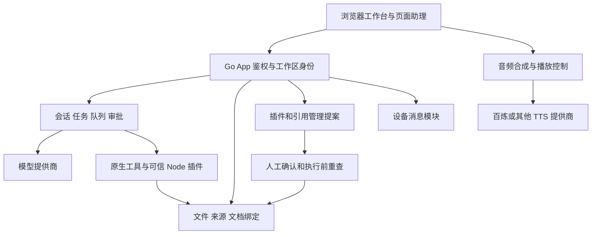

# 软件模块与职责说明

基线：2026-10-17，`0fef6411`。本页是代码职责索引；配图说明用户入口，不能代替 API、持久化或加密验收。关系图为源码推导的工程示意，实际界面见[截图清单](../ui-evidence.md)。

## 分层与依赖

## 服务端模块

| 模块 / 入口 | 职责、输入输出 | 重要依赖与边界 |
| --- | --- | --- |
| `cmd/aide/main.go`、`server.go` | 启动、App 组装、HTTP 路由、构建身份 | 正常发行由启动器与 Compose 管理；截图专用实例不是发行验证 |
| `workflow.go`、`tool_calls.go` | 任务循环、工具调用、队列、文件与命令提案、状态持久化 | 任务授权与工作区快照；SSE 为增量，持久化状态兜底 |
| `context.go`、`provider.go`、`profiles.go` | 上下文预算、摘要、提供商请求、流式输出、usage 与策略 | 每次请求独立窗口；实际用量与估算分别标记 |
| `files.go`、`sources.go`、`workspace_config.go` | 工作区、本地/SSH、来源身份与锁、文件读写 | 可见、启用、可写分别校验；不绕过只读挂载 |
| `document_proposals.go`、`generated_documents.go` | 固定文档来源与目标绑定，生成文件提案；四阶段临时副本发布 | 正式目标按配置解析；未配置四阶段保留缓存旧行为，不扩权 |
| `management.go`、`web/management.js` | 管理工具、四项授权、包预检、人工待办、执行结果 | 管理动作与日常调用分开；执行前重查授权、工作区与来源 |
| `plugins.go`、`plugin_host.js` | 登记、启停、schema、Node handler、插件工具 | 可信代码；语法预检不是安全审计或实际功能测试 |
| `mcp_source.go`、`mcp_http.go` | stdio / Streamable HTTP 发现与受限调用 | 仅允许实时声明为只读的工具；宿主 MCP 不自动继承 |
| `assistant_agent.go`、`assistant_watch.go`、`voice_agent.go` | 助理动作、交办任务、跟进状态、语音意图与历史 | 页面生命周期、身份门、消息授权；代审有独立开关 |
| `tts/`、`tts_catalog.go` | 合成适配、百炼兼容目录、密钥与参数校验 | 云端可用性与地域/配额相关；浏览器负责音频播放及打断 |
| `message_center.go`、`internal/messaging/` | 联系人、消息、群组/通话邀请、文件分块与恢复 | 持久设备密钥、完整指纹、短码冲突校验、逐项同意与拉黑 |
| `knowledge_*.go`、`code_analysis/`、`document_analysis/` | 多来源有界索引、代码关系、原文与 TF-IDF 检索 | 指纹重查、候选静态关系；无通用 OCR/向量库承诺 |
| `config_backup.go`、`paths.go`、`migration.go` | 配置、凭据和数据分层、迁移、备份 | 数据卷与项目文件分离；不要提交令牌和业务数据 |

文件名均相对于 `internal/server/`，另行注明的目录除外。完整导航见[代码布局](code-layout.md)和[架构接口索引](../architecture.md)。

## 三条关键调用链

**交付文档**：任务工具 → 来源与相对路径 → 绑定工作空间配置 → 生成提案/基准哈希 → 审批 → 执行前重查 → 写入 → 系统回执/读回。配置变更后不能把旧提案静默写到新的同名来源。

**插件或引用管理**：`manage_plugins` / `manage_references` → 角色对应管理权限 → 准备包或配置差异 → 工作区人工待办 → 用户确认 → 重查授权与身份 → 执行 → applied/failed/rejected。生成代码只做预检，不在准备阶段执行。已有来源更新保留锁，新引用默认只读，内置来源不由该接口删除。

**助理统筹**：身份通过 → 页面监视任务/提醒/已授权消息 → 生成协调动作 → 启动/排队任务并标来源 → 跟进结果。麦克风收听是显式动作；TTS 代次取消与人声打断独立于任务执行。锁屏/关闭页面停止统筹，不是常驻 OS 后台服务。

## 存储与验证

工作空间、文档绑定、缓存、`/data` 及消息模块状态各有用途。具体目录查[数据布局](data-layout.md)，不能依据截图里的示例路径硬编码。当前截图只验证入口和实际示例内容；外部模型、双设备通信、真实语音、写入冲突与恢复应沿调用链另验，历史测试记录不替代本轮状态。
