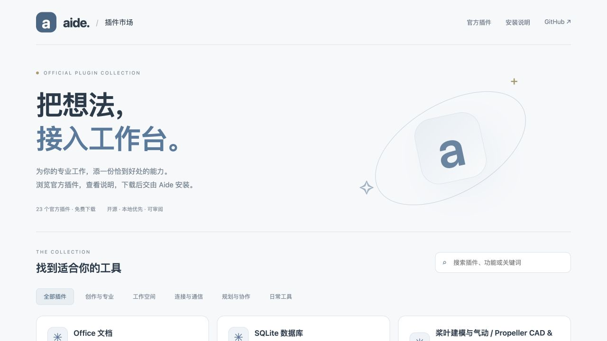

# 官方插件市场 · 第一版

核对日期：2026-10-18。市场目录/网站仓库：[aide-pkg-shop](https://github.com/skyelan1999/aide-pkg-shop)，网站：[官方市场](https://skyelan1999.github.io/aide-pkg-shop/)。运行与验收证据见 `docs/tasks/plugin-market-20261018.json`；网站上线、Aide 源码推送、本机运行、发行版本分别记录。

## 用户入口

Aide「插件」侧栏增加「已安装 / 市场」。保留上传、设置、启停、删除和能力声明；市场显示搜索、分类、版本和安装状态，详情显示最低 Aide 版本、平台、运行依赖、权限说明、许可证、源码、摘要及使用说明。暂无真实截图的插件不伪造截图。

用户在详情确认安装或更新。等待状态不伪造百分比；失败保留原因并允许重试。完成后刷新列表。原已安装同版本不自动覆盖；用户安装了更高版本时市场不提供降级。市场侧栏按24项分批渲染，搜索/分类在本地进行；目录/README 仅作为文本渲染，不执行 HTML。图标来自本地受控 SVG。

网站与客户端读取同一份 `catalog.json`。网站不持有工作台令牌，不探测 localhost，不发起静默安装；用户可下载 ZIP 后上传到 Aide。网站核对下载包大小和 SHA-256，通过后才触发保存。

## 目录发布

官方受控仓库保存目录与不可变命名的 ZIP：`packages/<id>/<version>-<digest-prefix>.zip`。首批23个插件共120983字节，来自审阅过的 Aide 源码 `4dc9a7b0b01fef6ac3550b0b0fcf97db42d45f94`。此版用仓库和 Pages 直接分发小包，未创建或声称存在 Releases 附件。

市场仓库 `scripts/build_catalog.py --aide ../aide --ref <sha>` 只读取该提交的受控插件文件，补充根 LICENSE，按固定排序/时间戳打包，执行宿主的独立入口校验，生成目录与摘要。不得从本地插件注册表、设置或缓存打包。`verify_catalog.py` 核对每个包及 manifest，并只将网站、目录和被引用的包复制到 `public/`。Pages workflow 发布该目录。

`schemaVersion=1`；条目包含 `kind=plugin`、ID、名称、描述、版本、分类、相对包路径、SHA-256、字节数、最低宿主版本、功能要求、平台、依赖、权限说明、许可证、源码、README 和变更说明。第一版仅接收官方受控仓库，未开放第三方自动收录和发布。

## 服务端流程

- `GET /api/plugin-market[?refresh=1]`：获取目录、已安装状态、兼容性、目录修订号和工作空间修订号。10分钟目录缓存；首次/过期浏览先返回已验证缓存或随宿主打包的固定目录，显式 `stale=true`，客户端在卡片展示后再请求刷新；远端失败时仍可浏览。
- `GET /api/plugin-market/{id}/download?revision=<sha>`：下载被审阅的目录版本中的包，返回 ZIP 与 `X-Content-SHA256`。
- `POST /api/plugin-market/{id}/install`：请求包含 `revision/version/sha256/workspace/workspaceRevision`，不接受外部下载 URL。服务端重新匹配目录及工作空间，执行下载、校验与安装/更新。

目录来源固定为 `skyelan1999/aide-pkg-shop`。服务端先取得 main 的提交 SHA，再从同一 SHA 读取目录和包；不会逐文件跟随移动的 main。目录最多200项/2MiB；包最多24MiB，继续沿用现有 ZIP 路径、文件数、展开大小、manifest/入口校验。

首次市场安装在临时目录运行宿主加载探测，检查新增能力与现有插件的兼容；确认通过才登记到现有安装流程。安装收据记住包摘要及市场升级来源。更新复用 `upgradePlugin` 的候选目录、依赖探测、设置/启用/数据保留、备份和恢复日志；市场来源的已安装插件也可从原「升级」按钮检查目录。

`AIDE_DATA/cache/plugin-market/` 保存目录和已核对 ZIP；默认 Docker 对应持久数据卷。每次重用 ZIP 仍核对摘要和大小。缓存最多64包/256MiB，满后明确报错，不自动删除已存在文件。`os.Root` 限定缓存写入范围。

## 权限与边界

安装是用户从 UI 发起的管理动作，不改变助理/Aide 的管理开关，也不绕过引用可见/可写锁。锁定、锁定代际变化、只读沙箱、工作空间或目标插件状态变化、取消、目录修订或摘要变化都会使待执行安装失效。目录文本和模型输出本身不是安装授权。

仅访问固定 GitHub 目录/API 主机；复用限制私网、凭据与重定向的下载客户端。不向 GitHub 转发本机 Authorization/Cookie。客户端也以文本渲染目录内容。

第一版的官方信任来自受控仓库权限、GitHub HTTPS 和固定快照；**尚无独立发布签名**。SHA-256 是内容完整性核对，不能称为发布方签名。Node 插件在可信宿主进程环境执行，并非权限沙箱。依赖和系统权限不会自动安装或开启。平台标签表示宿主支持范围，不等于设备、账号、模型和每个平台的端到端实机验收。

## 回退与后续

市场网站可回退目录提交；Aide 本机可回退镜像/源码，保留数据卷。不要清空插件注册表或共享缓存。已安装插件根据升级备份恢复；回退市场目录不会自动卸载用户插件。

后续可在版本化目录中加入 Releases/CDN 包源、发布签名与密钥轮换、撤回清单、更多版本选择和独立 Skill 条目；当前不宣称这些能力已经实现。

## 私有付费包（源码候选，2026-10-18）

目录兼容 schemaVersion 1，免费条目继续保留在 plugins；私有条目放入独立 privateListings 扩展数组，旧客户端忽略该字段，仍能刷新免费目录。私有条目增加 `distribution=private` 和 `commerce`。不允许私有条目携带公开包路径、字节数或摘要；`marketPackage` 拒绝任何私有下载，从而不将它们加入公开缓存。PjPlan 是 coming_soon 展示条目，尚未开放销售。

`POST /api/plugin-license/device` 在解锁、非只读状态生成/读取 AIDE_DATA 的 32 字节随机安装标识，返回带域隔离的 SHA-256 设备授权码。标识保存在 auth/plugin-license-device，以 0600 独占创建；并发串行化。该标识独立于工作区、网卡和 IP，重装或克隆数据目录不是硬件防克隆保证。

`POST /api/plugin-market/{id}/install` 继续接受公开包的 JSON 请求；私有包使用 multipart：`review` 是含原 revision/version/sha256/workspace/workspaceRevision 与 `license` 的 JSON，`bundle` 是 ZIP。总请求有界，私有 ZIP 不进入公开下载缓存。许可证封装 `{keyId,payload,signature}` 使用标准 Base64；公钥仅取自审阅的官方目录，上传内容不得自己声明信任根。签名原文是 UTF-8 `aide-plugin-license-v1\n` 与 payload 字节拼接，算法 Ed25519。payload 含 schemaVersion=1、licenseId、pluginId、version、sha256、deviceId、issuedAt 与可选 expiresAt（Unix 秒）。签名、安装身份、时间、版本、包摘要与包 manifest 都通过后才复用既有安装和升级事务，原有锁定代次、工作区与插件状态撤销边界仍生效。

当前为永久版本授权的人工交付工具链，授权只在市场私有安装时核验。不在插件运行时强制到期，不替代订单/退款/席位服务，也不删除现有普通 ZIP/源码导入能力。授权安装不是防破解承诺。大版本付费升级由发行者权益决定；具体小版本包需重签，重签不等于重复收款。公钥轮换通过目录保留多把公钥完成。

在线支付、已验证支付回调、权益后台和私有对象存储/短效下载尚未接入。公开网站没有支付密钥、订单或用户访问令牌；本次不改已有历史源码许可。PjPlan 发行工具与流程见其仓库 docs/commercial-delivery.md。

## PjPlan 独立核心（本地技术候选）

开源 Aide 只承担插件管理与安装许可验证，不充当不可绕过的 DRM。PjPlan 新增公开连接层 ZIP，保持原工具契约，把规则调用转给独立本机核心；连接层没有分类表或算法，也不以原明文实现降级。原公开 3.1.0 内容权利不变，未来私有功能另行定版。

核心源码保存在独立私有项目，不进入 Aide、公开插件仓库或市场。核心使用编译进原生程序的 Goja 执行 AES-GCM 加密规则，签名公钥固化在构建中，代码密钥不在插件或二进制里明文分发。核心许可使用独立的 `pjplan-core-license-v1` 签名域，并绑定版本、密文摘要与设备 X25519 公钥；每次调用重新核验。设备私钥依赖操作系统凭据库，缺失时不自动用文件或宿主 activated 设置替代。Aide 安装许可与核心运行许可互不代替。

仅允许 IPv4 本机回环 POST 调用，临时 bearer 连接文件须私下保管。Docker Desktop 需要显式只读挂载和可达性配置；普通 Linux Docker 不能假设宿主回环可达。未自动改变宿主网络或防火墙，未完成三平台系统凭据库、Docker/真实安装验收、系统发行签名或公证。

系统凭据库不等于硬件不可导出密钥，同用户代码、管理员调试和内存提取仍可攻击。离线方案不保证实时吊销、席位计数或时钟回拨抵抗。服务端高级能力、收款与授权后台尚未实现；目录继续 coming_soon，没有真实密钥或商业包公开下载。
