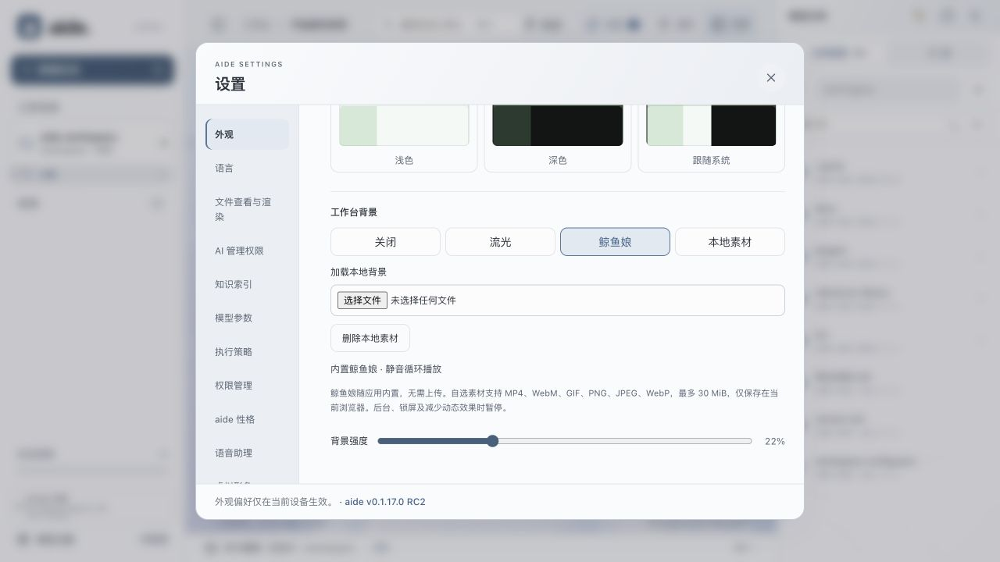
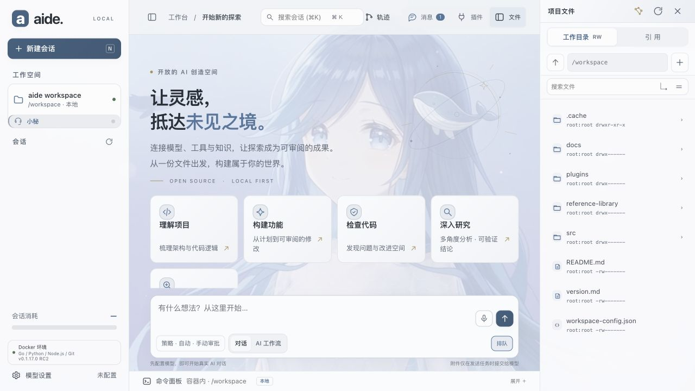
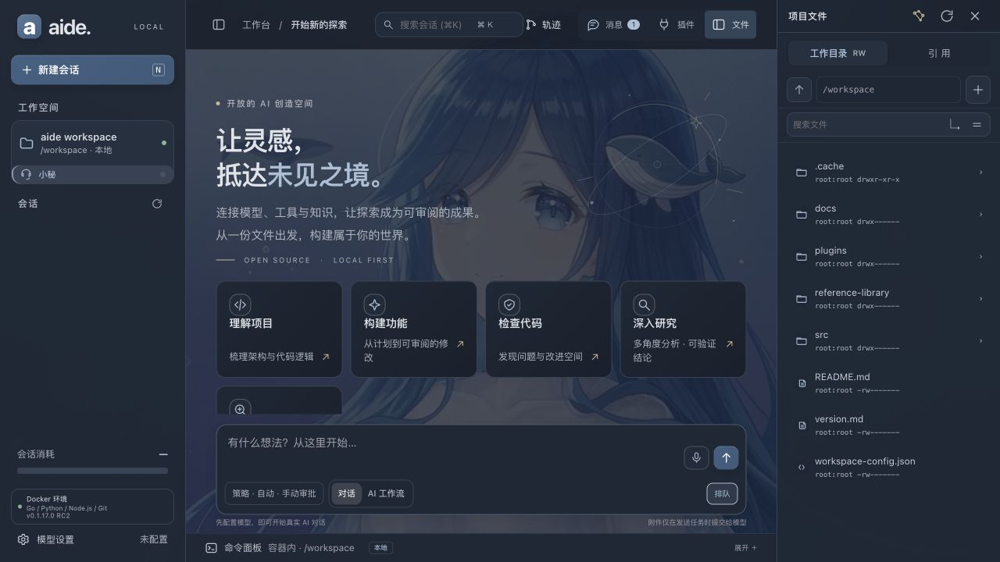

# 内置鲸鱼娘背景

2026-10-17；源码基线 `e2b35b95` 加本任务改动。用户指定将现有鲸鱼娘视频作为 Aide 内置可选背景，而非只用于文档截图。视频原样复制进前端资源，随 `go:embed` 编入应用；不依赖下载目录、外部 CDN、模型服务或浏览器本地素材库。

## 使用方式

打开 **设置 → 外观 → 工作台背景 → 鲸鱼娘**。选择立即生效，仍可调节背景强度，也可切换关闭、流光或自选本地素材。新安装默认仍关闭，不覆盖已有背景偏好。选用内置视频不会删除用户上传的文件；“删除本地素材”只作用于浏览器上传素材，不删除随应用安装的视频。

视频静音循环、内联播放，不带播放器控制；后台、锁屏或减少动态效果时暂停并隐藏动态层，恢复后按原有规则继续。它不是助理虚拟形象，不接收语音或任务状态，也不会产生模型费用。

## 实现与素材

- 偏好值 `background=whale` 由 `settings-init.js` 持久化和跨标签规范化，原有 off/aurora/local 保持兼容。
- `workbench-background.js` 直接加载同源 `/backgrounds/whale-girl.mp4`，不先写 IndexedDB，不把静态路径当作 Blob URL 回收。
- 视频为用户本次指定的已有素材，3,307,020 字节，未重新生成或转码。文件校验和、截图原图及运行边界见[清单](images/builtin-whale-20261017/manifest.json)。
- 本次更新增加一个可选项，不自动切换用户当前工作台设置；需要将此源码构建到运行服务后才能看到新入口。

## 实际验证

已在专用真实源码实例中选择内置项，确认视频可解码并播放；重新打开页面仍保留选择。实测“减少动态效果”使视频 paused=true 且隐藏，恢复系统设置后继续。实际编译的 Go 服务返回 `video/mp4`，全量内容与原素材 SHA-256 一致，Range 请求得到 206。

预览的一次刷新出现独立的 highlight.js 加载异常；新页面无该控制台错误，背景偏好和播放仍保留。未修改高亮组件，也不据此宣称所有页面刷新问题已经解决。用户正在使用的服务未重建或重启，三平台安装及发行包未在本轮验收。
