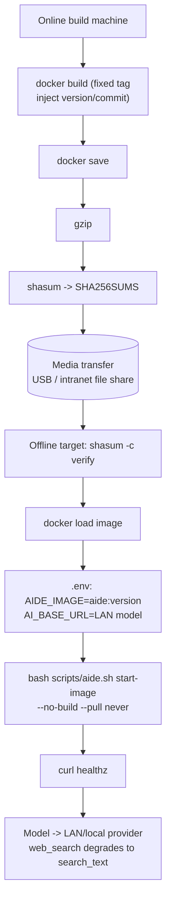

# Installation and first launch

> **Startup configuration:** `.env` is the local source of truth. `start.command` → `scripts/aide.sh` → Docker Compose, using `AIDE_PORT` (default 8097) and `COMPOSE_FILE`. Temporary review ports are not user startup entries. See [workspace mount modes](../workspace-paths.md).

[简体中文](../installation.md) · **English**

aide combines AI and an integrated work environment. The RC8 Release includes a linux/arm64 Docker image and launch packages for Apple Silicon macOS, Windows ARM64, and Ubuntu ARM64. Launchers automatically fetch and verify the matching image on first start. An amd64 image has not been built. The installer checks prerequisites, initializes first-run settings, verifies image archives, and starts the application. It does not silently install host software, request sudo, overwrite `.env`, or delete volumes.

## 1. Prepare the host

| Platform | Requirements | Notes |
| --- | --- | --- |
| Apple Silicon macOS | Docker Desktop, Git, Python 3 for image verification | Start Docker and wait for the engine; release-image target is linux/arm64 |
| ARM64 Linux | Docker Engine, Compose v2, Git, Python 3 | Current user must be able to access Docker |
| x86 Linux/macOS | Equivalent prerequisites | Build from source instead of importing the ARM archive |
| Windows ARM64 | Docker Desktop with an ARM64 Linux engine | Use the Windows ARM64 launcher; not validated on a Windows device |
| Windows x64 | Docker Desktop, WSL2 | RC8 has no linux/amd64 image; build from source |

Official installers: [Docker Desktop](https://docs.docker.com/desktop/), [Docker Engine](https://docs.docker.com/engine/install/), [Git](https://git-scm.com/downloads), [Python](https://www.python.org/downloads/). Check Docker Desktop licensing for your organization. aide is MIT-licensed. Host Go is unnecessary. Development checks additionally require Node.js and Python 3.

## 2. Get the matching source

```bash
git clone https://github.com/skyelan1999/aide.git
cd aide
git checkout v0.1.14.0-RC8
bash scripts/install.sh --check
```

A source ZIP is also usable for image installation. Keep its scripts, Compose file, and `version.md`: an image tarball is not a standalone desktop installer.

Download `aide-<tag>-full-linux-<arch>.zip` from a GitHub Release for the complete runtime package. After extraction, run `start.command` on macOS, `aide-launcher.exe` or `start.bat` on Windows, or `start.sh` on Ubuntu. The launcher verifies and imports the bundled Docker image, so first launch does not need to download the image. The same ZIP can be uploaded from Settings > Software Update on an existing Release installation. If macOS automatically extracts it, select the extracted full package folder; the updater locates and verifies the payload under `docker-images/`. Lightweight platform launcher ZIPs do not include the image; on first launch they download and verify the approximately 500 MB image from the same GitHub Release. macOS/Linux transfers resume after interruption; native Windows removes its owned partial download and retries on the next start. The browser opens only after the image is verified and the service is healthy. Lightweight ZIPs cannot be used for A/B updates.

Release launchers read the persisted host port. On first launch, if the default port is occupied, they select and save the next available port. Windows offline and full packages run a host-side port monitor that applies Settings port changes by updating the Compose mapping and restarting the service; `/data` and workspace volumes remain shared. Source development startup uses the repository `.env` and does not enable the Release package's automatic upgrade flow.

| Asset | Launch | Target |
| --- | --- | --- |
| `aide-v0.1.14.0-RC8-macos-arm64.zip` | Double-click `start.command` | Apple Silicon macOS |
| `aide-v0.1.14.0-RC8-windows-arm64.zip` | Double-click `start.bat` | Windows ARM64 |
| `aide-v0.1.14.0-RC8-ubuntu-arm64.zip` | Run `./start.sh` | Ubuntu ARM64 |
| `aide-<tag>-full-linux-arm64.zip` | First launch or upload in Settings for update; contains launchers and arm64 image | Docker Engine is linux/arm64 |
| `aide-<tag>-full-linux-amd64.zip` | First launch or upload in Settings for update; contains launchers and amd64 image | Docker Engine is linux/amd64 |

Launchers check Docker engine architecture, SHA256, and image ID, then start without build/pull. The architecture in the complete package name describes its Linux Docker image; it contains launch files for all host platforms. On a builder with matching architecture bases, run `scripts/package-release-assets.sh <tag> <image> [output-dir]`; upload generated assets with `scripts/publish-release-assets.sh <tag> <output-dir>` after pushing the tag.

## 3A. Install a released ARM64 image

Use this only when the [Releases](https://github.com/skyelan1999/aide/releases) page has image assets. Download the image and SHA256SUMS from the **same release**, and replace `<matching-version>` below with the exact asset filename:

Download `aide-<matching-version>-linux-arm64.tar.gz` and `SHA256SUMS` from [Releases](https://github.com/skyelan1999/aide/releases), placing both in `docker-images/`:

```bash
bash scripts/install.sh --image "docker-images/aide-<matching-version>-linux-arm64.tar.gz"
```

The script verifies SHA256, loads the image, checks its architecture, and starts with `--no-build --pull never`. A failed checksum, missing tag, or incompatible architecture stops installation. Existing `.env` is preserved; inspect it if you are upgrading.

## 3B. Build the selected source checkout

```bash
bash scripts/install.sh --source
```

Use a Git checkout for source identity. First builds download base images. If `.env` does not exist, the installer creates it, makes `context/`, and restricts local directory browsing to the repository. It does not overwrite an existing configuration.

## 3C. Offline / air-gap install (target machine has no internet)

For fully isolated intranet/disconnected environments. **Golden rule: on the target machine only `docker load` the imported image and launch it with `start-image`; never run `start`** — `start` triggers `docker build`, which pulls base images and will fail or hang offline. Compose sets `pull_policy: never` as a second guard so a bare `compose up` cannot pull; a missing image fails fast instead of hanging on a fetch.

Three delivery artifacts (all from the same version tag, e.g. 0.1.14.0 RC1):

1. Matching-tag source (or a source ZIP with the Compose file, scripts, and version.md);
2. Self-contained image archive `aide-<matching-version>-linux-aarch64.tar.gz` (use `amd64` on x86; Docker reports the architecture as arm64 internally while archive filenames uniformly use aarch64/amd64);
3. A single `SHA256SUMS` manifest in the same directory (legacy per-archive `*.sha256` files are deprecated).

```bash
# On the offline target: verify -> load -> configure -> start
cd aide                                    # matching-tag source root
shasum -a 256 -c docker-images/SHA256SUMS  # verify integrity; stop on mismatch
docker load -i "docker-images/aide-<matching-version>-linux-aarch64.tar.gz"
# Copy .env.example to .env and set:
#   AIDE_IMAGE=aide:<matching-version>
#   AI_BASE_URL=http://<lan-model-address>
#   AIDE_WEBSEARCH_URL=        # leave empty: web_search degrades offline
bash scripts/aide.sh start-image           # = --no-build --pull never; never builds/pulls
curl -fsSk https://127.0.0.1:8097/healthz    # health check (-k skips self-signed cert)
```

Offline behavior notes:

- **Point the model at a LAN/local provider** (intranet gateway, local vLLM, etc.); `AI_BASE_URL` must not point to the public internet.
- **`web_search` is unavailable offline**: with `AIDE_WEBSEARCH_URL` unset the tool returns "offline environment, online search unavailable; use search_text to search locally" — it makes no outbound call and does not crash. Use local `search_text`, or self-host SearXNG on the intranet and put its URL in `AIDE_WEBSEARCH_URL`.
- The frontend, drawio, and Office parsing are all bundled into the image (no CDN/external fonts); the image is self-contained with the runtime toolchain.

Offline deployment flow:



## 4. Build, test, and release gate (source development)

The [standard launcher contract](../architecture/launcher-contract.md) separates source compilation from everyday startup.

| Command | Source package | Release package |
| --- | --- | --- |
| `start` | Reopen a healthy instance or start a validated installed image; never compile | Reopen/start; import the packaged image when needed; never compile |
| `build` | Incremental runtime build, plus native Windows host on Windows; verify and automatically start | Not shipped |
| `stop` | Cancel work, stop owned helpers/plugins/containers and clear connected pages | Same |
| `clean` | Remove owned cache/images, then build | Not shipped |
| `docker_clean` | Remove this installation's Docker environment, preserving user data | Same; retain offline archive for recovery |
| `verify` | Report version, Docker/Compose/configuration and runtime health | Same |
| `release` | Dispatch existing delivery workflow for a clean, tagged, gated main commit with reviewed notes | Not shipped |

Use `bash build.sh` after cloning or `git pull`; use `bash start.sh` for everyday access. On macOS use `.command`, on Windows use `.bat`. Windows commands call the native C++ executable; the first Git `build.bat` bootstraps it inside Docker. No host PowerShell/Python/compiler is required. Legacy build environment variables cannot make start compile. Builds use an installation-scoped Buildx cache and image; the first build needs BuildKit, base images and dependencies. Shared host image tags alone do not guarantee an offline build.

For full race/vet checks use `python3 scripts/agent-route.py verify full`; publication continues to use the existing version and delivery gates. `AIDE_RUN_TESTS=1 bash scripts/aide.sh build` enables the image build's full Go tests.

**Runtime pip layer caching and offline (#46)**

- The runtime stage puts its stable layers (system user + Office-parsing pip dependencies) **before** the `COPY` of the business binary, and the binary (which changes on every code/frontend edit) last. Thus a Go/frontend change only invalidates the final COPY layer; the pip layer stays `CACHED` and never re-downloads online. The shipped image is self-contained and never pip-installs at runtime.
- Dependencies are pinned (python-docx==1.2.0, openpyxl==3.1.5, python-pptx==1.0.2, ezdxf==1.4.4); pip downloads are reused via a BuildKit cache mount.
- **Offline / air-gap first build**: on a networked machine run `bash scripts/prebuild-wheels.sh` to pre-download the manylinux/arm64 wheels into `docker/wheels/`, carry them to the offline build machine, and build with `--build-arg PIP_OFFLINE=1` (`pip install --no-index --find-links=/wheels`, fully local, zero network). `docker/wheels/` ships with only `.gitkeep`; online builds ignore it.

## 5. Select your directories

Use existing paths, preferably absolute:

```dotenv
AIDE_IMAGE=aide:<matching-version>
AIDE_PORT=8097
AIDE_WORKSPACE=/absolute/path/to/project
AIDE_CONTEXT=/absolute/path/to/references
AIDE_LOCAL_ROOT=/absolute/path/to/projects
```

For subsequent image runs use `bash scripts/aide.sh start`. Apply custom source changes with `bash scripts/aide.sh build`; it selects an installation-scoped source image instead of overwriting a published release label.

The workspace and local roots are writable. References mounted at `/context` are read-only. Sessions, keys, rates, and configuration are in the `/data` volume; development caches are in `/home/aide`. An image archive is not a data backup.

## 6. Sign in and connect a model

Open `https://localhost:8097`. macOS opens a token-authenticated URL automatically; Linux uses xdg-open when available. Without a desktop opener, retrieve the token locally:

```bash
docker compose exec -T aide cat /data/auth/access-token
```

Paste it into the login form. Never share the token or token-bearing URL. This is not your model API key.

> Since 0.1.11 the main port is **HTTPS**: on first start a loopback-only self-signed certificate is generated in the data directory. The browser warns "your connection is not private" — click **Advanced → Proceed to localhost**. Use `localhost` rather than `127.0.0.1` (the WebAuthn RP ID does not allow IP literals). For CLI checks use `curl -k https://...`. Offline installs are unaffected (the cert is generated locally). See [Security: HTTPS/TLS entry hardening](../security/tls.md).

Open **Model settings**, set a Base URL, model ID, and provider key. Installation makes no model calls. Test with a non-sensitive prompt before using private material. In a language-enabled build, change the interface using the login selector or **Settings → Language**.

## Troubleshooting

| Symptom | Action |
| --- | --- |
| Docker unavailable | Start the engine and rerun `--check` |
| Port 8097 in use | Change AIDE_PORT; do not stop unrelated services |
| Missing bind path | Check `.env`; existing configurations are not auto-corrected |
| Missing image tag | Match source/image versions and AIDE_IMAGE |
| Checksum mismatch | Stop and download matching assets again |
| dev/unknown version | Use a release image or build from the Git checkout |
| Model requests fail | Check provider settings, permissions, and network |
| Old conversations missing | Check Compose project name and the original data volume |
| Language selector missing | Check the running image version; use the current release image |

`status`, `logs`, and `stop` are supported by `scripts/aide.sh`. Do not use `docker compose down -v` as an ordinary upgrade step. See [Operations](../../HANDOVER.md).

### Local offline voice (optional)

The image bundles the sherpa-onnx synthesizer (Apache-2.0, offline); Chinese voice models are externalized
to `/data/tts/` to keep the image small. On a networked host run `scripts/tts-setup --model huayan` inside the
container to download the default female voice (~67MB, SHA256-verified); for air-gapped setups place the model
manually per [Local offline TTS](../en/security/tts-local.md). After install + restart, pick "Auto" in Settings →
TTS engine to prefer local offline synthesis (text never leaves the machine).

## Actual post-start workbench（源码 0fef6411）

Captured from an isolated source instance on 17 October 2026. This is not an installer, release-image or multi-platform acceptance test. Use your configured AIDE_PORT, not the temporary screenshot address.


[Environment and all original captures](../ui-evidence.md).

## Windows Release manual slot activation

The Windows host updater accepts both `-` placeholders and legacy empty optional command fields, so activating a previously installed slot does not require a package download. Startup paths are quoted as one argument. The updater waits only for the launcher process, rather than its persistent monitor descendants, then verifies both the running container image ID and health before reporting success. Failed activation restores the previous marker and invokes the same launcher to recover it. Compose directory overrides remain in effect.

For containerd archive imports, only a unique reference from the verified import receipt can resolve a rewritten local image ID; the platform is checked and the canonical ID is synchronized after success. An exclusive OS file handle provides updater ownership and releases automatically on process exit. An old empty lock directory is recoverable. If an older updater is still running when replacing the scripts, restart Windows before launching the repaired version; never remove locks while activation is in progress.

The [Windows manual-switch task](../tasks/release-manual-switch-20261026.json) separates PowerShell execution with synthetic adapters from native Windows/Docker Desktop acceptance. The former does not establish the latter.

### Windows single-file resident host

The [native Windows host](../../native/windows-launcher/README.md) distributes one
EXE for lifecycle commands, port coordination, A/B updates and embedded directory/
LAN components. BAT shortcuts call it directly; host PowerShell/Python is not a
runtime dependency. Docker Desktop and Compose remain required. Embedded helper
components are SHA256-verified and automatically cached, not separate installers.

The controller runs in the current user's login session and supervises port/update
workers of the same EXE. Container mutations use one installation lock;
`aide-launcher.exe host-status` reads task state independently. `stop` ends this
installation's background tasks and containers, retaining data; `host-stop` only
stops host tasks. No Windows service or login startup entry is registered.
Legacy migration requires unambiguous same-root ownership; select an intended
orphan project explicitly with `--project NAME`.

Building needs existing Go 1.26+, Python and a local Linux tool image. Portable
fault tests and cross-compilation do not establish Windows Job/NTFS ACL behavior,
Docker Desktop, real migration/A/B updates, ARM64 or macOS acceptance. Preserve
`.env`, `.aide-data` and workspaces. Unconfirmed termination leaves a blocker;
restart does not silently clear unknown unsafe state. See the implementation
notes for build commands, diagnostics and remaining platform checks.
