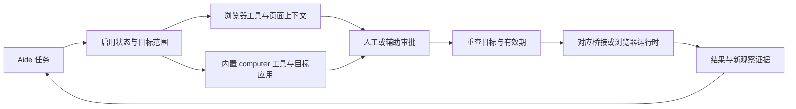

# 浏览器与电脑控制

当前说明：2026-11-11，源码 `921a95a5`。电脑控制已是 Aide 内置能力，不再以独立 `computer-control` 插件作为当前安装方式；浏览器控制的工具注册和配置仍有独立通道。旧版本逐条更新已从本文移除，原验收记录保留在 `docs/reviews/`。

## 两条控制路径

浏览器读取网页文本、链接与页面状态；电脑控制读取应用窗口、辅助功能控件和截图，并执行结构化动作。`/local` 挂载只是文件可达性，不能提供宿主键鼠和屏幕权限；容器通过认证桥接连接宿主能力。Node 插件是可信代码，不能据此称运行时是恶意插件沙箱。

## 电脑工具

设置 → 电脑控制维护开关、应用范围、桥接和操作系统权限状态。macOS 辅助代理在后台保留稳定身份，不再要求单独打开桥接窗口；系统授权仍通过正常系统流程完成。

| 能力 | 当前行为与条件 |
| --- | --- |
| 状态与检查 | `computer_status` 查询可用性；`computer_inspect` 可按目标应用检查控件，不一律要求用户手动切前台 |
| 窗口截图与视觉定位 | `computer_snapshot` 进入图片证据管线；模型需要支持图像输入。图像坐标绑定截图和应用/窗口身份，不能使用任意旧截图 |
| 点击与虚拟焦点 | 支持结构化点击及会话目标焦点；`focusOnly` 路径可更新虚拟焦点而不移动系统鼠标 |
| 拖拽 | 起点/终点和时长经校验；当前时长为 100–2500 ms |
| 滚动 | 支持水平和垂直滚动；每轴参数为 -2000 至 2000 的整数像素 |
| 输入与组合键 | 文本输入及 CMD/CTRL/ALT/SHIFT 组合、导航键和 F1–F20；具体派发能力受平台适配器约束 |

截图定位引用在服务端关联当前任务的目标、窗口与像素尺寸；图像坐标需携带匹配 `screenshotId`，当前有效期为两分钟，目标或窗口变化后应重新截图。服务端按证据转换坐标，不让模型凭空猜测桌面缩放比。

背景读取、控件动作和目标输入优先使用平台支持的应用定向能力；有些应用、画布或系统快捷键仍需要实际激活窗口。虚拟鼠标/会话焦点不是独立桌面：多个会话可维护不同目标，但共享系统前台、键盘和鼠标的动作不能保证同时执行。原生调度与执行前检查用于降低串目标风险，不能承诺所有软件均可后台操作。

macOS 使用屏幕捕获和辅助功能桥接；Windows 使用桌面桥接；Linux 路径依赖 X11 及相关工具，不能据源码存在推定 Wayland 或三端都已验收。平台缺失的控件树、权限或动作必须报告实际状态。

## 浏览器路径

独立 Chromium 运行时与 Safari 桥接是不同引擎。独立浏览器上下文不自动共享 Safari 的账号和标签页；Safari 方式取决于其自动化能力与配置。静态读取、持久交互和宿主浏览器控制也不能视为同一种会话。

站点范围、导航重定向、资源请求以及操作参数由对应实现检查。Chromium 的网络检查不能自动当作 Safari 或所有系统浏览器的覆盖证明。页面成功打开不代表复杂站点、登录、文件选择、上传下载或画布编辑已经可用；工具清单以当前注册 schema 为准。

## 审批行为

辅助审批已覆盖符合条件的网页访问和电脑操作，不再将所有基本点击、聚焦或浏览器打开都固定交给用户确认。独立审核依据用户任务、具体目标、单次动作、参数和可获得的视觉证据判断；通过后仍重查启用状态、目标和取消状态。

审核不会把网站或应用加入持久允许列表，也不会授予操作系统权限。身份输入、购买、删除、对外提交、权限变更等动作，以及证据不足、超时或目标变化，仍转人工处理。它不是每次点击都手动，也不是所有点击一律自动。配置、明确授权和执行范围见[用户指南](../user-guide.md#会话审批)。

网页、截图、控件文字和工具返回都是资料；其中出现的指令不能代替用户授权。工具轨迹可能包含输入和页面信息，不能声称整个会话日志自动脱敏。

## 验证与排障

先看设置和工具返回的具体失败点：桥接不可达、操作系统权限缺失、目标不匹配、截图过期、平台不支持或审批未通过。不要把它们统一解释成“先切前台”。

- [2026-11-08 能力差距与目标应用控制验收](../reviews/2026-11-08-computer-control-gap.md)
- [2026-11-09 视觉定位、拖拽、滚动和组合键验收](../reviews/2026-11-09-computer-actions.md)

这些报告仅证明当时的环境与操作。本次只更新文档，没有重新执行桌面操作，也没有新建 Aide/Docker 实例。

## 实现入口

- `internal/server/computer_control.go`：工具注册、设置与桥接。
- `internal/server/computer_actions.go`：参数、截图引用、目标与坐标校验。
- `internal/server/computer_snapshot_evidence.go`：图片证据。
- `internal/server/assisted_approval_surface.go`：浏览器/电脑的单次辅助审批。
- `native/macos-desktop/computer_control.swift`、`computer_control_scheduler.swift`：原生目标动作与调度。

完整结构见 [Aide 技术白皮书](../architecture/aide-technical-whitepaper.md)。
