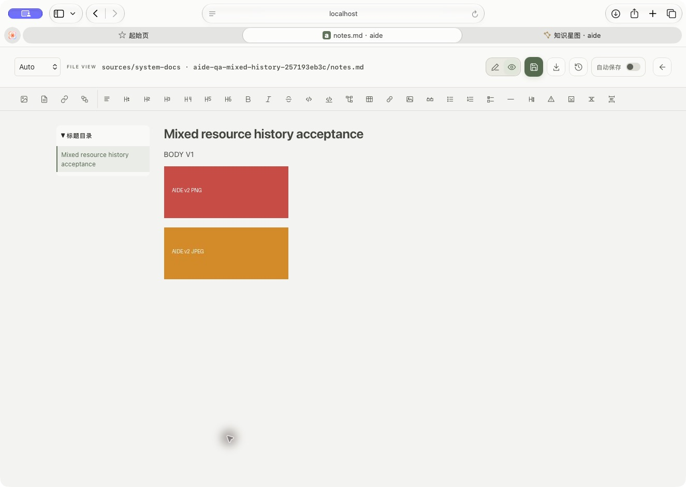
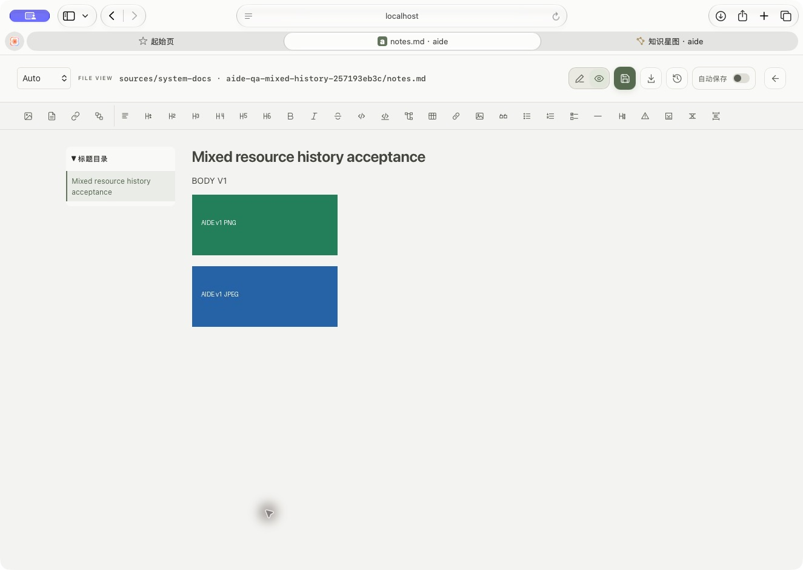

# 当前工作台推理写回与混合资源历史验收

本批继续[原连续工作目标](../../tasks/aide-continuity-knowledge-20261009.json)，不缩减原12条工作流。任务为[当前验收](../../tasks/continuity-history-current-20261016.json)。Windows由用户验收，真实向量服务测试暂缓。

## 推理强度

当前9999实际Safari中创建两个专用空会话，分别通过控件保存A为high、B为medium。API与规范磁盘JSON逐项一致，revision均为1，runs均为空。完整刷新后B仍勾选中，切回A仍勾选高。没有发送模型请求。两会话经标题、身份和空任务检查后删除，原会话文件、设置（除编号计数）、认证与来源均保持一致，编号45→47保持单调。没有再次复测此前已验过的全部五档十次写入。

## 复现与修复

专用Markdown包含PNG和JPEG，相对路径固定。建立V1、V2后，通过实际历史界面恢复V1。磁盘完整字节已恢复，但Safari仍显示V2图片，正文则是V1，证明此前只核对正文或文件字节不足以证明预览同步。

现在恢复回执的操作编号用于当前文档资源URL的版本参数，并先于预览输入事件设置。主编辑器和独立文件页均使用同一机制，原相对引用、来源与鉴权保持。正常重绘保留URL，不按每次键入重拉图片；draw.io修改后的资源版本也保留到后续重绘和导出。

定向回归先复现失败，再验证两个恢复回调的顺序、URL变化、稳定重绘及来源/路径/认证参数。实际Safari进一步采用更严格的场景：正文保持V1，仅把PNG/JPEG改为V2，再恢复旧版。预览立即显示两张V1图片，没有刷新页面。

恢复后的三个文件均与最初V1完整字节相同，原始字节API也逐项相同。历史连续读取保持5版，没有追加重复版本；备份统计为6个去重对象、5754字节。专用目录经逐项内容与归属校验后移除，原目录列表、会话、设置、认证和来源精确保全。只保留自有合成历史，没有执行全局历史清理。

## 账本核对与边界

[历史管理任务](../../tasks/markdown-history-storage-ui-20261015.json)已有实际Safari的ZIP导入/合并、保留策略和对象清理预览/取消证据，主目标仍把这些列为未验，现已纠正。不可逆保留/清理没有执行；本批也不证明用户SSH主机的整版恢复或异常中断恢复界面。

源码为`6ac147aa`，本机经指定start.command更新，镜像`551eff0003ba`。完整离线包内外校验、本机导入和新数据目录无构建/拉取启动通过；另一设备导入未运行。最终全量门禁与main推送按[脱敏收据](evidence/continuity-history-current-proof.json)记录。原12条工作流继续保持进行中。

Final gate: all105 checks passed, including Go race/vet. Exact fingerprint `b591063007169e65ef75e2eb84e118ba404d65b76b947e7c784f460b3cf4ca44`, verified tree `34062b9689c3d1435982bf43c24d4f4e2addadda`. Reasoning observations used the prior52e943e1e8c3 runtime before this batch deployed the resource-only fix551eff0003ba; session-selection implementation is unchanged. Clean-main delivery pending.

Delivery confirmed: clean-main scoped release gate passed; push exit0 and exact upstream `418199649a3cd61c9299094b0e84a90974154dbb` verified. Local9999 and full offline bundle updated. No formal tag/Release. Original12 requirements remain active.
