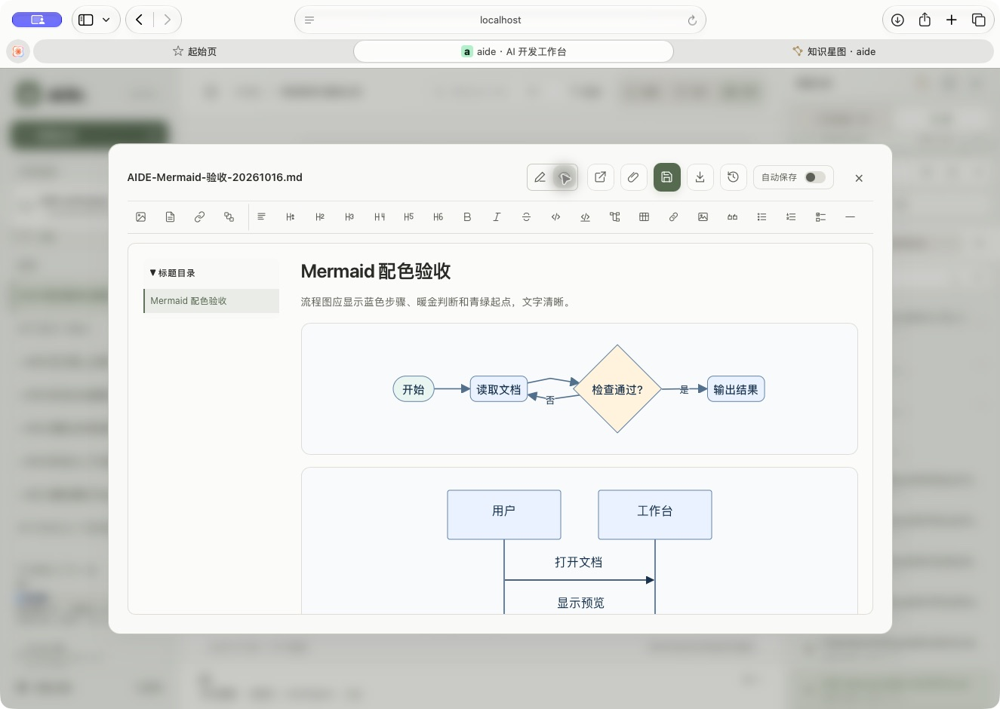

# Markdown Mermaid 黑色渲染修复

工作台 `style-src self` 禁止内联样式，而 Mermaid 生成的 SVG 用内嵌样式定义节点、文字和连线。Safari 在同策略页面上复现修复前节点为 `rgb(0,0,0)`；之前只有配色配置的模拟测试，无法发现浏览器 CSP 实际拦截。

保持服务端 CSP 不变，通过构造式样式表和 CSSOM 应用 SVG 样式；临时测量阶段同步安装作用域样式，默认使用 SVG 文字标签，避免 foreignObject 字体尺寸差异。序列化 SVG 仍保留样式用于导出；重复渲染、主题切换、错误和移除均清理样式表，再次挂载可恢复。浏览器需支持构造式样式表（当前 Safari 已实测）。

实际 Safari 严格 CSP 页面验证流程图、时序图、类图、状态图，浅→深→浅切换、作者 classDef 配色和移除后样式表数量恢复均通过；放大浏览可读，恢复100%。实际9999工作台从 `start.command` 启动，打开临时 Markdown 文件验证彩色预览，随后关闭并移除自建文件、刷新列表。未新增标签页，原会话和“舒适·跟随系统”保留；配置、认证、会话与挂载摘要一致。

[明暗组件收据](evidence/mermaid-csp-receipt.json)记录真实计算颜色、运行身份和完整离线包。运行/打包只在移动硬盘目录进行，旧BD镜像和包保留。接收设备、原生Windows/amd64和实际PDF导出未验；不能将组件验收当作所有Mermaid语法或所有浏览器兼容性保证。

本批源码与完整包已冻结，最终 main 全量检查与推送结果见[任务账本](../../tasks/mermaid-black-20261016.json)。

干净 main `20fd013531b8c9007eb43c52b7706524a1b5482a` 的102项 full 检查全部通过，服务端竞态回归679.550秒；release-check通过，main及任务分支推送后精确核对远端一致。最终只补文档收据，不改变已验证程序。验证指纹：`8892eb3d66482561f0d157a3a94caa3def1d36212436a4e88ce49809577e10f7`。
