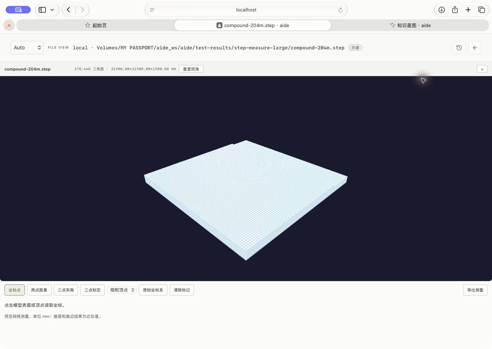
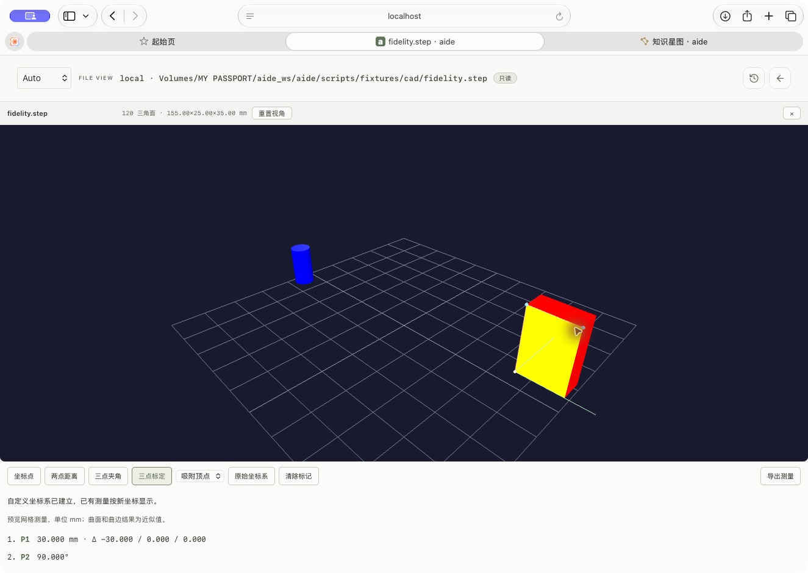

# 大型 STEP 完整曲面、测量与坐标标定

用户要求大型 STP 正常预览，支持测量和坐标标定，并明确要求按专业 CAD 的完整模型效果处理。线框不作为最终替代。代码分批实现：`22bad28b` 的原生转换与测量，以及 `e7342840` 的 CAD 专用凭据隔离，另由 `f367c6b3` 拒绝打开命名管道等非普通输入并补齐错误翻译。已整合远端 Windows 启动参数与存储所有权修复，并让 CAD 凭据目录遵循同一容器用户所有权规则（76fcf066/7a4a49c5）。最终 main 门禁和远端状态在任务账本记录。

## 实际验证

| 范围 | 结果与边界 |
| --- | --- |
| 204 MiB 几何样例 | 214,184,920 字节，30,870 个立方体实体；370,440 个预期三角面、185,220 个面及 31,900×31,900×1,900 mm 尺寸完整匹配。实际 9999 接口分 24 批返回，全程约 57.5 秒，工作台实例未重启；最终转换器的 Safari 页面也实际显示全部预期网格。 |
| 装配与颜色 | 嵌套装配旋转/平移、零件红蓝色及单独面的黄色均匹配；原生样例 2 个零件、9 个面、120 个三角面，包围盒为 [-55,-5,0]–[100,20,35] mm。额外构造带自身位置的 XCAF 自由根，校验位置不会重复叠加。 |
| 单位与法线 | 原生与浏览器兼容路径均验证毫米、米、英寸样例统一为 1000 mm；原生法线有限、归一化且与三角面方向一致。 |
| 测量 | 最终本机页面测得 30 mm 边长和 90° 夹角；三点建立新坐标系后，原 ΔZ=-30 转为 ΔX=-30，距离不变。导出 JSON、恢复原坐标系及清除标记均通过。测量基于预览网格，明确标注近似精度。 |
| 生命周期 | 实际 Safari 取消 204 MiB 重载后，转换子进程为 0、临时上传目录为 0；关闭/换文件释放查看器资源。Worker 批次确认、截断、大小、来源、内存错误和监听清理回归通过。 |
| 桌面与主题 | 工作台弹窗和独立文件页通过；专业/舒适/经典各明暗主题实际打开并保存截图。400% 缩放下，工具换行、滚动及键盘定位可访问；这不是 390×844 实机移动端验收。原主题“舒适·跟随系统”和 Safari 100% 缩放已恢复，未增加标签页。 |
| 隔离与数据 | CAD 容器 4 GiB、一次一个转换、私有网络、无宿主发布端口，仅只读挂载 CAD 派生凭据。实测该凭据不能登录工作台 API，登录凭据不挂载给 CAD 服务。既有会话、认证、配置和工作区挂载逐项摘要一致。 |

原生样例最高容器采样约 2.206 GiB，释放 STEP 交换读取器后明显下降；这是采样观察，不是精确峰值或所有模型的保证。原先浏览器方案虽返回 success 却没有网格；另一整件原生转换尝试曾超过 5 GiB。这些失败已保留为研发证据，没有算作通过。

[测量导出](evidence/step-metrology.json)与[脱敏验收收据](evidence/step-preview-receipt.json)保存尺寸、单位、运行身份及具体边界。原始日志、压力输入和六种主题截图保存在本机 `.agent-state/step-measure-large/`，不随程序分发。

## 分发与未验证项

内外层摘要、实际 Docker 导入及隔离空目录首次启动均已通过；新装同时验证完整模型、CAD 专用只读凭据和禁拉取方式，未替换本机正式数据。

当前为 `linux/arm64` 本机候选，沿用既有版本，不创建版本标签或正式 GitHub Release。完整离线包包含应用、依赖、新版 Compose 和启动/维护脚本；原生 CAD 服务与工作台使用同一个应用镜像。内外摘要、实际镜像导入、空数据目录启动及最终 main 门禁的结果见[任务账本](../../tasks/step-measure-large-20261016.json)及镜像目录说明。

用户的原始复杂 200 多 MiB 模型没有提供，本次按用户要求生成样例；不能据此声称其原文件、任意复杂曲面、透明材质、PMI、精确 B-rep 计量或所有专业 CAD 功能都已兼容。接收设备导入、Windows 原生启动和 amd64 运行未实测。384 MiB 输入与三百万三角面预算仍是明确边界，超过预算会报错并释放未完成场景。

回滚保留原 `598b0da06a45` 应用镜像、完整包和旧卷。只回退程序时先停止 CAD 服务，再以保留镜像启动 `aide` 服务；不删除 `.aide-data/`，不恢复旧数据覆盖当前会话。具体身份和发布状态见任务记录。

清理只涉及本任务创建的可再生 CAD 实验缓存、临时文件列表样例及已另存验收资料的导出，逻辑大小约 891 MB；保留规范的 204 MiB 输入、研发日志、用户数据、原598回滚包和旧卷。未交付的020/c97/047中间镜像包已移除。

## 最终 main 验证

干净的 main `8c18165cf0ddf7251a1960e8f3f0894e5424856b` 完成 102 项 full 检查，全部通过；其中服务端竞态回归用时 668.615 秒，原生 CAD 装配、颜色、全表面、单位和法线检查通过。`release-check step-measure-large-20261016` 通过，main 与任务分支均已推送，远端 main 精确核对一致。最终收据提交只修改任务、评审及证据文档，不改变已验证的程序输入。

验证指纹：`1ba33eb09e5c9fc7c0752fd5c887ad038f668665bf6dad70bf14578f398d2d52`。本次不升版、不打标签、不创建正式 Release；其余主目标工作流仍按原账本推进。
