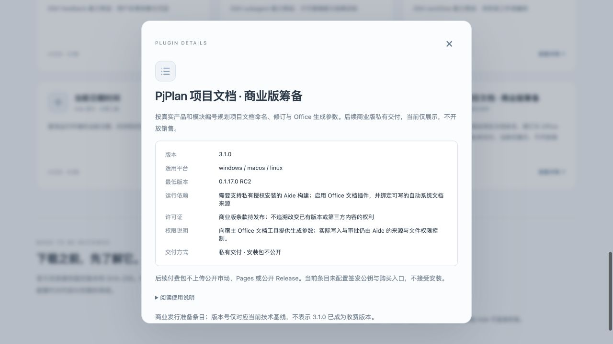

# 私有付费插件交付准备 · 2026-10-18

本次同时调整 Aide、aide-pkg-shop 和 aide-pkg-PjPlan。付费安装包不进入公开市场仓库；当前 PjPlan 只是筹备展示，价格、购买入口、发行公钥与真实商业版本均未启用。现有公开源码及第三方内容的权利未被追溯改变。

## 结果

- 市场继续提供 23 个原免费包；PjPlan 元数据位于 `privateListings` 扩展数组。旧版客户端仍可读取原 `plugins` 目录，不因付费字段而丢失免费更新。
- Aide 支持来自受控目录公钥的 Ed25519 离线许可证，绑定持久安装身份、具体版本与包摘要，再执行既有安装/升级事务。安装身份在 `auth/plugin-license-device`，独立于网卡、IP 和工作区。服务器重启不应改变它。
- PjPlan 打包默认输出忽略的 `private-release/`，不再要求公开 Release 附件。发行端工具生成公钥/私钥及签名许可证，拒绝将发行密钥、客户许可证放进 Git checkout；仅测试中生成了已清理的临时密钥。
- 发布时先推送市场目录，再推送并构建对应 Aide 快照。当前只做本地提交；没有推送、产品 Release、正式服务重启或真实收款。

## 验证与边界

相关 Go race 覆盖真实隔离包的授权安装、更新状态保留、错误签名/签发者/设备/摘要、筹备状态、锁定与只读、目录兼容和安装身份冷启动稳定性。结果以任务记录及 `.agent-state/paid/go-final.log` 为准。市场生成器重建 23 个 ZIP，公开总字节数仍为 120983；私有目录回归拒绝公开包路径与未配公钥销售。PjPlan 合入 origin/main 的 1147314 后，3.1.0 原有 49 个测试加 1 个真实打包/签发工具测试通过，使用合成订单与临时测试密钥。

实际浏览器检查了本机生成的官网目录、搜索与筹备详情，以及独立空数据 Aide 的筹备详情；截图不是设计稿。隔离 Aide 的页面观察在合并 PjPlan 3.1.0 元数据前完成；最终官网截图使用 3.1.0。最终正式宿主部署和 PjPlan 3.1.0 的真实授权安装尚未执行。授权安装的正负路径通过隔离后端测试，未使用真实购买者、正式发行密钥或真实支付。未把脚本验证写成实际 Windows/Linux、支付、自动发货或正式部署验收。临时网页、预览容器和回环静态服务已清理，用户工作台未重启。

## 后续商业上线

确定可商用的源码/数据范围、正式版本、价格、许可条款、付款渠道和私有存储后，才配置 `available` 与真实签发公钥。当前只有人工确认权益、私下交付 ZIP/许可证的工具链。在线支付回调校验、权益/席位/退款后台和短效下载服务尚未实现或部署。

授权在私有市场安装时核验，保留已有普通 ZIP/源码导入；没有声称不可复制、防破解、硬件锁、运行期到期停用或离线实时吊销。已购小版本包可免费重签，大版本收费由发行者权益决定，不能把每次重签当成自动收费。

协议与实现见[插件市场架构](../architecture/plugin-market.md)；PjPlan 的发行操作见其仓库 `docs/commercial-delivery.md`。
