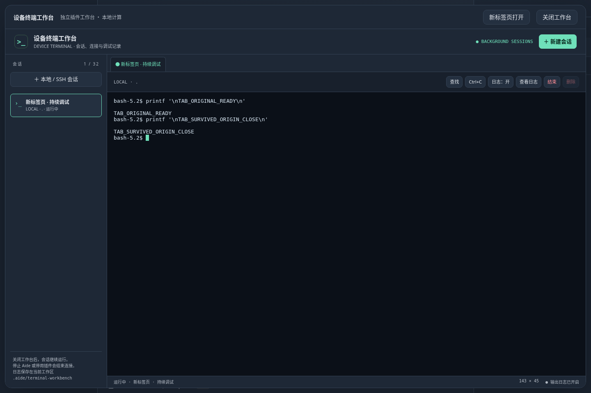

# 工作台新标签页按钮验收

插件卡片及工作台标题栏新增“新标签页打开”，保留原页入口。新页面通过同源深链接自动创建独立沙箱和桥接；URL 仅携带插件 ID，使用同源登录存储，不携带令牌/票据，不依赖原页 opener。解锁前不打开受控工作台，刷新后按链接恢复。

真实 Chromium 154.0.8037.57 验收 PASS：两个入口均打开新标签页；`opener===null`、referrer为空；原工作台仍保留；关闭原标签页后，在新页继续输入命令并收到实际 Shell 输出；刷新自动恢复会话；390px无横向页面溢出；实际下载日志包含新页执行的输出；测试会话已明确结束。所有测试页面已关闭，零页面 JS 错误。见 [结果](result.json)。

执行 `node --test --test-isolation=none scripts/plugin-workbench.test.cjs scripts/plugin-workbench-client.test.cjs`，14项 PASS；四个变更 JS 文件语法检查及 `git diff --check` PASS。浏览器脚本 `scripts/plugin-workbench-tab.browser.cjs`，设置 `AIDE_TEST_URL`、`AIDE_TEST_DATA`、`AIDE_EVIDENCE_DIR` 与可选 `AIDE_PLAYWRIGHT_MODULE`，仅指向隔离实例。源码与候选二进制见 [内容指纹](content-sha256.json)。

候选运行在回环8100，目录 `/workspace/.aide-cloud/terminal-tab`，原8097与前候选8099未替换。没有提交、推送或线上发布；插件安装 ZIP 未改变，因为按钮由宿主提供。先前候选的发布限制仍见 [常驻终端工作台记录](../2026-10-20-terminal-workbench/README.md)。本次没有后端逻辑变更，未重复无关全量测试。

[卡片入口打开的新页](card-new-tab.png) · [窄屏按钮布局](mobile.png)
