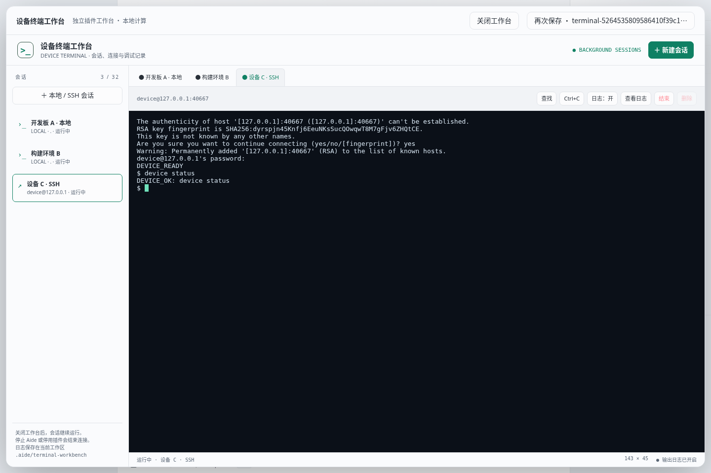

# Terminal 设备工作台 · 开发候选验收

在原命令提案插件上增加常驻设备终端工作台。支持本地 Bash PTY、真实 OpenSSH 交互、多会话隔离、标签切换、Ctrl+C、窗口尺寸适配、输出查找和磁盘日志。关闭或刷新工作台后已有会话继续运行；停止 Aide/插件会结束连接，后端恢复记录和日志但不重放命令。完整操作与边界见 [Terminal README](https://github.com/skyelan1999/aide-pkg-terminal/blob/main/README.md)。

源码同时保存在主仓库 `plugins/terminal` 和独立工作区 `/workspace/aide-pkg-terminal`；主仓库新增通用桥接续期、daemon detach 生命周期，以及导入已启用 daemon 包后立即启动后台。旧命令提案和目录工具保留。1.1.0 是未发布候选；主仓库基线 `f795a240cdb37e9b92a37d91664bd1bb3053b809`，独立插件基线 `9d224763c467a8ffe315ea92ce05da967e4d6126`。

## 实际验证

| 检查 | 结果 |
| --- | --- |
| `go test -race ./internal/server -run 'TestPluginWorkbench\|TestPluginBundle\|TestTerminalWorkbench' -count=1` | PASS，62.218 秒；覆盖桥接鉴权、预算/重放、原子续期、作用域撤销、断开请求后的单次完成、明确撤销、ZIP 安装/daemon 启动、真实 Shell 和旧工具兼容 |
| `node --test --test-isolation=none scripts/plugin-workbench.test.cjs scripts/plugin-workbench-client.test.cjs` | PASS，12项；包括140次调用、跨续期的序号重放拒绝、正常分离与强制撤销 |
| 独立插件 `npm test` | PASS，6项；真实 PTY、多会话/工作区隔离、尺寸/Ctrl+C、磁盘轮转/暂停/身份、符号链接拒绝、daemon 死亡后的 Shell 清理、真实 OpenSSH 指纹与密码交互 |
| 最终 ZIP 经实际 HTTP multipart 安装 | PASS；TLS 信任验证、健康检查、无需手动切换即启动 daemon，见 [安装收据](import-result.json) |
| Chromium 154.0.8037.57，最终 ZIP 与最终宿主构建 | PASS；218次真实调用、1次续期；140次日志切换、关闭后继续输出、刷新恢复、SSH/会话隔离、查找、实际下载、390px窄屏、明暗主题、明确结束、取消及确认删除，零页面 JS 错误；见 [浏览器收据](browser-result.json) |
| 独立入口与安装包 | 实际 `plugin_host.js validate` PASS；包不含 npm 运行依赖；源码镜像字节一致，`git diff --check` PASS |
| 全仓 quick | 原始135条命令130通过，5失败；逐项补测后3项通过，仍有2条既有环境失败，**quick 收据仍为 fail**，没有替换为成功收据 |

Quick 剩余项是 `test_launcher_data.py` 的 UID 1000 目录所有权假设，以及 `test_offline_bundle.py` 的无桌面容器中浏览器启动/平台假设。补测通过项为 knowledge web parser（原先超时）、STEP 导入 tar 子进程及 CAD 回环服务。未修改这些无关模块以迎合环境。全量 Docker/宿主发行门禁未执行，没有发布成功收据。

原始日志留在 `/workspace/.aide-cloud/workbench-final-go.log`、`terminal-final/plugin-tests.log`、`terminal-quick.log`、`terminal-quick-retries/`；原 quick 原始明细为 `.agent-state/verify-20261019T234406951157Z.log`。源码及最终二进制摘要见 [内容指纹](content-sha256.json)。

## 可审阅候选

候选文件：`/workspace/aide-pkg-terminal/dist/aide-pkg-terminal-v1.1.0-candidate.zip`，100117字节，SHA-256：`1f8e035440fbcf65253ef83855b968bc149435cc84275cbd4ebb6c2cd81f245a`。由 `python3 plugins/terminal/scripts/package.py` 可从相同运行源码重建，使用市场既有的固定时间戳/排序 ZIP 格式。旧版1.0.0包、GitHub Release 和线上市场保持原状。

最终候选以 `/workspace/.aide-cloud/bin/aide-terminal-workbench` 运行在回环8099，数据、测试工作区和运行日志位于 `/workspace/.aide-cloud/terminal-candidate/`；测试创建的会话均已结束，其中一个已通过界面明确删除。未连接实际设备或调用模型。旧8098验收实例已停止，原8097环境服务没有被替换。没有推送、提交、打tag或生产部署。

实际验证范围为 Linux 原生运行环境与临时回环 SSH 模拟设备；没有真实硬件设备型号验收、macOS 或 Windows 实机测试。Windows 原生 ConPTY 未实现；Windows 可选择 Aide Linux 容器运行路径。旧宿主缺少续期/分离能力时，候选工作台会提示更新并禁用会话创建，不能单独更新插件后宣称兼容。

日志为 PTY 原始输出，权限0700/0600、每会话4×2MiB轮转；不另存输入，但设备回显的敏感内容可能进入日志。数据在工作区 `.aide/terminal-workbench`，升级插件不覆盖。未上线，无生产回滚动作；本地回退前先结束会话并备份该目录，再恢复旧插件及主仓库对应变更。

[深色桌面](desktop-dark.png) · [经典浅色桌面](desktop-classic-light.png) · [窄屏](mobile.png)
