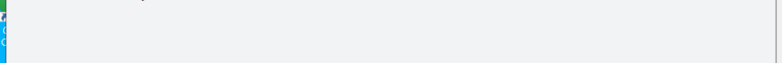
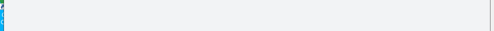

# Windows compact app tabs and icon — #757

[Issue #757](https://github.com/skyelan1999/aide/issues/757), [implementation PR #758](https://github.com/skyelan1999/aide/pull/758). Source `8d4b7866f8b83c2b650a9e15e5f0119259e79971` was squash-merged as `1430bfa37bc6fe5fb04434cbf87567b4be4f9a46`. No Release, version bump or running Mac application/service replacement.

The strip uses 32 DIP instead of the former fixed 48 px allocation (48→32 physical pixels at 100% DPI). The active tab contains its close control; New follows the tab group when space permits. Overflow reserves both native arrow controls before New. Labels use 9pt Segoe UI with system smoothing preferences, readable inactive text and a visible active mark. Layout updates fonts/icons with monitor DPI and resets native logical-focus/scroll anchors only when metrics/selection change. Theme changes repaint unused parent areas; button paint avoids legacy frame artifacts. Native tab/button input and the existing close/save guard remain.

Ten-size (16–256 px) Aide icon resources are linked into AMD64 and ARM64 EXEs. Small entries use BGRA DIB + AND mask, 256 px uses PNG; existing Aide branding/native renderer is reused. Actual window icons, DPI-specific bitmap sizes, shell extraction and PerMonitorV2 manifest were checked on Windows. Shell extraction correctly returns two handles for the requested large and small icons.

## Validation

- Local quick: 322 commands passed, fingerprint `ab473c13c7f5c4b9b1b1f5839c7c82c6fbd6e27a55541c82f4a46e46ce64c627`; receipt `.agent-state/verify-20261103T091348297429Z.log`.
- [Aide CI 41609323153](https://github.com/skyelan1999/aide/actions/runs/41609323153): quick, Go compilation/critical regressions and gate passed.
- [Windows Desktop Check 41609323264](https://github.com/skyelan1999/aide/actions/runs/41609323264): AMD64/ARM64 compilation, actual Windows x64 native UI/interaction/resource tests, and all prior stop recovery checks passed.
- Existing plugin new tabs, shared storage/MessagePort, native bridge isolation, TLS pin, dirty-close cancellation and download cancellation passed.
- Added checks cover the 32 DIP viewport boundary, text contrast, inline close, visible selection after synthetic DPI changes, unobstructed overflow buttons, resource/window/shell icons and PerMonitorV2.
- Human review of normal/narrow, light/dark and synthetic 150% screenshots confirmed clear labels, no legacy button boxes/theme residue, and complete selected tabs/arrows. These are native-component screenshots with synthetic web content, not full real-plugin acceptance. Physical low-quality displays, physical multi-monitor behavior, ARM64 execution and Hello signing remain NOT_RUN.

Exact booleans and artifact hashes are in [results.json](results.json). The selected screenshots below are from the final source; the cropped baseline is from Windows CI 41602550093 before this UI change.

## Screenshots

Before, 48 px strip:

After, 32 DIP strip at 100%:

[Normal dark](normal-dark.png), [normal light](normal-light.png), [narrow dark](narrow-dark.png), [narrow light](narrow-light.png), [narrow dark at synthetic 150%](narrow-dark-150.png), [narrow light at synthetic 150%](narrow-light-150.png).

## LAN integration and operations

The requested LAN HTTPS/password access implementation `6058f703af50c769fe393f5e487b814f718627cd` is an ancestor of this branch and merged main. It is included, remains default-off, requires password login, and disallows zero lock timeout while enabled. This UI work changes no LAN policy or saved settings.

Update the Windows source and run `build.bat` to compile/apply the native resources. Owned local synthetic EXEs were removed after evidence collection; logs, screenshots and necessary build caches/dependencies remain. Existing user sessions, Mac runtime, source checkout and unrelated Terminal task records were retained.
