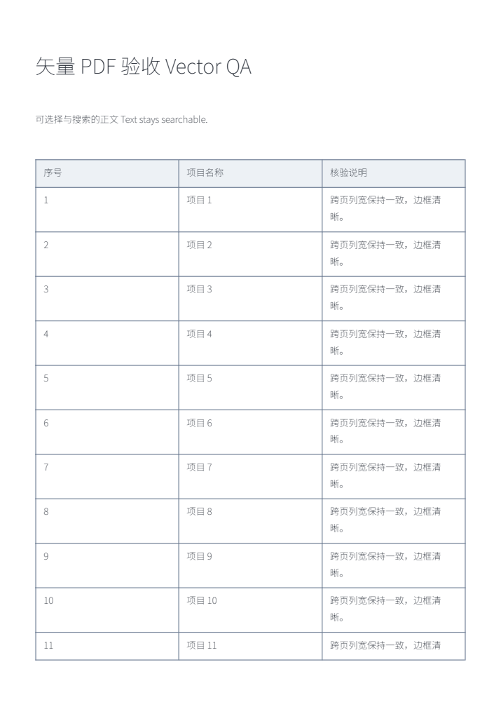
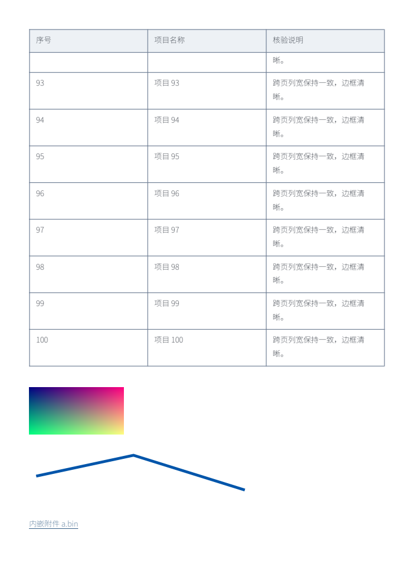

# Final native decoder and PDF checks — 2026-11-12

Baseline: `7fbb1961abac0d8d4ac1a80d022214433f3df57c`. This source change covers 14 retained decoder issues plus Markdown PDF acceptance. The wider task still has #790 (SSH/plugin compatibility) and #773 (host directory object binding) in progress. No running Aide installation, installed plugin or program Release was replaced.

## Decoder implementation and verification

The old upstream fallback is retained as provenance. The shipped worker now embeds a separately named local artifact, generated from pinned OpenJPEG/Mozilla C sources and reviewed patches using an immutable Emscripten 4.0.19 compiler image. Two clean ARM64 builds produced identical SHA-256 `46b308b55777d4dbf96dc3a7907dce0692d874139e5e621e024feb2b552ccbd2`. The adapter no longer rewrites minified native allocator/sentinel instructions. See [build recipe](../../../scripts/openjpeg/README.md) and [rebuild receipts](rebuilds.json).

| Issues | Final source behavior | Evidence |
| --- | --- | --- |
| #682, #594 | Failed outer-precinct / inner-code-block growth preserves nested ownership for destruction | 25 real `realloc` failures at each site under ASan/UBSan/LSan |
| #574, #607 | Immutable buffer streams borrow bounded PPM/PPT marker payloads; file streams keep owned copies | 2 MiB payload over 33 markers requires 2,103,884 additional native requested bytes; normal pixels preserved; duplicate-marker cleanup checked under sanitizers for both stream types |
| #708 | HT cleanup occupies one pass, leaving later refinement in its own segment | Full raster equals the retained single-layer control |
| #653 | Reversible DC addition uses 64-bit arithmetic before clamping | Reported 31-bit input yields `[191,255,96,112]` in each tested row |
| #582, #623, #625 | Signed int16 offsets sign-extend; lookup advances to later MCC records; fractional offsets survive conversion until final rounding | int16 −1 equals int32 −1; later-record controls use a non-clipped positive offset; offsets 100/100.75/101 yield 11/12/12; nonfinite offsets refused |
| #642 | Bad cleanup segmentation symbols become decoder errors, preserving restoration/cleanup | Malformed retained input rejected; subsequent valid input decodes |
| #627 | Signed grayscale is shifted by its precision midpoint before narrowing | Auto/explicit gray output equals unsigned control |
| #693 | Full-resolution e-sYCC uses PIMA 7667:2001 Annex B normalization and conversion | All 512 RGBA bytes equal the supplied independent PIMA-derived reference; subsampled layout remains refused |
| #665 | The source rebuild uses the proper membership destination | Two hash-pinned official vectors match separately compiled native CLI output across all 1,179,648 bytes each; this is frontend consistency, not an independent conformance oracle |
| #621 | Terminal HT row stores explicitly check block height | 64 block-height mutations under ASan/UBSan/LSan. The historical file10 vector is rejected before HT on the current baseline as well; the original old-Wasm overrun was not reproduced on the current adapter |

Reproducible checks: `node scripts/pdf-jpx-native-fixes.test.cjs`, `node scripts/pdf-jpx-packet-borrow.test.cjs`, `node scripts/pdf-jpx-allocation-layer.test.cjs` (385 allocation fault positions), `python3 scripts/openjpeg/test-native.py --work NEW_DIRECTORY`, and `node scripts/pdf-jpx-official.test.cjs VERIFIED_FIXTURE_DIRECTORY`. The [native receipt](native-sanitizers.json) records fixture hashes. Production C contains no fault/capture hooks.

Actual Debian Chromium 156.0.8078.79 rendered six PDF.js preview cases with this regenerated worker: explicit/automatic component conversion, alpha and filter pipeline. Image operators were populated, canvas pixels matched and viewer teardown completed without page errors. See [browser receipt](browser-jpx.json). Direct decoder tests and sanitizer checks cover the new malformed/native fixtures; those checks are separate from the six preview-page cases. AMD64 compiler reproducibility and physical Windows/Safari acceptance were not run.

## Markdown vector PDF (#813)

The vector PDF implementation was already on main. Actual Chromium 153.0.8010.12 acceptance found that pdfMake's FileAttachment nodes default to hidden embedded files: bytes existed via `/AF`, but standard `/Names/EmbeddedFiles` discovery was absent. Setting `hidden:false` and relationship `Data` preserves the attachment annotation and registers it for reader attachment panels.

The real product export menu, vendored Markdown parser, font, converter and PDF libraries generated nine pages containing searchable Chinese/English text, a 100-row table, an independent 1024×512 PNG, a vector path and attachments. Independent pypdf extraction verified the final table row, text and attachment hashes; PDFium rendered pages for visual inspection. Table columns and repeated headers were stable, the image retained 2:1 proportions, and no full-page image replaced the text. Table rows may continue onto a subsequent page; the repeated header and remaining row text are retained.

The large case used **100 MiB aggregate random binary attachments (two files of 50 MiB each), plus a small visible mixed Markdown document and image**. It is not evidence for 100 MiB of visible plain text. The exported PDF was 105,019,538 bytes. Both embedded files were independently recovered byte-for-byte. See [reader verification](vector-pdf.json). Re-run with `AIDE_VECTOR_LARGE=1 AIDE_COMPONENT_EVIDENCE_DIR=... node scripts/browser-markdown-vector-pdf.cjs` in a prepared Chromium runtime, then inspect with a PDF reader; the script records input hashes.

## Browser transfer report (#776)

Three isolated actual-browser runs at 1,800 / 2,500 / 3,600 MiB completed upload, copy, move, pause, reload, resume and SHA-256-verified download of 67 MiB + 39 bytes. Each observed four concurrent range requests and only one acknowledged chunk-zero request. The actual embedded Aide page and native upload picker were exercised; save-picker storage was controlled OPFS. See [three receipts](transfer-runs.json).

The historical Chromium exit could not be reproduced on this runtime. Its original root cause has **not** been established. Per the user's explicit instruction, #776 may be temporarily closed as “无法复现，暂时关闭”, with these limits and a request for the failing runtime/input before reopening. This is not a claimed crash fix.
