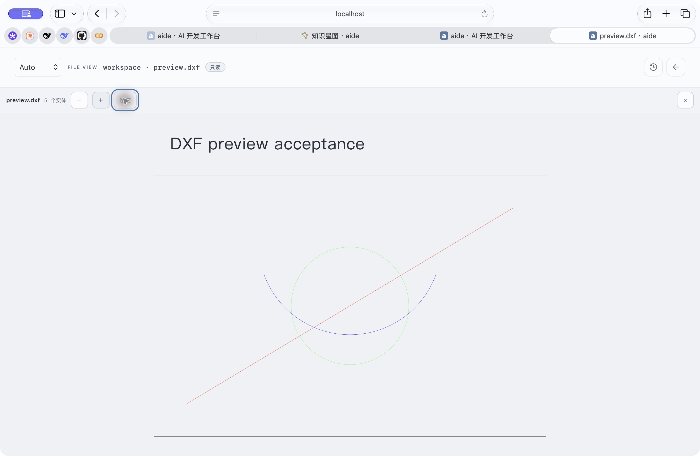
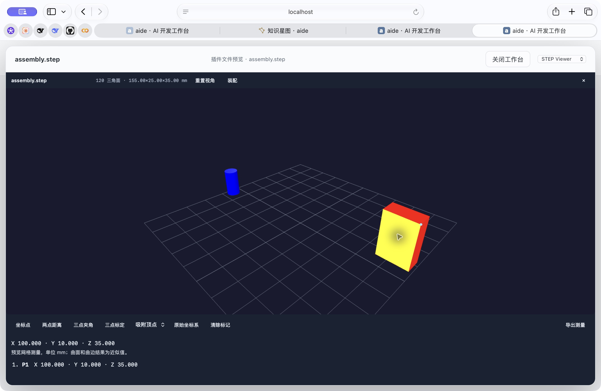

# Optional STEP preview extraction · 2026-10-23

User goal: faster default deployment and smaller releases, with DXF preview retained.

Default Aide no longer builds/copies OCCT, embeds the STEP WASM/parser/viewer modules, or starts a CAD sidecar. Existing generic raw streaming remains for downloads and MP3/video Range handling. Three.js/OrbitControls remain for STL/URDF, and DXF remains on dxf-parser + SVG. Both source and offline Compose paths and Windows launcher were updated. Local dependency generation v2 rejects an old CAD-containing parent; a later `rm` cannot erase inherited layer bytes. Existing production services and data have not been replaced.

[Public STEP Viewer source](https://github.com/skyelan1999/aide-pkg-STEPViewer) owns the native converter, original licenses, assembly/explode and metrology. Its small plugin ZIP excludes the separately downloaded ARM64/AMD64 engines. Engine setup is explicit, checks exact SHA-256/bytes, rejects unsafe archive entries and never uploads model files. Model input/output use the existing bound file bridge and opaque bounded native jobs. Abandoned uploads/conversions expire; child address space and container memory margin are bounded. No private 3D ModuleBox source was used.

## Actual size comparison

Both are Linux ARM64 worktree preview images built with the same Go/Node/Python base and byte-identical `pip freeze` output. The before snapshot is a4778c7f with its original STEP resources and pinned existing CAD dependency stage; after is this extraction worktree. Both use the original `package-release-assets.sh`, tag label v0.1.17.5-RC4, `docker image save | gzip -1` and the full ZIP's store method. These are controlled local comparison packages, **not a published RC4 release**.

| Artifact | Before (bytes) | After (bytes) | Reduction |
| --- | ---: | ---: | ---: |
| Full Release ZIP | 654,742,315 | 582,423,051 | 72,319,264 bytes / 68.97 MiB / 11.05% |
| Compressed image archive | 654,544,580 | 582,228,566 | 72,316,014 bytes |
| Docker image reported size | 2,631,965,485 | 2,271,275,483 | 360,690,002 bytes / 13.70% |

Both full ZIPs pass CRC; exact SHA-256 values are in [the comparison record](step-plugin-evidence/release-size-comparison.json). First engine installation is now an optional plugin download; users who need STEP still obtain that engine separately. Download/import/start elapsed-time benchmarking is not claimed.

## Executed verification

- Core quick profile PASS. Candidate image builds with Go vet/build; shipped assets checked as non-root uid1000, 23 readable files, Office DOCX round trip PASS, all 12 native LAN helper hashes checked. Default optional-STEP absence test PASS.
- Original native fidelity suite PASS under ARM64 and AMD64 engines: nested assembly placement, part/face colors, NURBS recovery, mixed/pure wire/point models, collapsed-face boundaries, units in mm/metre/inch and finite bounded batches. Two stable part identities and 24 forced chunks verified.
- Plugin native IO PASS: bounded upload/conversion/paged result, invalid offsets and job-path traversal rejected, competing admission rejected, cancel/reopen. Worker regression covers an empty first result poll followed by mesh acknowledgement/complete. Archive tests reject absolute/traversal/symlink entries.
- Actual Safari on isolated candidate https://localhost:18489: DXF shows 5 entities (rectangle, circle, line, arc, text), zoom and fit work. STEP opens through the installed plugin, displays 120 triangles, two colored parts and 155×25×35 mm bounds; remove/restore changes installed count 2→1→2, explode slider reaches 100%, reset works, coordinate picking returns X100/Y10/Z35 mm. The browser certificate warning was handled by the user. No paid model calls were made.
- Full current-source race/vet profile is still in progress; release remains gated. Public plugin release/install download and final main release are tracked separately and are not inferred from these local checks.

