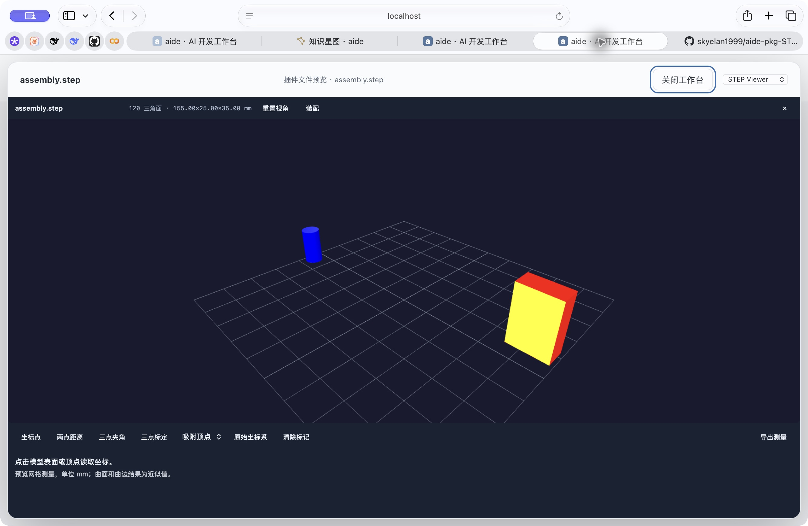
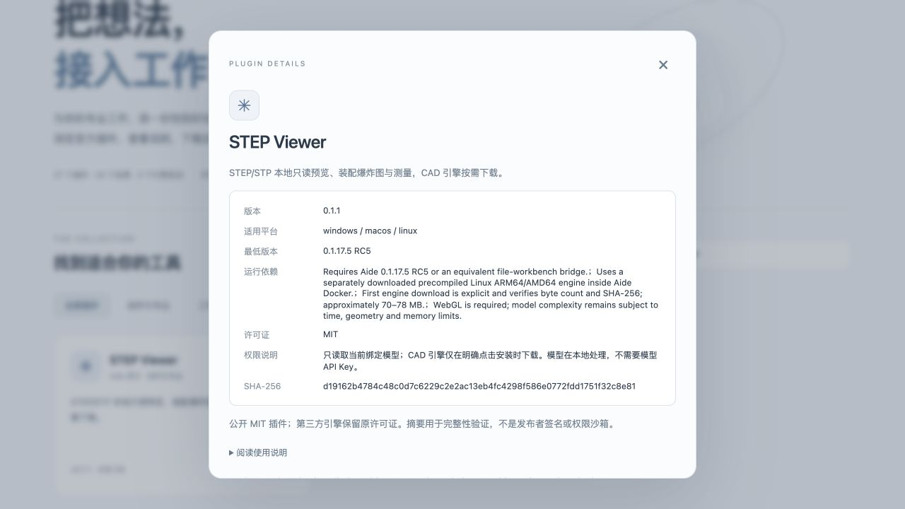

# Optional STEP preview extraction · 2026-10-23

User goal: faster default deployment and smaller releases, with DXF preview retained.

Default Aide no longer builds/copies OCCT, embeds the STEP WASM/parser/viewer modules, or starts a CAD sidecar. Existing generic raw streaming remains for downloads and MP3/video Range handling. Three.js/OrbitControls remain for STL/URDF, and DXF remains on dxf-parser + SVG. Both source and offline Compose paths and Windows launcher were updated. Local dependency generation v2 rejects an old CAD-containing parent; a later `rm` cannot erase inherited layer bytes. Existing production services and data have not been replaced.

[Public STEP Viewer source](https://github.com/skyelan1999/aide-pkg-STEPViewer) owns the native converter, original licenses, assembly/explode and metrology. Its small plugin ZIP excludes the separately downloaded ARM64/AMD64 engines. Engine setup is explicit, checks exact SHA-256/bytes, rejects unsafe archive entries and never uploads model files. Model input/output use the existing bound file bridge and opaque bounded native jobs. Abandoned uploads/conversions expire; child address space and container memory margin are bounded. No private 3D ModuleBox source was used.

## Actual size comparison

Both are Linux ARM64 worktree preview images built with the same Go/Node/Python base and byte-identical `pip freeze` output. The before snapshot is a4778c7f with its original STEP resources and pinned existing CAD dependency stage; after is this extraction worktree. Both use the original `package-release-assets.sh`, tag label v0.1.17.5-RC4, `docker image save | gzip -1` and the full ZIP's store method. These are controlled local comparison packages, **not a published RC4 release**.

| Artifact | Before (bytes) | After (bytes) | Reduction |
| --- | ---: | ---: | ---: |
| Full Release ZIP | 654,742,315 | 582,423,051 | 72,319,264 bytes / 68.97 MiB / 11.05% |
| Compressed image archive | 654,544,580 | 582,228,566 | 72,316,014 bytes |
| Docker image reported size | 2,631,965,485 | 2,271,275,483 | 360,690,002 bytes / 13.70% |

Both full ZIPs pass CRC; exact SHA-256 values are in [the comparison record](step-plugin-evidence/release-size-comparison.json). First engine installation is now an optional plugin download; users who need STEP still obtain that engine separately. Download/import/start elapsed-time benchmarking is not claimed.

## Executed verification

- Core quick profile PASS. Candidate image builds with Go vet/build; shipped assets checked as non-root uid1000, 23 readable files, Office DOCX round trip PASS, all 12 native LAN helper hashes checked. Default optional-STEP absence test PASS.
- Original native fidelity suite PASS under ARM64 and AMD64 engines: nested assembly placement, part/face colors, NURBS recovery, mixed/pure wire/point models, collapsed-face boundaries, units in mm/metre/inch and finite bounded batches. Two stable part identities and 24 forced chunks verified.
- Plugin native IO PASS: bounded upload/conversion/paged result, invalid offsets and job-path traversal rejected, competing admission rejected, cancel/reopen. Worker regression covers an empty first result poll followed by mesh acknowledgement/complete. Archive tests reject absolute/traversal/symlink entries.
- Actual Safari on isolated candidate https://localhost:18489: DXF shows 5 entities (rectangle, circle, line, arc, text), zoom and fit work. STEP opens through the installed plugin, displays 120 triangles, two colored parts and 155×25×35 mm bounds; remove/restore changes installed count 2→1→2, explode slider reaches 100%, reset works, coordinate picking returns X100/Y10/Z35 mm. The browser certificate warning was handled by the user. No paid model calls were made.
- Fixed-source full race/vet PASS with matching input fingerprint: all 24 server shards, other packages and vet. PR CI quick, Windows, Go and aggregate gate PASS. Public plugin release/install download is verified; final main release remains a separate build and publication gate.

## Published RC3 baseline and release status

GitHub RC3 full ZIP assets are 1,343,601,580 bytes for ARM64 and 1,576,733,772 bytes for AMD64 ([captured metadata](step-plugin-evidence/rc3-published-baseline.json)). The local ARM64 extraction candidate full ZIP is 582,423,051 bytes: 761,178,529 bytes (56.65%) below the published RC3 package. This broader change includes dependency/layer differences; the controlled same-base STEP-only reduction remains 72,319,264 bytes (11.05%). Final public RC5 assets must be compared separately before reporting a published size.

All commands in the first full verification returned zero, but committing tracked deletions during that run changed the tracked-path fingerprint, so its overall receipt is invalid. Full verification is rerunning on fixed commit 1827f3724ebb13325ecb3230018d64cfca4b7c03. No receipt was edited.

## Final plugin installer acceptance

STEP Viewer 0.1.1 commit 13e96e7 adds background engine installation with progress, bounded resumable HTTP Range retries and cache reuse. The first public 0.1.0 installer timed out on a slow GitHub transfer; this was recorded as public plugin issue #1 before repair. An intentionally dropped local HTTP connection resumes by Range and finishes native import; digest rejection and safe extraction remain enforced. A fresh disposable container also downloaded the real pinned public GitHub ARM64 engine, imported OCP and reused the cache successfully. Final 0.1.1 package SHA-256 is d19162b4784c48c0d7c6229c2e2ac13eb4fc4298f586e0772fdd1751f32c8e81, 210,001 bytes; Safari rendered its original two-color-part fixture with 120 triangles and unchanged 155×25×35 mm bounds.

## Core verification gate

The stable rerun completed successfully with fingerprint `1243260b20d635aae837c9b664f98a09cbee613a55e10859c7a42b44ca1e6ffc` on commit `1827f3724ebb13325ecb3230018d64cfca4b7c03`. [Full command receipt](step-plugin-evidence/step-core-full-verification.json) records every command exit code. Main merge preserves that exact code fingerprint.

## Final public release and market acceptance

[Core RC5](https://github.com/skyelan1999/aide/releases/tag/v0.1.17.5-RC5) is public, frozen at `4fc95878f3bff27735f7b1c3c5ff5d22b5d0dbb3`; both images share source digest `d37588dcf263a84d7fb959b213dad56f101161744b827938befa5c06bc1938b8`. [STEP Viewer 0.1.1](https://github.com/skyelan1999/aide-pkg-STEPViewer/releases/tag/v0.1.1) and both compiled engine archives are public. The [official market](https://skyelan1999.github.io/aide-pkg-shop/) was deployed from market merge `b5b78400074e136d785195071a4fb3fef136d115`; anonymous catalog and ZIP download verification passes, matching the plugin Release bytes and SHA-256. Browser search and public detail show STEP Viewer 0.1.1 / minimum RC5. Temporary market/browser-warning IAB tabs were closed.

Actual public same-architecture full ZIP bytes ([metadata and exact digests](step-plugin-evidence/final-public-release-size.json)):

| Platform | RC3 bytes | RC5 bytes | Saved bytes | Reduction |
| --- | ---: | ---: | ---: | ---: |
| arm64 | 1,343,601,580 | 631,524,276 | 712,077,304 | 53.00% |
| amd64 | 1,576,733,772 | 634,169,683 | 942,564,089 | 59.78% |

These are the final uploaded assets, not the earlier local 582 MB preview. The broader RC3-to-RC5 difference includes all dependency/layer changes; the separate controlled STEP-only measurement remains 72,319,264 bytes. No download/import-time speed percentage is claimed.

Both [ARM64](step-plugin-evidence/rc5-arm64-candidate-proof.json) and [AMD64](step-plugin-evidence/rc5-amd64-candidate-proof.json) pass native compilation, complete repository verification, runtime assets/absence checks, all-layer privacy audit, full ZIP CRC/SHA, image export/reimport and authenticated smoke with the correct RC5 version/commit and zero installed plugins. Native Windows/macOS full-bundle host startup was not separately exercised; Windows PowerShell 5.1/7 launcher regressions pass. Production 9999 was not replaced, and user tasks/data/rollback images remain intact.

Publication exception is preserved transparently: the first ARM64 attempt hit the existing 350 ms local-root timeout assertion boundary (Issue #48); unchanged-source race `-count=100` passes, followed by the full ARM64 rerun passing every check. Issue #48 remains open for timing-stability follow-up. The workflow then uploaded all four assets but its final by-tag draft lookup returned 404 (Issue #50), so the workflow's overall conclusion remains failure. No receipt or workflow status was rewritten. Equivalent [release-ID verification](step-plugin-evidence/rc5-draft-by-id-verification.json) independently checks successful native plans, matching source identities, immutable tag, exact remote asset set/bytes/SHA-256 and downloaded metadata. Only then was the existing draft made public; anonymous metadata confirms it is public. The reusable CI lookup fix is owned by the separate video/RC6 task. Frozen RC5 inputs and uploaded payloads were not changed.

[Compiled engine identity](step-plugin-evidence/step-compiled-engine-proof.json) confirms ARM64 and x86-64 ELF64 libraries. ARM64 was independently rebuilt and its OCP binary digest matches the shipped archive, with native fidelity passing again. Installer wrong-digest, connection-loss Range resume, real public download and cache reuse are accepted separately from core compilation.

Video PR #47 was separately merged after RC5 froze and is not in the RC5 binaries. RC6 and its video market listing are handed to the other explicitly authorized conversation; they are not claimed as published here.
