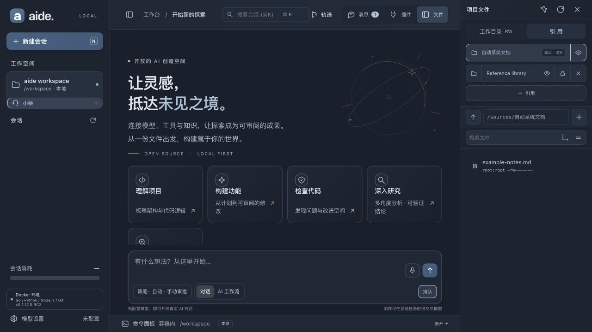
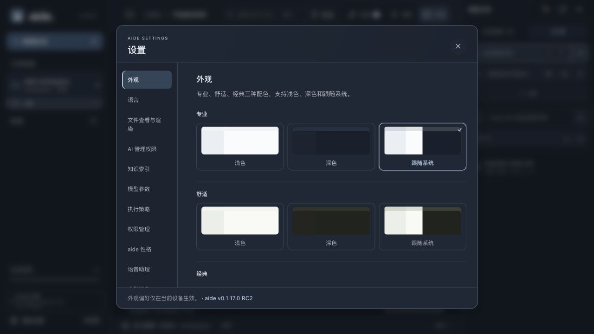
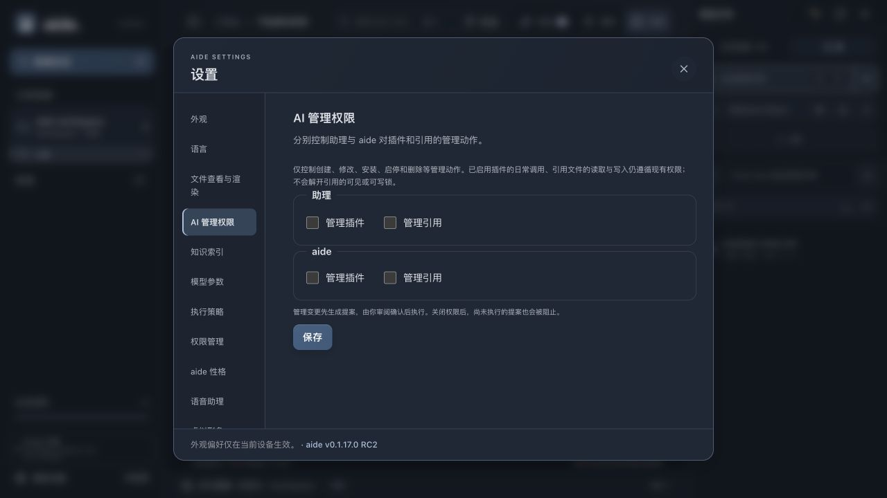
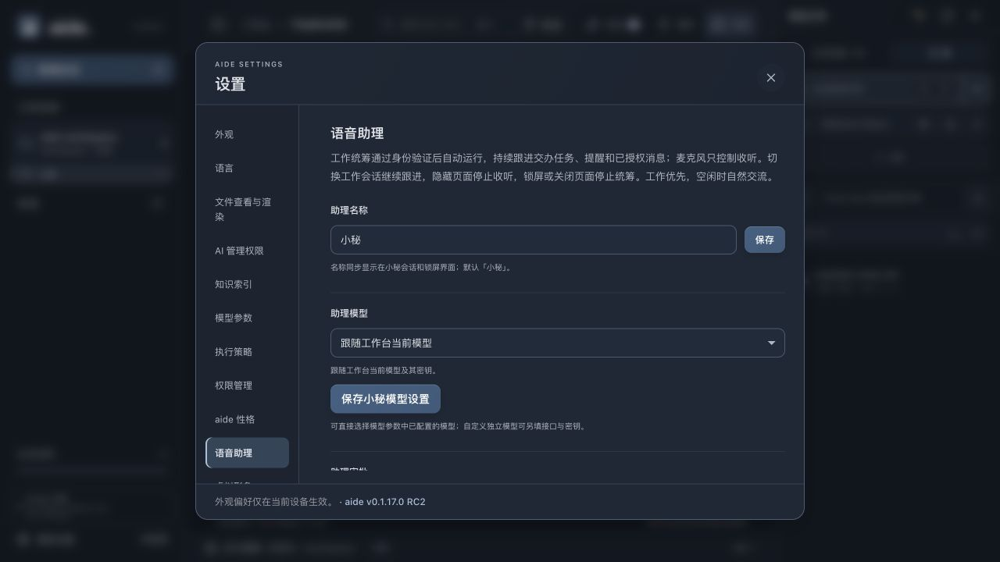
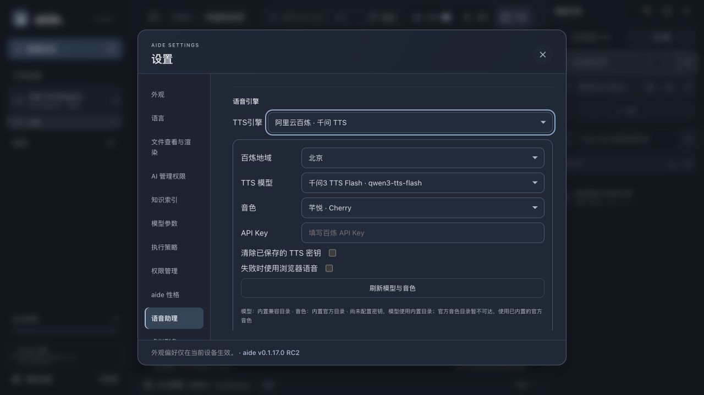
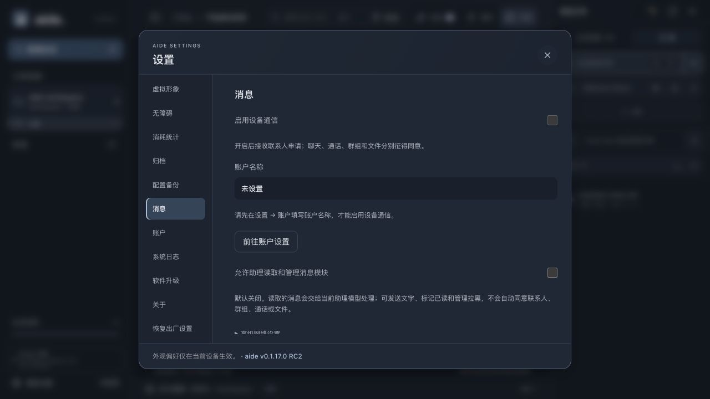
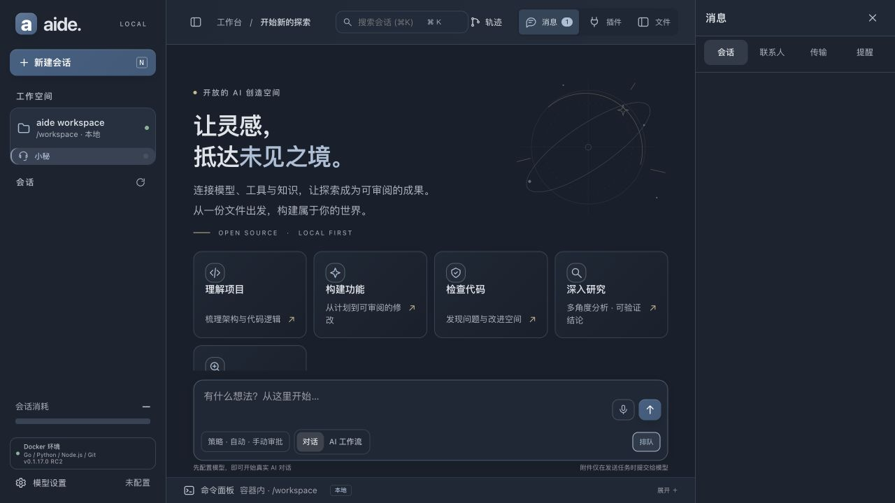
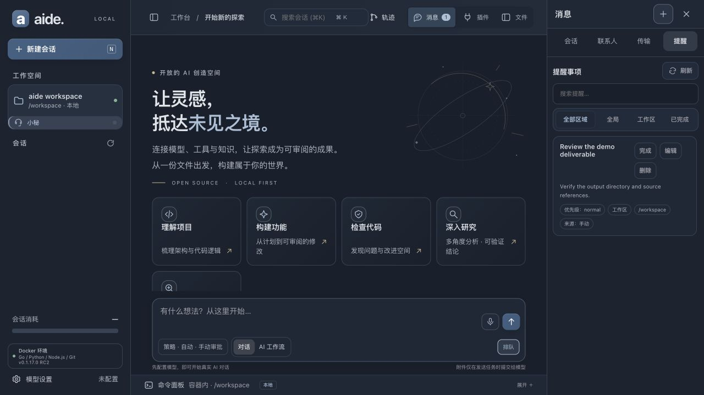
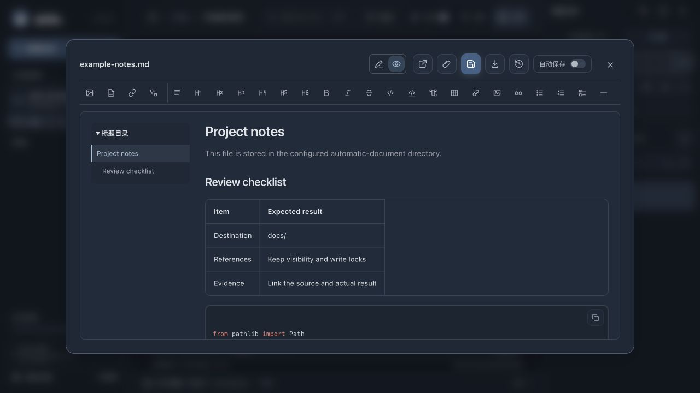
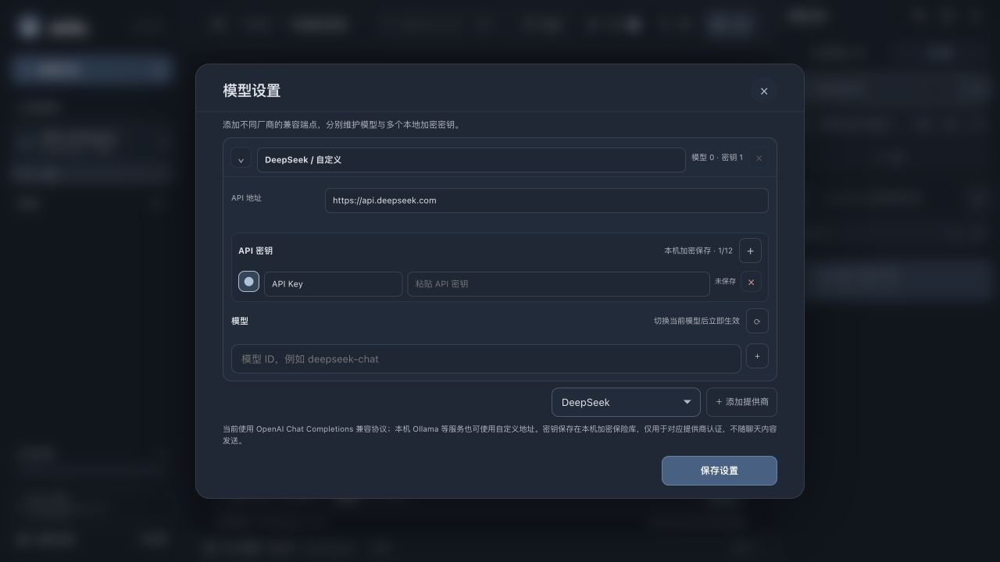

# 实际使用截图与证据范围

2026-10-17 对照源码 `0fef6411`。下列图片全部由实际运行的 Aide 浏览器界面直接采集，未使用设计稿、AI 生成图片、拼接或改字。当前正文插图统一引用本目录；历史报告保留当次图片及原有结论。

## 环境与数据

使用 macOS 宿主上的隔离 Docker 实例，真实 `server.New`、真实 API、原仓库前端资源；浏览器视口为 1280×720。构建标记为 source、commit 为 `0fef6411`。专用本机回环代理提供界面与 API；容器使用内部网络。它不是用户正在使用的服务，也不是新发行镜像的验收。

专用示例工作区包含 Markdown、Python 文件、六个仓库内置插件和一条示例提醒。截图中的 `/workspace/docs` 是示例绑定，不是产品固定路径。模型与百炼密钥为空，消息通信关闭，账户名称未配置。没有替换模型响应、伪造任务完成或填入用户业务数据。

页面角落的 `0.1.17.0 RC2` 来自版本文件，不能证明本提交已经打 tag、构建发行附件或部署到生产。每张原图的操作路径、字节数与 SHA-256 见 [截图清单](images/current-20261017/manifest.json)。

## 截图索引

| 场景 | 实际操作与观察 | 不证明的能力 |
| --- | --- | --- |
| [工作台](images/current-20261017/01-workbench.jpg) | 新建探索 → 项目文件；主页、模型未配置、三栏布局 | 完整业务流程与跨平台验收 |
| [工作空间配置](images/current-20261017/02-workspace.jpg) | 工作空间卡片 → 自动系统文档；实际绑定路径 /workspace/docs | 完整业务流程与跨平台验收 |
| [引用](images/current-20261017/03-references.jpg) | 文件 → 引用；固定系统文档、普通引用的可见与可写锁 | 完整业务流程与跨平台验收 |
| [外观](images/current-20261017/04-appearance.jpg) | 设置 → 外观；配色、背景与动效入口 | 完整业务流程与跨平台验收 |
| [AI 管理权限](images/current-20261017/05-management.jpg) | 设置 → AI 管理权限；助理与 aide 的四项独立管理权限，均关闭 | 完整业务流程与跨平台验收 |
| [语音助理](images/current-20261017/06-assistant-settings.jpg) | 设置 → 语音助理；工作统筹、名称、模型选择入口 | 外部模型连接、真实合成与扬声器播放 |
| [百炼 TTS](images/current-20261017/07-qwen-tts.jpg) | 语音助理 → TTS 引擎选择百炼，未保存；地域、模型、音色、密钥与失败回退字段；当前使用内置目录 | 外部模型连接、真实合成与扬声器播放 |
| [消息设置](images/current-20261017/08-message-settings.jpg) | 设置 → 消息；账户名称未设置时禁止启用；助理消息权限关闭 | 完整业务流程与跨平台验收 |
| [消息中心](images/current-20261017/09-messages.jpg) | 顶栏 → 消息 → 会话；会话、联系人、传输、提醒四个标签；通信未启用，列表为空 | 完整业务流程与跨平台验收 |
| [提醒](images/current-20261017/10-reminders.jpg) | 消息 → 提醒；专用示例提醒的标题、说明、筛选和操作 | 完整业务流程与跨平台验收 |
| [插件工坊](images/current-20261017/11-plugin-workshop.jpg) | 插件 → 搜索 plugin-authoring；真实已启用的插件工坊及管理工具声明 | 完整业务流程与跨平台验收 |
| [Markdown 预览](images/current-20261017/12-markdown.jpg) | 引用 → 自动系统文档 → example-notes.md；实际文件的标题目录、表格与代码预览 | 完整业务流程与跨平台验收 |
| [模型设置](images/current-20261017/13-models.jpg) | 模型设置 → 展开提供商；独立提供商、命名密钥和模型获取入口，密钥未保存 | 外部模型连接、真实合成与扬声器播放 |

## 原图

### 工作台

新建探索 → 项目文件。观察到：主页、模型未配置、三栏布局。

### 工作空间配置

工作空间卡片 → 自动系统文档。观察到：实际绑定路径 /workspace/docs。

### 引用

文件 → 引用。观察到：固定系统文档、普通引用的可见与可写锁。

### 外观

设置 → 外观。观察到：配色、背景与动效入口。

### AI 管理权限

设置 → AI 管理权限。观察到：助理与 aide 的四项独立管理权限，均关闭。

### 语音助理

设置 → 语音助理。观察到：工作统筹、名称、模型选择入口。

### 百炼 TTS

语音助理 → TTS 引擎选择百炼，未保存。观察到：地域、模型、音色、密钥与失败回退字段；当前使用内置目录。

### 消息设置

设置 → 消息。观察到：账户名称未设置时禁止启用；助理消息权限关闭。

### 消息中心

顶栏 → 消息 → 会话。观察到：会话、联系人、传输、提醒四个标签；通信未启用，列表为空。

### 提醒

消息 → 提醒。观察到：专用示例提醒的标题、说明、筛选和操作。

### 插件工坊

插件 → 搜索 plugin-authoring。观察到：真实已启用的插件工坊及管理工具声明。

### Markdown 预览

引用 → 自动系统文档 → example-notes.md。观察到：实际文件的标题目录、表格与代码预览。

### 模型设置

模型设置 → 展开提供商。观察到：独立提供商、命名密钥和模型获取入口，密钥未保存。

## 验证边界

本轮实际完成的是启动专用源码实例、打开上述界面、读取示例文档、筛选插件与查看提醒。没有执行付费模型任务，没有启用麦克风、通信或管理权限，没有新建真正的跨设备联系人，也没有把显示的目录当作联网获取成功。

语音可听效果、说话打断、后台节流、多平台安装、联系人同意、多方语音及跨互联网续传需另做带实际设备的验收。后端已有测试的历史结果应查对应任务记录，本轮不将其重记为新测试通过。工程架构图是依据源码绘制的关系示意，单独标注，不冒充使用截图。

### 未形成成功截图的操作

本轮点击项目文件“知识星图”后，新标签停在“知识星图已锁定，请回到工作台解锁”页面；未取得可用图谱，不记录为索引或星图验收通过。消息中心的会话列表在通信关闭时为空，其截图只说明四标签入口。没有为了凑图修改权限、跳过身份门或填入虚构记录。
